  <picture>
    <source media="(prefers-color-scheme: dark)" srcset="assets/branding/usque-readme-banner-dark.png">
    
  </picture>

  <a href="README.md">English</a>
  ·
  <a href="README.zh-CN.md">简体中文</a>
  ·
  <a href="README.ja.md">日本語</a>
  ·
  <a href="README.ko.md">한국어</a>
  ·
  <a href="README.ru.md">Русский</a>
  ·
  فارسی

  کلاینت غیررسمی سازگار با خدمات Cloudflare® WARP® برای Windows، Linux و Android / Android TV، 
  با رابط بومی Flutter و موتور MASQUE نوشته‌شده با Rust.

  

  
  
  

  پروژه‌ای مستقل. به Cloudflare, Inc. وابسته نیست، از آن حمایت مالی نمی‌گیرد و مورد تأیید آن نیست.

<table>
  <tr>
    <td align="center" valign="top">
      
<strong>Windows</strong>

      <picture>
        <source media="(prefers-color-scheme: dark)" srcset="assets/screenshots/usque-windows-home-dark.png">
        
      </picture>
    </td>
    <td align="center" valign="top">
      
<strong>Android</strong>

      <picture>
        <source media="(prefers-color-scheme: dark)" srcset="assets/screenshots/usque-android-connect-dark.gif">
        
      </picture>
    </td>
  </tr>
</table>

پیش‌نمایش‌های انگلیسی رابط از منبع فعلی و با داده‌های نمونه رندر شده‌اند.

## نگاه کلی

- **کارایی** — موتور MASQUE نوشته‌شده با Rust روی HTTP/3 با بازگشت خودکار به HTTP/2، ورودی/خروجی دسته‌ای UDP در Android و Linux، بافر دریافت UDP بزرگ‌تر در Windows و Android، و کنترل ازدحام قابل انتخاب از جمله BBRv2 و BBRv3 آزمایشی.
- **VPN و پروکسی‌های محلی** — VPN سیستم (آداپتور شبکهٔ مجازی)، SOCKS5 و پروکسی HTTP از یک اتصال WARP مشترک استفاده می‌کنند و می‌توانند با هم کار کنند.
- **پروکسی زنجیره‌ای** — پس از WARP از راه OpenVPN، WireGuard، Proton VPN، VPN Gate، HTTP یا SOCKS5 خارج شوید.
- **مسیریابی و مسدودسازی تبلیغات** — قواعد DIRECT/REJECT/PROXY برای دامنه‌ها و CIDR، Ads و مسیریابی مستقیم بر اساس کشور.
- **DNS رمزنگاری‌شده** — DoH یا DoT برای خروجی WARP و برای پرس‌وجوهای قاعده‌های مستقیم.
- **تشخیص شبکه** — تأخیر، ازدست‌رفتن بسته و روند 60 ثانیه؛ بررسی‌های عمیق فقط پس از تأیید.
- **سناریوها** — تنظیمات شبکهٔ پرکاربرد را در **نمایه‌ها** ذخیره کنید و بین آن‌ها جابه‌جا شوید.
- **حریم خصوصی** — بررسی اجباری کلید کارساز، انبارهای اعتبارنامهٔ سیستم، تشخیص محلی با حذف اطلاعات حساس و بدون آمار استفاده.
- **یکپارچگی با سکوها** — سینی سیستم Windows، کاشی تنظیمات سریع Android و ناوبری تلویزیون؛ بیست‌ویک زبان، با حالت روشن و تیره.

## صفحه‌ها

<table>
  <tr>
    <td align="center" valign="top" width="25%">
      <picture>
        <source media="(prefers-color-scheme: dark)" srcset="assets/screenshots/usque-gallery-scenes-dark.png">
        
      </picture>
       <strong>سناریوها</strong>
       جابه‌جایی بین تنظیمات ذخیره‌شده
    </td>
    <td align="center" valign="top" width="25%">
      <picture>
        <source media="(prefers-color-scheme: dark)" srcset="assets/screenshots/usque-gallery-chain-dark.png">
        
      </picture>
       <strong>پروکسی زنجیره‌ای</strong>
       خروجی‌های OpenVPN، WireGuard و پروکسی
    </td>
    <td align="center" valign="top" width="25%">
      <picture>
        <source media="(prefers-color-scheme: dark)" srcset="assets/screenshots/usque-gallery-routing-dark.png">
        
      </picture>
       <strong>تنظیمات عبور مستقیم</strong>
       مستقیم، مسدود یا پروکسی با قاعده
    </td>
    <td align="center" valign="top" width="25%">
      <picture>
        <source media="(prefers-color-scheme: dark)" srcset="assets/screenshots/usque-gallery-quality-dark.png">
        
      </picture>
       <strong>کیفیت شبکه</strong>
       تأخیر، ازدست‌رفتن بسته و توان عبور
    </td>
  </tr>
</table>

## سازوکار

برنامه‌ها از راه VPN یا پروکسی‌هایی که روشن کرده‌اید به Usque می‌رسند. Usque ترافیک آن‌ها را با MASQUE به WARP می‌برد و از آنجا مستقیم یا از راه یک خروجی زنجیره‌ای اختیاری بیرون می‌رود. قاعده‌های مستقیمِ صریح، ترافیک منطبق را به‌جای آن از شبکهٔ فعلی عبور می‌دهند.

```mermaid
flowchart LR
  apps["برنامه‌ها و ترافیک سیستم"]
  usque(["Usque"])
  warp["WARP"]
  chain["خروجی زنجیره‌ای اختیاری<br/>OpenVPN · WireGuard<br/>Proton VPN · VPN Gate<br/>HTTP · SOCKS5"]
  local["شبکهٔ فعلی"]
  net(("اینترنت"))

  apps -->|"VPN/TUN<br/>SOCKS5 · HTTP"| usque
  usque -->|"MASQUE<br/>HTTP/3 · HTTP/2"| warp
  warp --> net
  warp -.-> chain -.-> net
  usque -.->|"قاعده‌های مستقیم"| local -.-> net

  classDef brand fill:#C2500C,stroke:#C2500C,color:#ffffff
  class usque brand
```

## دانلود

در **v0.3.4** سناریوهای محلی اتصال اضافه شده‌اند و تنظیمات، مسیریابی و تجربهٔ دسکتاپ و Android بهبود یافته‌اند. برای نسخهٔ نصب‌شده، یادداشت‌های انتشار و مستندات برچسب همان نسخه را ببینید.

| سکو | حداقل سیستم | بسته‌ها |
| --- | --- | --- |
| Windows | Windows 10 2004، build 19041 | نصب‌کنندهٔ EXE برای x64-v2 یا ARM64 |
| Linux (از v0.3.3) | Ubuntu 22.04+، Debian 12+، Fedora پشتیبانی‌شده؛ systemd | AppImage، deb یا rpm برای amd64 یا arm64 |
| Android / Android TV | Android 8.0، API 26 | APK برای arm64-v8a، x86_64 یا armeabi-v7a، یا APK یکپارچه |

Windows x64 به پردازنده‌ای با پشتیبانی از **x86-64-v2** نیاز دارد؛ برای Windows ARM64 از بستهٔ بومی ARM64 استفاده کنید. اگر ABI دستگاه Android معلوم نیست، APK یکپارچهٔ بزرگ‌تر را که هر سه ABI را دارد به کار ببرید. هر نسخه همچنین دو فایل Windows MSI ویژهٔ به‌روزرسانی درون‌برنامه دارد؛ برای نصب دستی Windows از EXE استفاده کنید.

> [!IMPORTANT]
> **بسته‌های رسمی را فقط از [GitHub Releases](https://github.com/GeorgeXie2333/usque-app/releases) بگیرید.** مصنوعات Pull Request، ساخت‌های محلی و باینری‌های بدون برچسب رسمی نیستند.
>
> **پیش از نصب بررسی کنید.** SHA-256 بسته را با `SHA256SUMS` و چکیدهٔ فایل در GitHub مقایسه کنید، سپس اثرانگشت امضاکننده را که در یادداشت‌های انتشار آمده بررسی کنید. در Linux امضای Ed25519 فهرست بسته را هم بررسی کنید. اگر هر مقداری فرق داشت، متوقف شوید.
>
> **از هشدارها نگذرید.** بسته‌های Windows/Android پیش از 1.0 از گواهی‌های خودامضای ثابت استفاده می‌کنند که پروژه آن‌ها را مدیریت می‌کند: Windows ممکن است هشدار ناشر ناشناس نشان دهد و بسته‌های Android بیرون از Google Play نصب می‌شوند. برای گذشتن از هشدار، آنتی‌ویروس یا دیوار آتش را خاموش نکنید و گواهی بسته‌های غیررسمی را وارد نکنید.

- **ارتقا پیکربندی را یک‌طرفه منتقل می‌کند.** نسخه‌های v0.3.2 و v0.3.3 از نسخهٔ 26 ساختار پیکربندی استفاده می‌کنند. ارتقا از v0.3.1 ساختار پیکربندی را از نسخهٔ 24 به 26 منتقل می‌کند و v0.3.1 و نسخه‌های قدیمی‌تر آن را نمی‌خوانند. v0.3.4 آن را از نسخهٔ 26 به 27 منتقل می‌کند و v0.3.3 و نسخه‌های قدیمی‌تر آن را نمی‌خوانند. نصب دوبارهٔ نسخهٔ قدیمی مهاجرت را برنمی‌گرداند؛ پس پیش از ارتقا [سازگاری پیکربندی](docs/INSTALLATION.md#configuration-compatibility-when-upgrading) را بررسی و پشتیبان لازم را آماده کنید.
- **Linux:** نخستین راه‌اندازی VPN در AppImage با تأیید مدیر، سرویس پس‌زمینه را نصب می‌کند؛ اطلاعات ورود به دسته‌کلید بازشدهٔ Secret Service نیاز دارد. جزئیات GNOME/KDE، X11/Wayland، بازیابی و دامنهٔ آزمون‌ها در [راهنمای Linux](docs/LINUX_DESKTOP.md) آمده است.
- **به‌روزرسانی** پیش از دانلود به تأیید نیاز دارد و با نصب‌کنندهٔ سکو انجام می‌شود؛ نصب بدون حضور کاربر وجود ندارد.
- ارتقاء، حذف، بازیابی و جزئیات تأیید توسعه‌دهنده در Android در [نصب و حذف](docs/INSTALLATION.md) آمده است و هویت‌های رسمی امضا در [امضای کد](docs/CODE_SIGNING.md).

## شروع سریع

1. یک [بستهٔ رسمی تأییدشده](docs/INSTALLATION.md#verify-before-installing) نصب کنید و Usque را باز کنید.
2. گام‌های مجوزها و شرایط را در اولین اجرا کامل کنید، سپس یک حساب مصرف‌کنندهٔ WARP® ثبت کنید و در صورت تمایل کلید مجوز WARP را وارد کنید. اگر راه‌اندازی قطع شد، پیش از ثبت دوباره نتیجهٔ ذخیره‌شده را بررسی کنید. Usque وارد کردن WARP Secret تازه را نمی‌پذیرد.
3. **پروکسی** را باز کنید. **آداپتور شبکهٔ مجازی** (Windows/Linux) یا **VPN** (Android) را در بخش **ترافیک دستگاه** و **پروکسی SOCKS5** یا **پروکسی HTTP** را با کلید بالای بخش خودش روشن کنید و از **خانه** وصل شوید.

راه‌اندازی Android فقط مجوز اختیاری اعلان را درخواست می‌کند. مجوز VPN هنگام اتصال با خروجی VPN درخواست می‌شود و ممکن است VPN دیگری را قطع کند؛ اتصال فقط با پراکسی محلی آن را درخواست نمی‌کند. این کلیدها فوراً اعمال می‌شوند؛ تغییر نشانی یا درگاه گوش‌دادن به **اعمال تغییرات** نیاز دارد.

| گزینهٔ اتصال | چه وقت به کار رود |
| --- | --- |
| VPN/TUN | ترافیک سیستم را از تونل عبور دهید، همراه با قاعده‌های عبور و قاعده‌های Android برای هر برنامه. |
| SOCKS5 | به برنامه‌های سازگار یک پروکسی محلی TCP/UDP بدهید؛ DNS دوردست پیش‌فرض است. |
| پروکسی HTTP | به برنامه‌های سازگار یک پروکسی HTTP محلی بدهید، از جمله HTTPS از راه CONNECT. |
| پروکسی سیستم (Windows/Linux) | تنظیمات پروکسی Windows یا GNOME/KDE را به پروکسی HTTP در Usque اشاره دهید؛ خروجی HTTP باید روشن باشد. |

VPN، SOCKS5 و HTTP به‌طور پیش‌فرض روشن‌اند و پروکسی سیستم خاموش است. آن‌ها از یک اتصال WARP مشترک استفاده می‌کنند و می‌توانند با هم کار کنند. اگر همهٔ این گزینه‌ها خاموش شوند، اتصال WARP برقرار می‌ماند، اما ترافیک برنامه‌ها از آن عبور نمی‌کند. هر حساب اطلاعات ورود خودش را نگه می‌دارد؛ در هر لحظه فقط یک حساب وصل می‌شود. تنظیمات شبکه بین همهٔ حساب‌ها مشترک است.

## جزئیات قابلیت‌ها

### کارایی و انتقال

- **توان عبور:** موتور در Android و Linux بسته‌های UDP را دسته‌ای ارسال و دریافت می‌کند (`sendmmsg`/`recvmmsg`)، در Windows و Android [بافر دریافت UDP](docs/UDP_RECEIVE_BUFFER.md) بزرگ‌تری درخواست می‌کند و [کنترل ازدحام HTTP/3](docs/congestion-control.md) قابل انتخاب دارد: پیش‌فرض Cubic، و نیز BBRv2، BBRv3 آزمایشی و Reno.
- **انتقال خودکار:** HTTP/3 و در صورت شکست بازگشت به HTTP/2. تلاش روی IPv4 و IPv6 به پیدا کردن نقطهٔ پایانی در دسترس کمک می‌کند؛ تغییر شبکهٔ پشتیبانی‌شده می‌تواند اتصال H3 را منتقل کند. [رفتار مسیر](docs/h3-path-infrastructure.md) را ببینید.
- **[حالت آزمایشی L4](docs/L4_PROXY.md)** (باید خودتان روشن کنید) TCP را روی HTTP/3 پروکسی می‌کند. بدون زنجیرهٔ OpenVPN از نوع TCP، UDP معمولی را جلو نمی‌برد؛ برنامه‌هایی که به UDP نیاز دارند ممکن است کار نکنند. حالت خودکار L4 را انتخاب نمی‌کند.

### سناریوها و حساب‌ها

- **[سناریوهای محلی اتصال](docs/SCENARIOS.md)** در **نمایه‌ها** قرار دارند و پیوند حساب، پروکسی زنجیره‌ای، نقاط پایانی، ترجیح IP نقطهٔ پایانی و روش انتقال را ذخیره می‌کنند. پیش از استفاده تغییرات را بررسی کنید یا آخرین تغییر را بازگردانید؛ کلیدهای آداپتور شبکهٔ مجازی و پروکسی، مسیریابی و DNS سراسری می‌مانند. ذخیرهٔ سناریو اتصال فعلی را تغییر نمی‌دهد؛ وضعیت ذخیره و اعمال جدا نمایش داده می‌شود. حساب‌ها در **مدیریت حساب‌ها → حساب‌ها** مدیریت می‌شوند.
- **صادر کردن اطلاعات ورود WARP:** پس از تأیید می‌توان اطلاعات ورود WARP (WARP Secret) مصرف‌کننده را در فایلی که خودتان انتخاب می‌کنید صادر کرد. Usque نمی‌تواند آن فایل را وارد کند تا حساب را پس از نصب دوباره بازیابی کند.

### پروکسی زنجیره‌ای

- **پروکسی → پروکسی زنجیره‌ای** را باز کنید و **OpenVPN**، **WireGuard**، [**WARP via WireGuard**](docs/WARP_WIREGUARD.md)، [**Proton VPN**](docs/PROTON_VPN.md)، **VPN Gate**، **HTTP** یا **SOCKS5** را به‌عنوان خروجی پس از WARP انتخاب کنید. پیکربندی VPN را وارد کنید یا کارساز پروکسی اضافه کنید، سپس یکی را انتخاب و اعمال کنید. به‌طور پیش‌فرض خاموش است؛ [راهنمای پروکسی زنجیره‌ای](docs/CHAIN_PROXY.md) را ببینید.
- VPN، SOCKS5 و HTTP خروجی مشترکی دارند؛ قاعده‌های مستقیمِ صریح همچنان اعمال می‌شوند.
- پشتیبانی بومی Proton هنوز در حال اعتبارسنجی است؛ ورود واقعی، حل دستی پازل و تونل کامل آزمایش نشده‌اند.

### مسیریابی، مسدودسازی و DNS

- VPN با تونل کامل، DNS درون تونل، Kill Switch، دسترسی به شبکهٔ محلی و [قواعد DIRECT/REJECT/PROXY همراه با Ads](docs/ROUTING.md). دامنه‌ها و CIDR از استثناهای دقیق‌تر پشتیبانی می‌کنند و تعارض‌ها پیش از ذخیره بررسی می‌شوند.
- در اتصال پایدار، تغییر قواعد سفارشی بدون اتصال مجدد روی جریان‌های جدید اعمال می‌شود. اتصال‌های TCP/CONNECT موجود و مقصدهای فعال UDP مسیر خود را حفظ می‌کنند. نتیجهٔ اعمال را برای تغییرات در انتظار یا ناموفق بررسی کنید.
- با فعال‌کردن و اعمال مسدودسازی تبلیغات، قواعد خودکار آماده می‌شوند و هنگام اجرای برنامه هر هفت روز بررسی می‌شوند. درخواست‌های جدید بدون اتصال مجدد از آن‌ها استفاده می‌کنند؛ **جزئیات قواعد** شامل وضعیت، منبع و به‌روزرسانی دستی است.
- مسیریابی مستقیم اختیاری بر اساس کشور. دادهٔ GeoIP کشورهای انتخاب‌شده و فهرست سراسری GeoSite جداگانه دانلود می‌شوند. وقتی نام دامنه دیده شود، Usque از قاعده‌های دامنه استفاده می‌کند وگرنه از قاعده‌های IP؛ مقصدهای ناشناخته در تونل می‌مانند.
- [DNS خروجی WARP](docs/WARP_DNS.md) سفارشی: **تنظیمات → تنظیمات پیشرفتهٔ شبکه → DNS ‏WARP** را باز کنید، DNS معمولی، DoH یا DoT را انتخاب و **اعمال تغییرات** را بزنید. تغییر DNS اتصال نشست فعال را دوباره برقرار می‌کند؛ خروجی نهایی زنجیره سیاست DNS خودش را نگه می‌دارد.

### تشخیص

- [تشخیص شبکه](docs/network-doctor.md) به‌صورت محلی و صفحهٔ **کیفیت شبکه**، با تأخیر، خوانش‌های ازدست‌رفتن بسته و در دسترس بودن آن‌ها، صف‌ها و روند 60 ثانیه. بررسی‌های **استاندارد** فقط وضعیت محلی را می‌خوانند؛ بررسی‌های **عمیق** فقط پس از تأیید درخواست آزمایشی می‌فرستند.

### رایانه و Android

- **Windows:** سینی سیستم با نشانگر وضعیت و کلیدهای آداپتور شبکهٔ مجازی و پروکسی سیستم؛ در پس‌زمینه، اتصال مجددی که پنج ثانیه ادامه یابد، خطای اتصال و بازیابی پس از وقفهٔ اعلام‌شده اعلان دارند؛ فعال‌سازی تک‌نمونه، اجرا هنگام ورود، بستن پنجره به سینی و به‌خاطر سپردن جای پنجره نیز در دسترس‌اند. **Ctrl+1–4** صفحه‌ها را انتخاب می‌کند، **Ctrl+S** تغییرات را اعمال می‌کند و **F5** فهرست VPN Gate یا تشخیص را تازه می‌کند. [کنترل‌های سینی و صفحه‌کلید](docs/INSTALLATION.md#tray-and-keyboard-controls) را ببینید.
- **Android:** کاشی تنظیمات سریع، میانبرهای راه‌انداز، بازیابی پس از راه‌اندازی و ناوبری تلویزیون.
- **پروکسی به‌ازای برنامه** در Android برای کل برنامه و در همهٔ حساب‌ها اعمال می‌شود. وقتی خاموش است، همهٔ برنامه‌ها از VPN استفاده می‌کنند. وقتی روشن است، فقط برنامه‌های انتخاب‌شده؛ برنامه‌های تازه‌نصب را باید انتخاب کرد. اگر **اتصالات مسدود‌شده بدون VPN** در Android روشن باشد، برنامه‌های انتخاب‌نشده به‌جای دور زدن تونل مسدود می‌شوند.
- **همه‌جا:** بیست‌ویک زبان، با حالت روشن و تیره.

## حریم خصوصی و امنیت

- **بررسی کارساز.** Usque تطابق کلید عمومی کارساز WARP با کلید ثبت‌شده را لازم دارد. گزینه‌ای برای رد شدن از این بررسی نیست.
- **حفاظت از اطلاعات ورود.** اطلاعات ورود در مدیر اعتبارنامهٔ Windows، دسته‌کلید Secret Service در Linux یا Android Keystore می‌ماند. در Windows و Linux عملیات شبکه‌ای ممتاز را یک Agent جدا انجام می‌دهد؛ در Android، VPN در فرایندی اختصاصی اجرا می‌شود.
- **پروکسی‌های محلی.** پروکسی‌ها به‌طور پیش‌فرض فقط روی loopback گوش می‌دهند. SOCKS5 و HTTP احراز هویت اختیاری با نام کاربری و رمز عبور دارند؛ اگر اطلاعات ورود تنظیم نشده باشد، احراز هویت لازم نیست. حالت فقط پروکسی، Kill Switch سراسری VPN را فراهم نمی‌کند.
- **بدون آمار.** تشخیص به‌صورت محلی ساخته می‌شود و اطلاعات حساس آن حذف می‌شود. آمار استفاده و آپلود خودکار وجود ندارد و سابقهٔ کیفیت فقط در حافظه می‌ماند. گزارش‌ها به‌طور پیش‌فرض در سطح INFO هستند و به 7 روز یا 20 MiB محدود می‌شوند. اطلاعات ورود یا بسته‌های خام تشخیص را در Issueهای عمومی نگذارید؛ آسیب‌پذیری‌ها را از راه [SECURITY.md](SECURITY.md) گزارش کنید.

### محدودیت‌ها

- Kill Switch درون‌برنامهٔ Android پس از پایان فرایند VPN نمی‌تواند از ترافیک محافظت کند. خرابی نهایی VPN Gate هم اتصال را قطع می‌کند. برای مسدود ماندن برنامه‌ها پس از پایان VPN، هر دو گزینهٔ سیستمی **VPN همیشه روشن** و **اتصالات مسدود‌شده بدون VPN** را روشن کنید. [راه‌اندازی Android](docs/INSTALLATION.md#android-and-android-tv) را ببینید.
- Usque چند مسیر را برای پهنای باند بیشتر با هم ترکیب نمی‌کند. برخی خوانش‌های کیفیت، از جمله ازدست‌رفتن بستهٔ HTTP/2 و PMTU، در دسترس نیستند. تشخیص محلی نمی‌تواند نشت ترافیک را تشخیص دهد.

### حریم خصوصی DNS

- **قاعده‌های مستقیم به‌طور پیش‌فرض از DNS شبکهٔ فعلی استفاده می‌کنند.** قاعده‌های اتصال مستقیم بر اساس کشور و دامنهٔ سفارشی به‌طور پیش‌فرض از **DNS شبکهٔ فعلی** استفاده می‌کنند: پرس‌وجوی دامنه‌های منطبق به کارسازهای DNS شبکهٔ فعلی، بیرون از VPN، می‌رود. به‌جای آن می‌توان **DoH** را با نشانی کامل HTTPS یا **DoT** را با نام کارساز و پورت انتخاب کرد. پیش‌نویس‌های جدید با Cloudflare پر می‌شوند؛ تنظیمات سفارشی ذخیره‌شده حفظ می‌شوند. پرس‌وجوها به همان کارساز می‌رسند؛ اگر اتصال برقرار نشود، به DNS متن ساده برنمی‌گردند. [گام‌های پیکربندی و نمونه‌ها](docs/encrypted-direct-dns.md) را ببینید.
- **سایر پرس‌وجوهای VPN دوردست** از تونل WARP یا خروجی نهایی انتخاب‌شده استفاده می‌کنند. DNS زنجیرهٔ HTTP/SOCKS5 به‌طور پیش‌فرض Cloudflare® DoH را با بررسی TLS از راه همان پروکسی به کار می‌برد؛ DNS سفارشی یا به‌ارث‌رسیدهٔ غیرپیش‌فرض همچنان از TCP استفاده می‌کند. با این دو خروجی، پرس‌وجوی UDP/53 به حل‌کنندهٔ انتخاب‌شدهٔ برنامه، از راه TCP به همان حل‌کننده می‌رود و به DNS شبکهٔ فیزیکی برنمی‌گردد. [انتخاب‌های DNS زنجیره](docs/CHAIN_PROXY.md#http-and-socks5-exits--http-与-socks5-出口) را ببینید.
- **برنامه‌هایی که DNS رمزنگاری‌شدهٔ خودشان را به کار می‌برند** نام دامنه‌ها را از Usque پنهان می‌کنند، پس مسیریابی مستقیم از قاعده‌های IP استفاده می‌کند.
- دانلود قاعده‌ها در حالت قطع اتصال هم Android Lockdown و Kill Switch باقی‌ماندهٔ Windows را رعایت می‌کند.

### قابلیت‌های آزمایشی و خارج از پشتیبانی

[ثبت‌نام Zero Trust](docs/ZERO_TRUST_EXPERIMENTAL.md) آزمایشی است. برای تونل اینترنت MASQUE از هویت سازمان استفاده می‌کند و سازگاری کامل با Cloudflare One™ Client را فراهم نمی‌کند. منبع macOS نگه داشته شده، اما ساخته یا منتشر نمی‌شود. iOS، توزیع فروشگاهی و CLI عمومی بیرون از محدودهٔ این انتشار هستند.

## تنظیمات پیش‌فرض شبکه

| تنظیم | پیش‌فرض |
| --- | --- |
| انتخاب نقطهٔ پایانی | خودکار؛ تنظیمات قبلی در حالت سفارشی می‌مانند |
| نشانی سفارشی ذخیره‌شدهٔ IPv4 | `162.159.198.2` |
| نشانی سفارشی ذخیره‌شدهٔ IPv6 | `2606:4700:103::2` |
| پورت / SNI | `443` / `speed.cloudflare.com` |
| انتقال | خودکار: نخست HTTP/3، سپس HTTP/2 |
| کنترل ازدحام HTTP/3 | `cubic`؛ BBRv2، BBRv3 آزمایشی و `reno` قابل انتخاب‌اند |
| بافر دریافت UDP برای QUIC | [هدف 2 MiB](docs/UDP_RECEIVE_BUFFER.md) در Windows و Android برای H3 و L4؛ ظرفیت واقعی به سیستم‌عامل بستگی دارد |
| TUN MTU | `1280` |
| DNS پشتیبان | `1.1.1.1`، `2606:4700:4700::1111` |
| SOCKS5 | `127.0.0.1:1080`، `[::1]:1080` |
| پروکسی HTTP | `127.0.0.1:8080`، `[::1]:8080` |

<strong>تغییرات پروکسی، نقطهٔ پایانی و کنترل ازدحام چه زمانی اعمال می‌شوند</strong>

 

ویرایش نشانی پروکسی و پورت تا زمان اعمال، پیش‌نویس می‌ماند. DNS پروکسی به‌طور پیش‌فرض از خروجی فعلی استفاده می‌کند: [WARP DNS](docs/WARP_DNS.md) را در تنظیمات پیشرفته یا DNS خروجی نهایی را در تنظیمات زنجیره تنظیم کنید. صفحهٔ پروکسی تنظیمات DNS ندارد؛ تنظیم DNS پروکسی که در نسخهٔ قدیمی‌تر ذخیره شده، همچنان اعمال می‌شود.

بازنشانی تنظیمات پیشرفته فقط پیش‌فرض‌ها را در پیش‌نویس می‌گذارد و همان لحظه اعمالشان نمی‌کند.

در تنظیمات پیشرفتهٔ شبکه، حالت خودکار اتصال به نقاط مجاز حساب را هم‌زمان آغاز می‌کند و حالت سفارشی نشانی‌های دستی را نگه می‌دارد. پورت و SNI در هر دو حالت قابل ویرایش‌اند. [راهنمای نقاط پایانی](docs/NETWORK_SETTINGS.md#automatic-endpoints--自动选择端点) را ببینید.

Zero Trust ابتدا از نشانی‌های ثبت‌شده استفاده می‌کند. در تنظیمات پیشرفتهٔ شبکه، **ویرایش نقاط پایانی Zero Trust** را انتخاب کنید، هشدار قرمز تمام‌صفحه را بخوانید و خطرها و مجوز استفاده را تأیید کنید؛ سپس IPv4/IPv6 را ویرایش و **اعمال تغییرات** را بزنید. بازنشانی نشانی‌های ثبت‌شده را در پیش‌نویس می‌گذارد؛ ورود دوباره آن‌ها را بازیابی و نشانی‌های سفارشی را حذف می‌کند. تا زمانی که حساب انتخاب‌شده نشانی‌های سفارشی Zero Trust داشته باشد یا اتصال فعلی ZT همچنان از آن‌ها استفاده کند، هشدار خطر در صفحهٔ اصلی باقی می‌ماند و قابل بستن نیست.

تغییر کنترل ازدحام برای اتصال دستی یا تلاش دوبارهٔ بعدی ذخیره می‌شود و روی نشست فعلی یا اتصال‌های خودکار دوبارهٔ آن اعمال نمی‌شود. HTTP/2 از TCP سیستم استفاده می‌کند. [کنترل ازدحام HTTP/3](docs/congestion-control.md) را ببینید.

## مستندات و توسعه

برای راه‌اندازی و راهنماهای عملی از [Wiki](https://github.com/GeorgeXie2333/usque-app/wiki/Home) شروع کنید. مرجع کامل در [فهرست مستندات](docs/README.md) است؛ بیشتر سندهای فنی به انگلیسی‌اند.

| نیاز | سند |
| --- | --- |
| نصب، به‌روزرسانی، حذف یا بازیابی | [نصب](docs/INSTALLATION.md) |
| راه‌اندازی بومی مهمان یا حساب Proton | [راهنمای Proton VPN و محدودیت‌های فعلی](docs/PROTON_VPN.md) |
| اتصال به Proton VPN از راه WARP | [راهنمای WireGuard over MASQUE](https://github.com/GeorgeXie2333/usque-app/wiki/Proton-VPN-over-MASQUE) |
| بررسی محلی کیفیت | [Network Doctor](docs/network-doctor.md) |
| ساخت و آزمودن امن تغییرات | [مشارکت](CONTRIBUTING.md) |
| وضعیت پیاده‌سازی و راستی‌آزمایی | [پیاده‌سازی](docs/IMPLEMENTATION.md) |
| نگهداری انتشار رسمی | [فرایند انتشار](docs/RELEASE.md) |

از زنجیرهٔ ابزارهای سنجاق‌شده و بررسی‌های متناسب با محدودهٔ تغییر در راهنمای مشارکت استفاده کنید. ساخت‌های فقط برای کامپایل و آزمون‌های قطعی روی ایستگاه کاری امن‌اند؛ نصب بسته‌های توسعه یا آزمودن چرخهٔ حیات VPN به محیط‌های ایزولهٔ تعیین‌شده نیاز دارد.

## بالادست و مجوز

رفتار پروتکل از [Diniboy1123/usque](https://github.com/Diniboy1123/usque) پیروی می‌کند. این مخزن یک تصویر از آن کلاینت را در `oracle/go` برای آزمون‌های تعامل‌پذیری نگه می‌دارد. رابط Flutter و موتور Rust کد تازهٔ این پروژه است. حق نشر بالادست در مجوز باقی می‌ماند.

کد خود پروژه تحت مجوز [MIT](LICENSE.md) است. اجزای شخص ثالث مجوز خودشان را حفظ می‌کنند. [پروکسی زنجیره‌ای](docs/CHAIN_PROXY.md) اختیاری، OpenVPN 3 Core را تحت MPL-2.0 و Mbed TLS را تحت Apache-2.0 در خود دارد. منبع متناظر، وصله‌های بازبینی‌شده و متن مجوزها در `third_party` هستند؛ برنامه این اعلامیه‌ها را در صفحهٔ VPN Gate نشان می‌دهد. WireGuard از BoringTun 0.7.1 (BSD-3-Clause) استفاده می‌کند و آیکون‌های SVG محلی از flutter_svg 2.3.0 (MIT)؛ اعلامیه‌های آن‌ها در فهرست مجوزهای برنامه است.

پیاده‌سازی مستقل Proton SRP از Proton go-srp با مجوز MIT به‌عنوان مرجع استفاده می‌کند. [اعلان حق نشر و متن کامل مجوز](apps/usque_gui/assets/licenses/proton-srp.txt) در منبع، بردارهای آزمون و فهرست مجوزهای برنامه حفظ شده‌اند.

---

Usque پروژه‌ای مستقل است. به Cloudflare, Inc. وابسته نیست، از آن حمایت مالی نمی‌گیرد و مورد تأیید آن نیست. استفاده از خدمات WARP مصرف‌کننده همچنان تابع شرایط و سیاست حریم خصوصی Cloudflare است. Cloudflare، WARP و Cloudflare One علائم تجاری و/یا علائم تجاری ثبت‌شدهٔ Cloudflare, Inc. در ایالات متحده و سایر حوزه‌های قضایی هستند.
