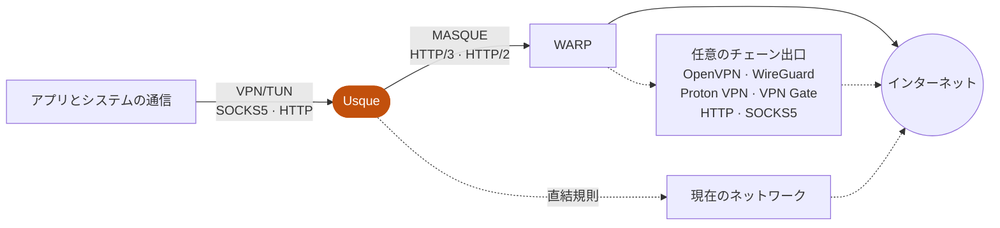

  <picture>
    <source media="(prefers-color-scheme: dark)" srcset="assets/branding/usque-readme-banner-dark.png">
    
  </picture>

  <a href="README.md">English</a>
  ·
  <a href="README.zh-CN.md">简体中文</a>
  ·
  日本語
  ·
  <a href="README.ko.md">한국어</a>
  ·
  <a href="README.ru.md">Русский</a>
  ·
  <a href="README.fa.md">فارسی</a>

  Windows、Linux、Android / Android TV 向けの Cloudflare® WARP® サービスと互換性のある非公式クライアントです。 
  ネイティブの Flutter インターフェースと Rust 製の MASQUE エンジンで動作します。

  

  
  
  

  独立したプロジェクトです。Cloudflare, Inc. との提携関係はなく、同社からの支援や推奨も受けていません。

<table>
  <tr>
    <td align="center" valign="top">
      
<strong>Windows</strong>

      <picture>
        <source media="(prefers-color-scheme: dark)" srcset="assets/screenshots/usque-windows-home-dark.png">
        
      </picture>
    </td>
    <td align="center" valign="top">
      
<strong>Android</strong>

      <picture>
        <source media="(prefers-color-scheme: dark)" srcset="assets/screenshots/usque-android-connect-dark.gif">
        
      </picture>
    </td>
  </tr>
</table>

現在のソースから描画した英語インターフェースのプレビューです（サンプルデータ）。

## 概要

- **パフォーマンス** — Rust 製の MASQUE エンジンが HTTP/3 を使い、HTTP/2 へ自動でフォールバックします。Android と Linux では UDP を一括送受信し、Windows と Android ではより大きな UDP 受信バッファを要求し、輻輳制御では BBRv2 や実験的な BBRv3 も選べます。
- **VPN とローカルプロキシ** — システム VPN（仮想ネットワークアダプター）、SOCKS5、HTTP プロキシが 1 つの WARP 接続を共有し、同時に使用できます。
- **チェーンプロキシ** — WARP の先に OpenVPN、WireGuard、Proton VPN、VPN Gate、HTTP、SOCKS5 の出口を追加できます。
- **ルーティングと広告ブロック** — ドメインと CIDR に対する DIRECT／REJECT／PROXY ルール、Ads、国別の直結ルーティング。
- **暗号化 DNS** — WARP 出口と直結規則の問い合わせに DoH または DoT を使用できます。
- **ネットワーク診断** — 遅延、パケットロス、直近 60 秒の推移。詳細検査は確認後にのみ実行します。
- **シーン** — よく使うネットワーク設定を **プロファイル** に保存して切り替えられます。
- **プライバシー** — サーバー公開鍵の検証を必須とし、認証情報は OS の資格情報ストアに保存し、診断はローカルで生成して機密情報を除去します。利用状況の分析はありません。
- **プラットフォーム連携** — Windows のタスクトレイ、Android のクイック設定タイルと TV のリモコン操作。21 言語とライト・ダークテーマ。

## 画面

<table>
  <tr>
    <td align="center" valign="top" width="25%">
      <picture>
        <source media="(prefers-color-scheme: dark)" srcset="assets/screenshots/usque-gallery-scenes-dark.png">
        
      </picture>
       <strong>シーン</strong>
       保存したネットワーク設定を切り替え
    </td>
    <td align="center" valign="top" width="25%">
      <picture>
        <source media="(prefers-color-scheme: dark)" srcset="assets/screenshots/usque-gallery-chain-dark.png">
        
      </picture>
       <strong>チェーンプロキシ</strong>
       OpenVPN・WireGuard・プロキシの出口
    </td>
    <td align="center" valign="top" width="25%">
      <picture>
        <source media="(prefers-color-scheme: dark)" srcset="assets/screenshots/usque-gallery-routing-dark.png">
        
      </picture>
       <strong>バイパス設定</strong>
       ルールで直結・ブロック・プロキシ
    </td>
    <td align="center" valign="top" width="25%">
      <picture>
        <source media="(prefers-color-scheme: dark)" srcset="assets/screenshots/usque-gallery-quality-dark.png">
        
      </picture>
       <strong>ネットワーク品質</strong>
       遅延、パケットロス、スループット
    </td>
  </tr>
</table>

## しくみ

アプリは、オンにした VPN またはプロキシを通じて Usque に接続します。Usque は通信を MASQUE で WARP へ運び、そのままインターネットへ、または任意のチェーン出口を経由して送り出します。明示的な直結規則に一致した通信は、代わりに現在のネットワークを通ります。

## ダウンロード

**v0.3.4** ではローカル接続シーンを追加し、設定、ルーティング、デスクトップと Android の操作を改善しました。インストールした版のリリースノートと対応するタグの文書を確認してください。

| プラットフォーム | 最低 OS 要件 | パッケージ |
| --- | --- | --- |
| Windows | Windows 10 2004、ビルド 19041 | x64-v2 または ARM64 の EXE インストーラー |
| Linux（v0.3.3 以降） | Ubuntu 22.04+、Debian 12+、サポート中の Fedora；systemd | amd64 または arm64 の AppImage、deb、rpm |
| Android / Android TV | Android 8.0、API 26 | arm64-v8a、x86_64、armeabi-v7a の APK、またはユニバーサル APK |

Windows x64 には **x86-64-v2** 対応 CPU が必要で、ARM64 Windows にはネイティブ ARM64 パッケージを使用します。Android の ABI が不明な場合は、3 種類の ABI をすべて含む、サイズの大きいユニバーサル APK を使用できます。各リリースにはアプリ内更新専用の Windows MSI も 2 個含まれます。Windows を手動でインストールする場合は EXE を使用してください。

> [!IMPORTANT]
> **正式なパッケージは [GitHub Releases](https://github.com/GeorgeXie2333/usque-app/releases) からのみダウンロードしてください。** Pull Request の成果物、ローカルビルド、タグのないバイナリは正式リリースではありません。
>
> **インストール前に検証してください。** パッケージの SHA-256 を `SHA256SUMS` と GitHub に表示されるファイルのダイジェストに照合し、リリースノートに記載された署名者のフィンガープリントも確認してください。Linux では Ed25519 署名付きマニフェストも検証してください。いずれかが一致しない場合は、インストールを中止してください。
>
> **警告を回避しないでください。** 1.0 より前の Windows/Android パッケージは、プロジェクトで管理する固定の自己署名証明書を使用します。Windows では発行元が不明という警告が表示されることがあり、Android パッケージは Google Play 外からインストールします。警告を回避するためにウイルス対策やファイアウォールを無効にしたり、非公式パッケージに付属する証明書をインポートしたりしないでください。

- **アップグレードによる設定の移行は一方向です。** v0.3.2 と v0.3.3 は設定スキーマ 26 を使用します。v0.3.1 からのアップグレードではスキーマが 24 から 26 に移行し、v0.3.1 以前では読み込めません。v0.3.4 ではスキーマが 26 から 27 に移行し、v0.3.3 以前では読み込めません。旧版の再インストールでは移行を元に戻せないため、事前に[設定の互換性](docs/INSTALLATION.md#configuration-compatibility-when-upgrading)を確認し、必要なバックアップを用意してください。
- **Linux：** AppImage の初回 VPN 設定では管理者承認でバックグラウンドサービスを導入します。認証情報にはロック解除済みの Secret Service キーリングが必要です。GNOME/KDE、X11/Wayland、復旧手順とテスト範囲は [Linux デスクトップガイド](docs/LINUX_DESKTOP.md) を参照してください。
- **更新** のダウンロードには確認が必要で、インストールには各プラットフォームのインストーラーを使用します。無人での自動インストールは行いません。
- アップグレード、アンインストール、復旧、Android の開発者確認については[インストールと削除](docs/INSTALLATION.md)、正式な署名に使う証明書については[コード署名](docs/CODE_SIGNING.md)を参照してください。

## クイックスタート

1. [検証済みの正式パッケージ](docs/INSTALLATION.md#verify-before-installing)をインストールし、Usque を開きます。
2. 初回起動の権限と利用規約の手順を完了し、個人向け WARP® アカウントを登録します。必要に応じて WARP ライセンスキーを入力します。セットアップが中断された場合は、再登録の前に保存済みの結果を確認してください。新しい WARP Secret のインポートには対応していません。
3. **プロキシ** を開き、**このデバイスの通信** で **仮想ネットワークアダプター**（Windows/Linux）または **VPN**（Android）をオンにし、**SOCKS5 プロキシ** / **HTTP プロキシ** は各セクション先頭のスイッチでオンにしてから、**ホーム** で接続します。

Android のセットアップでは任意の通知許可のみを求めます。VPN 出力で接続するときに VPN の許可を求め、別の VPN が切断される場合があります。プロキシのみの接続では求めません。これらのスイッチは即座に反映されます。待ち受けアドレスやポートを編集した場合は、**変更を適用** が必要です。

| 接続方式 | 用途 |
| --- | --- |
| VPN/TUN | バイパス規則と Android のアプリ別設定に従い、システムの通信をトンネル経由にします。 |
| SOCKS5 | 対応するアプリにローカル TCP/UDP プロキシを提供します。DNS は既定でリモート解決を使用します。 |
| HTTP プロキシ | 対応するアプリにローカル HTTP プロキシを提供します。CONNECT による HTTPS 接続も利用できます。 |
| システムプロキシ（Windows/Linux） | Windows または GNOME/KDE のプロキシ設定を Usque の HTTP プロキシに向けます。HTTP の接続方式を有効にする必要があります。 |

VPN、SOCKS5、HTTP は既定で有効、システムプロキシは無効です。これらは 1 つの WARP 接続を共有し、同時に使用できます。すべて無効にしても WARP 接続は維持されますが、アプリの通信には使われません。認証情報はアカウントごとに保存し、一度に接続できるアカウントは 1 つです。ネットワーク設定はすべてのアカウントで共有します。

## 機能の詳細

### パフォーマンスと転送

- **スループット：** エンジンは Android と Linux で UDP を一括送受信（`sendmmsg`/`recvmmsg`）し、Windows と Android ではより大きな [UDP 受信バッファ](docs/UDP_RECEIVE_BUFFER.md)を要求します。[HTTP/3 輻輳制御](docs/congestion-control.md)は既定の Cubic のほか、BBRv2、実験的な BBRv3、Reno を選べます。
- **自動の転送方式：** HTTP/3 に自動接続し、失敗時は HTTP/2 にフォールバックします。IPv4 と IPv6 の接続試行で到達可能なエンドポイントを探し、対応するネットワーク変更では H3 接続を移行できます。[経路の動作](docs/h3-path-infrastructure.md)を参照してください。
- **[実験的な L4 モード](docs/L4_PROXY.md)**（手動で有効化）は HTTP/3 経由で TCP をプロキシします。OpenVPN TCP のチェーン出口がない場合、通常の UDP は転送しないため、UDP が必要なアプリは動作しないことがあります。自動モードでは L4 を選びません。

### シーンとアカウント

- **[ローカルの接続シーン](docs/SCENARIOS.md)**は **プロファイル** に保存し、アカウント紐付け、チェーンプロキシ、エンドポイント、エンドポイントの IP 優先設定、転送方式を含みます。適用前に変更を確認でき、直前の切り替えも復元できます。仮想ネットワークアダプターとプロキシのスイッチ、ルーティング、DNS は全体設定を使います。シーンを保存しても現在の接続は変わらず、保存済みと適用済みを区別します。アカウントは **アカウント管理 → アカウント** で管理します。
- **WARP ログイン情報のエクスポート：** 確認後、個人向け WARP ログイン情報（WARP Secret）を指定したファイルにエクスポートできます。Usque はそのファイルのインポートに対応していないため、再インストール後のアカウント復元には使えません。

### チェーンプロキシ

- **プロキシ → チェーンプロキシ** から、**OpenVPN**、**WireGuard**、[**WARP via WireGuard**](docs/WARP_WIREGUARD.md)、[**Proton VPN**](docs/PROTON_VPN.md)、**VPN Gate**、**HTTP**、**SOCKS5** を WARP の先の出口として選べます。VPN 設定をインポートするかプロキシサーバーを追加し、1 つを選択して適用します。既定では無効です。[チェーンプロキシのガイド](docs/CHAIN_PROXY.md)を参照してください。
- VPN、SOCKS5、HTTP は同じ最終出口を使用します。明示的な直結規則は引き続き適用されます。
- ネイティブ Proton 機能は検証中です。実サービスへのログイン、本人によるパズル、完全なトンネルは未検証です。

### ルーティング、ブロック、DNS

- フルトンネル VPN、トンネル内 DNS、Kill Switch、LAN アクセス、[DIRECT／REJECT／PROXY ルールと Ads](docs/ROUTING.md)。ドメインと CIDR は具体的な例外に対応し、保存前に競合を確認します。
- 接続が安定している間、カスタムルールの変更は再接続せず新しいフローに適用されます。既存の TCP／CONNECT 接続と使用中の UDP 宛先は経路を維持します。適用結果で保留や失敗を確認してください。
- 広告ブロックを有効にして適用するとルールを自動準備し、アプリ実行中は 7 日ごとに更新を確認します。再接続せず新しいリクエストに適用され、**ルールの詳細** で状態・提供元・手動更新を確認できます。
- 任意の国別直結ルーティング。選択した国の GeoIP データと全体の GeoSite カタログを別々にダウンロードします。ドメイン名が見える場合はドメイン規則、それ以外は IP 規則で判定し、分類できない宛先はトンネル経由のままにします。
- [WARP 出口 DNS](docs/WARP_DNS.md) をカスタマイズ：**設定 → 高度なネットワーク設定 → WARP DNS** を開き、通常の DNS、DoH、DoT を選んで **変更を適用** します。DNS を変更すると接続中のセッションを再接続します。最終チェーン出口は独自の DNS 方針を維持します。

### 診断

- ローカルの[ネットワーク診断](docs/network-doctor.md)と **ネットワーク品質** ページ。遅延、パケットロスと測定の可否、キュー、直近 60 秒の推移を表示します。**標準** 検査はローカル状態の読み取りのみです。**詳細** 検査は確認後にテストリクエストを送信します。

### デスクトップと Android

- **Windows：** タスクトレイ（状態バッジ、仮想ネットワークアダプターとシステムプロキシのスイッチ）、バックグラウンドで 5 秒間続く再接続・接続エラー・通知済み中断からの復旧の通知、単一インスタンス、起動時の自動実行、ウィンドウを閉じてトレイへ最小化する機能、ウィンドウ位置の記憶。**Ctrl+1～4** でページ切替、**Ctrl+S** で変更適用、**F5** で VPN Gate または診断を更新します。[トレイとキーボード操作](docs/INSTALLATION.md#tray-and-keyboard-controls)を参照してください。
- **Android：** クイック設定タイル、ランチャーのショートカット、再起動後の復帰、TV のリモコン操作。
- **Android のアプリごとのプロキシ** は、アカウントに関係なくアプリ全体に適用されます。無効時はすべてのアプリが VPN を使用します。有効時は選択したアプリのみが使用し、新しくインストールしたアプリは手動で選択する必要があります。Android の **VPN 以外の接続のブロック** も有効にしている場合、未選択のアプリはトンネルを迂回するのではなく通信をブロックされます。
- **全プラットフォーム：** 21 言語とライト・ダークテーマに対応しています。

## プライバシーとセキュリティ

- **サーバーの検証。** WARP サーバーの公開鍵は登録済みの鍵と一致する必要があります。検証を省略する設定はありません。
- **認証情報の保護。** 認証情報は Windows 資格情報マネージャー、Linux の Secret Service キーリング、または Android Keystore に保存します。Windows と Linux では別の Agent が特権を必要とするネットワーク操作を行い、Android では専用プロセスで VPN を実行します。
- **ローカルのプロキシ。** プロキシの待ち受けは既定でループバックのみです。SOCKS5 と HTTP は任意のユーザー名・パスワード認証に対応し、認証情報を設定しなければ認証を要求しません。プロキシのみのモードでは、システム全体を対象とする VPN Kill Switch は提供されません。
- **分析なし。** 診断はローカルで生成し、機密情報を除去します。利用状況の分析や自動アップロードは行わず、品質履歴はメモリ内にのみ保持します。ログの既定レベルは INFO で、保存上限は 7 日または 20 MiB です。認証情報や未処理の診断バンドルを公開 Issue に投稿しないでください。脆弱性は [SECURITY.md](SECURITY.md) の手順で非公開報告してください。

### 制限

- Android のアプリ内 Kill Switch は、VPN プロセスの終了後には通信を保護できません。VPN Gate で接続を継続できない障害が起きた場合も、接続は終了します。VPN 終了後もアプリの通信をブロックするには、システムの **常時接続 VPN** と **VPN 以外の接続のブロック** の両方を有効にしてください。[Android のセットアップ](docs/INSTALLATION.md#android-and-android-tv)を参照してください。
- 複数の経路を束ねて帯域幅を増やすことはできません。HTTP/2 のパケットロスや PMTU など、利用できない品質指標があります。ローカル診断では通信漏れを検出できません。

### DNS のプライバシー

- **直結規則は既定で現在のネットワークの DNS を使用します。** 国別規則とカスタムドメインによる直結では、既定で **現在のネットワークの DNS** を使用します。規則に一致したドメインの問い合わせは、VPN の外側にある現在のネットワークの DNS サーバーへ送られます。代わりに **DoH** では完全な HTTPS URL、**DoT** ではサーバー名とポートを指定できます。新しい下書きには Cloudflare が入力され、保存済みのカスタム設定は維持されます。そのリゾルバーが問い合わせを受け取り、接続失敗時に平文 DNS へ切り替えることはありません。[設定手順と例](docs/encrypted-direct-dns.md)を参照してください。
- **その他のリモート VPN 問い合わせ** には WARP トンネルまたは選択した最終チェーン出口を使用します。HTTP/SOCKS5 のチェーン DNS は、既定でそのプロキシ経由の TLS 検証付き Cloudflare® DoH を使用します。カスタム DNS や既定値以外の継承 DNS は TCP DNS を維持します。この 2 種類の出口では、アプリが選んだリゾルバーへの UDP/53 問い合わせを、同じリゾルバーへの TCP 問い合わせに変換します。物理ネットワークの DNS にはフォールバックしません。[チェーン DNS の選択肢](docs/CHAIN_PROXY.md#http-and-socks5-exits--http-与-socks5-出口)を参照してください。
- **アプリが独自の暗号化 DNS を使用すると**、Usque にはドメイン名が見えないため、直結ルーティングには IP 規則を使用します。
- 切断中の規則ダウンロードも、Android の Lockdown と Windows に残る Kill Switch の制約に従います。

### 実験的な機能と未対応の範囲

[Zero Trust 登録](docs/ZERO_TRUST_EXPERIMENTAL.md)は実験的な機能です。組織の ID を使って MASQUE インターネットトンネルを構成しますが、Cloudflare One™ Client の全機能との互換性は提供しません。macOS のソースは保持していますが、ビルドやリリースは行いません。iOS、アプリストアでの配布、公開 CLI は今回のリリース範囲に含まれません。

## 既定のネットワーク設定

| 設定 | 既定値 |
| --- | --- |
| 個人向けエンドポイントの選択 | 自動選択。既存の設定はカスタムを維持 |
| 保存済みカスタム IPv4 エンドポイント | `162.159.198.2` |
| 保存済みカスタム IPv6 エンドポイント | `2606:4700:103::2` |
| ポート / SNI | `443` / `speed.cloudflare.com` |
| トランスポート | 自動: HTTP/3、次に HTTP/2 |
| HTTP/3 輻輳制御 | `cubic`。BBRv2、実験的な BBRv3、`reno` も選択可能 |
| QUIC UDP 受信バッファ | Windows/Android の H3 と L4 で [2 MiB を目標](docs/UDP_RECEIVE_BUFFER.md)として要求。実際の容量は OS に依存 |
| TUN MTU | `1280` |
| フォールバック DNS | `1.1.1.1`、`2606:4700:4700::1111` |
| SOCKS5 | `127.0.0.1:1080`、`[::1]:1080` |
| HTTP プロキシ | `127.0.0.1:8080`、`[::1]:8080` |

<strong>プロキシ、エンドポイント、輻輳制御の変更が反映される時期</strong>

 

プロキシのアドレスとポートの編集は、変更を適用するまで下書きです。プロキシ DNS は既定で現在の出口を使用します。高度な設定で [WARP DNS](docs/WARP_DNS.md)、またはチェーン設定で最終出口の DNS を設定します。プロキシ画面に DNS の設定項目はありません。旧バージョンで保存したプロキシ DNS の設定は引き続き有効です。

高度な設定のリセットは既定値を下書きに読み込むだけで、即座には適用しません。

高度なネットワーク設定の自動選択は、アカウントで利用可能なエンドポイントへの接続を並行して試みます。カスタムでは手動のアドレスを維持します。ポートと SNI はどちらでも編集できます。[自動エンドポイント選択](docs/NETWORK_SETTINGS.md#automatic-endpoints--自动选择端点)を参照してください。

Zero Trust は初期状態で登録時のアドレスを使用します。高度なネットワーク設定で **Zero Trust エンドポイントを編集** を選び、赤い全画面の警告を読み、リスクと利用権限を確認してから IPv4/IPv6 を編集し、**変更を適用** します。リセットは登録時のアドレスを下書きに戻し、再ログインはカスタムアドレスを削除して登録時のアドレスを復元します。選択中のアカウントにカスタム Zero Trust アドレスがある場合、または現在の ZT 接続がそれを使用している間は、ホームに閉じられないリスク警告が表示されます。

輻輳制御の変更は保存され、次の手動接続または再試行で有効になります。現在のセッションとその自動再接続には適用されません。HTTP/2 はシステムの TCP を使用します。[HTTP/3 輻輳制御](docs/congestion-control.md)を参照してください。

## 文書と開発

セットアップや実用的な手順は [Wiki](https://github.com/GeorgeXie2333/usque-app/wiki/Home) から始めてください。[文書一覧](docs/README.md)にはすべての参考資料があります。技術文書の多くは英語です。

| 知りたいこと | 参照先 |
| --- | --- |
| インストール、更新、削除、復旧 | [インストール](docs/INSTALLATION.md) |
| ネイティブ Proton のゲスト／アカウント設定 | [Proton VPN ガイドと現在の制限](docs/PROTON_VPN.md) |
| WARP 経由で Proton VPN に接続 | [WireGuard over MASQUE チュートリアル](https://github.com/GeorgeXie2333/usque-app/wiki/Proton-VPN-over-MASQUE) |
| ローカル品質検査の意味 | [Network Doctor](docs/network-doctor.md) |
| 変更を安全にビルド・テスト | [貢献ガイド](CONTRIBUTING.md) |
| 実装と検証の状況 | [実装状況](docs/IMPLEMENTATION.md) |
| 正式リリースの保守 | [リリース手順](docs/RELEASE.md) |

貢献ガイドの固定ツールチェーンと、変更範囲に応じた検査を使用してください。コンパイルのみのビルドと決定論的なテストは開発用 PC で実行できます。開発パッケージのインストールや VPN ライフサイクルの検証には、指定された隔離環境が必要です。

## 上流プロジェクトとライセンス

プロトコルの動作は [Diniboy1123/usque](https://github.com/Diniboy1123/usque) を参考にしています。このリポジトリは相互運用性テスト用に、そのクライアントのスナップショットを `oracle/go` に保存しています。Flutter UI と Rust エンジンは新たに実装したものです。上流の著作権表示はライセンスに残しています。

本プロジェクトのソースは [MIT](LICENSE.md) ライセンスです。サードパーティのコンポーネントはそれぞれのライセンスを維持します。任意の[チェーンプロキシ](docs/CHAIN_PROXY.md)は、MPL-2.0 の OpenVPN 3 Core と Apache-2.0 の Mbed TLS を組み込みます。対応するソース、レビュー済みのパッチ、ライセンス本文は `third_party` に含まれ、アプリの VPN Gate ページからライセンス表示を確認できます。WireGuard は BoringTun 0.7.1（BSD-3-Clause）、ローカル SVG アイコンは flutter_svg 2.3.0（MIT）を使用します。これらのライセンス表示もアプリのライセンス一覧に含まれています。

独立実装の Proton SRP は Proton go-srp（MIT）を参照しています。[著作権表示とライセンス全文](apps/usque_gui/assets/licenses/proton-srp.txt)はソース、テストベクトル、アプリのライセンス一覧に保持されています。

---

Usque は独立したプロジェクトです。Cloudflare, Inc. との提携関係はなく、同社からの支援や推奨も受けていません。個人向け WARP サービスの利用には、引き続き Cloudflare の利用規約とプライバシーポリシーが適用されます。Cloudflare、WARP および Cloudflare One は、米国およびその他の法域における Cloudflare, Inc. の商標または登録商標です。
