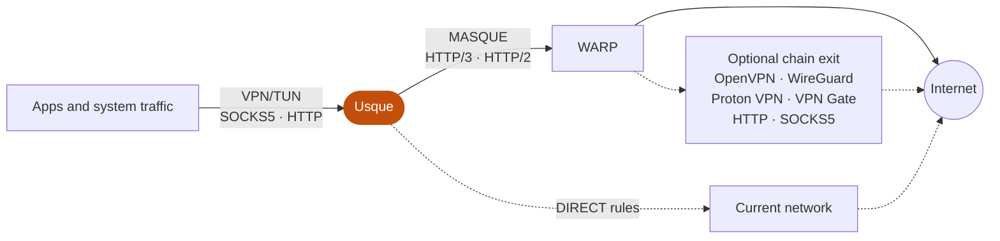

  <picture>
    <source media="(prefers-color-scheme: dark)" srcset="assets/branding/usque-readme-banner-dark.png">
    
  </picture>

  English
  ·
  <a href="README.zh-CN.md">简体中文</a>
  ·
  <a href="README.ja.md">日本語</a>
  ·
  <a href="README.ko.md">한국어</a>
  ·
  <a href="README.ru.md">Русский</a>
  ·
  <a href="README.fa.md">فارسی</a>

  An unofficial client compatible with Cloudflare® WARP® services for Windows, Linux and Android / Android TV, 
  with a native Flutter interface and a Rust MASQUE engine.

  

  
  
  

  An independent project. Not affiliated with, sponsored by, or endorsed by Cloudflare, Inc.

<table>
  <tr>
    <td align="center" valign="top">
      
<strong>Windows</strong>

      <picture>
        <source media="(prefers-color-scheme: dark)" srcset="assets/screenshots/usque-windows-home-dark.png">
        
      </picture>
    </td>
    <td align="center" valign="top">
      
<strong>Android</strong>

      <picture>
        <source media="(prefers-color-scheme: dark)" srcset="assets/screenshots/usque-android-connect-dark.gif">
        
      </picture>
    </td>
  </tr>
</table>

English interface previews rendered from the current source with sample data.

## Overview

- **Performance** — a Rust MASQUE engine over HTTP/3 with automatic HTTP/2 fallback, batched UDP I/O on Android and Linux, a larger UDP receive buffer on Windows and Android, and selectable congestion control including BBRv2 and experimental BBRv3.
- **VPN and local proxies** — system VPN (TUN), SOCKS5 and HTTP proxy share one WARP connection and can run together.
- **Chain proxy** — leave WARP through OpenVPN, WireGuard, Proton VPN, VPN Gate, HTTP or SOCKS5.
- **Routing and ad blocking** — DIRECT / REJECT / PROXY rules for domains and CIDRs, Ads rules and country-based direct routing.
- **Encrypted DNS** — DoH or DoT for the WARP exit and for direct-rule queries.
- **Network diagnostics** — latency, packet loss and 60-second trends, with deep checks only after confirmation.
- **Scenes** — save common network setups in **Profiles** and switch between them.
- **Privacy** — a server-key check that cannot be skipped, system credential stores, redacted local diagnostics and no analytics.
- **Platform integration** — Windows tray, Android Quick Settings tile and TV navigation; 21 languages with light and dark themes.

## Screens

<table>
  <tr>
    <td align="center" valign="top" width="25%">
      <picture>
        <source media="(prefers-color-scheme: dark)" srcset="assets/screenshots/usque-gallery-scenes-dark.png">
        
      </picture>
       <strong>Scenes</strong>
       Switch saved network setups
    </td>
    <td align="center" valign="top" width="25%">
      <picture>
        <source media="(prefers-color-scheme: dark)" srcset="assets/screenshots/usque-gallery-chain-dark.png">
        
      </picture>
       <strong>Chain proxy</strong>
       OpenVPN, WireGuard and proxy exits
    </td>
    <td align="center" valign="top" width="25%">
      <picture>
        <source media="(prefers-color-scheme: dark)" srcset="assets/screenshots/usque-gallery-routing-dark.png">
        
      </picture>
       <strong>Bypass settings</strong>
       Direct, block or proxy by rule
    </td>
    <td align="center" valign="top" width="25%">
      <picture>
        <source media="(prefers-color-scheme: dark)" srcset="assets/screenshots/usque-gallery-quality-dark.png">
        
      </picture>
       <strong>Network quality</strong>
       Latency, loss and throughput
    </td>
  </tr>
</table>

## How it works

Apps reach Usque through the VPN or proxies you turn on. Usque carries their traffic to WARP over MASQUE, where it leaves directly or through an optional chain exit. Explicit direct rules send matching traffic through your current network instead.

## Download

Version **v0.3.4** adds local connection scenes and improves setup, routing and the desktop and Android experience. For an installed version, follow its release notes and the documentation at its tag.

| Platform | Minimum system | Package |
| --- | --- | --- |
| Windows | Windows 10 2004, build 19041 | x64-v2 or ARM64 installer EXE |
| Linux (since v0.3.3) | Ubuntu 22.04+, Debian 12+, supported Fedora; systemd | amd64 or arm64 AppImage, deb or rpm |
| Android / Android TV | Android 8.0, API 26 | arm64-v8a, x86_64 or armeabi-v7a APK, or the universal APK |

Windows x64 requires a CPU supporting **x86-64-v2**; ARM64 Windows uses the native ARM64 package. When the Android ABI is unknown, use the larger universal APK, which contains all three ABIs. Each release also includes two Windows MSI files reserved for in-app updates; install Windows manually with the EXE.

> [!IMPORTANT]
> **Download official packages only from [GitHub Releases](https://github.com/GeorgeXie2333/usque-app/releases).** Pull Request artifacts, local builds, and untagged binaries are not official.
>
> **Verify before installing.** Compare the package SHA-256 with `SHA256SUMS` and GitHub's asset digest, then verify the signer fingerprint published in the release notes. On Linux, also verify the Ed25519 manifest. Stop if any value differs.
>
> **Never bypass a warning.** Pre-1.0 Windows and Android packages use fixed, project-controlled self-signed certificates: Windows may show an unknown-publisher warning, and Android packages are installed outside Google Play. Do not disable antivirus or the firewall, or import certificates from unofficial packages, to bypass a warning.

- **Upgrades migrate configuration one way.** v0.3.2 and v0.3.3 use configuration schema 26; upgrading from v0.3.1 migrates schema 24 to 26, which v0.3.1 and older clients cannot read. v0.3.4 migrates schema 26 to 27, which v0.3.3 and older clients cannot read. Reinstalling an older package does not reverse the migration, so review [configuration compatibility](docs/INSTALLATION.md#configuration-compatibility-when-upgrading) and any required pre-upgrade backup first.
- **Linux:** the first AppImage VPN setup installs a background service with administrator authorization, and credentials require an unlocked Secret Service keyring. The [Linux desktop guide](docs/LINUX_DESKTOP.md) covers GNOME/KDE, X11/Wayland, recovery and the tested coverage.
- **Updates** require confirmation before downloading and use the platform installer; there is no unattended installation.
- [Installation and removal](docs/INSTALLATION.md) covers upgrades, uninstall, recovery and Android developer verification; [Code signing](docs/CODE_SIGNING.md) lists the official identities.

## Quick start

1. Install a [verified official package](docs/INSTALLATION.md#verify-before-installing) and open Usque.
2. Complete the first-run permissions and terms steps, then register a Consumer WARP® account, optionally with a WARP License Key. If setup was interrupted, check the saved result before registering again. Usque does not accept new WARP Secret imports.
3. Open **Proxy**. Turn on **TUN** (Windows/Linux) or **VPN** (Android) under **Device traffic**, and the **SOCKS5 proxy** or **HTTP proxy** switch at the top of its own section, then connect from **Home**.

Android setup requests only optional notifications. VPN authorization is requested when connecting with VPN output and may disconnect another VPN; proxy-only connections do not request it. These switches take effect immediately; listener address and port edits require **Apply changes**.

| Connection option | When to use it |
| --- | --- |
| VPN/TUN | Route system traffic through the tunnel, with your bypass and Android per-app rules. |
| SOCKS5 | Give compatible applications a local TCP/UDP proxy; remote DNS is the default. |
| HTTP proxy | Give compatible applications a local HTTP proxy, including HTTPS through CONNECT. |
| System proxy (Windows/Linux) | Point Windows or GNOME/KDE proxy settings at Usque's HTTP proxy; HTTP output must be enabled. |

VPN, SOCKS5 and HTTP are enabled by default; system proxy is off. They share one WARP connection and can run together. Turning off every output keeps the WARP connection open, but no app traffic uses it. Each account stores its own credentials; only one account connects at a time. Network settings are shared by all accounts.

## Features

### Performance and transport

- **Throughput:** the engine batches UDP sends and receives (`sendmmsg`/`recvmmsg`) on Android and Linux, requests a larger [UDP receive buffer](docs/UDP_RECEIVE_BUFFER.md) on Windows and Android, and offers [selectable HTTP/3 congestion control](docs/congestion-control.md): Cubic by default, BBRv2, experimental BBRv3 and Reno.
- **Automatic transport:** HTTP/3 with HTTP/2 fallback. IPv4 and IPv6 connection attempts help find a reachable endpoint, and supported H3 network changes can migrate the connection. See [path behavior](docs/h3-path-infrastructure.md).
- **[Experimental L4 mode](docs/L4_PROXY.md)** (opt-in) proxies TCP over HTTP/3. Without an OpenVPN TCP chain, it does not forward ordinary UDP, so applications that need UDP may not work. Auto does not select L4.

### Scenes and accounts

- **[Local connection scenes](docs/SCENARIOS.md)** in **Profiles** save account binding, chain proxy, endpoints, endpoint IP preference and transport. Review changes before use and restore the latest switch; the TUN/VPN and proxy switches, routing and DNS stay global. Saving a scene does not change the running connection, and saved and applied states remain distinct. Accounts are under **Manage accounts → Accounts**.
- **WARP login information export:** after confirmation, export your Consumer WARP login information (WARP Secret) to a file you choose. Usque cannot import that file to restore the account after reinstalling.

### Chain proxy

- Open **Proxy → Chain proxy** to leave WARP through **OpenVPN**, **WireGuard**, [**WARP via WireGuard**](docs/WARP_WIREGUARD.md), [**Proton VPN**](docs/PROTON_VPN.md), **VPN Gate**, **HTTP** or **SOCKS5**. Import a VPN configuration or add a proxy server, then select and apply one. Off by default; see the [chain proxy guide](docs/CHAIN_PROXY.md).
- VPN, SOCKS5 and HTTP share the exit; explicit direct rules still apply.
- Native Proton setup is under validation; live sign-in, the human puzzle and the full tunnel remain untested.

### Routing, blocking and DNS

- Full-tunnel VPN, tunneled DNS, Kill Switch, LAN access and [DIRECT/REJECT/PROXY routing rules with Ads](docs/ROUTING.md). Custom domains and CIDRs support more-specific exceptions; conflicts are checked before saving.
- Custom routing-rule edits apply to new flows during a stable connection without reconnecting. Existing TCP/CONNECT streams and active UDP targets retain their paths; check the apply result for pending or failed changes.
- Ads rules are prepared automatically when enabled and applied, checked every seven days while the app runs, and take effect on new requests without reconnecting. **Rule details** provides status, source and manual updates.
- Optional country-based direct routing downloads the selected countries' GeoIP data and the global GeoSite catalog separately. Usque uses domain rules when the name is visible, otherwise IP rules; unknown destinations stay in the tunnel.
- Custom [WARP exit DNS](docs/WARP_DNS.md): open **Settings → Advanced network settings → WARP DNS**, choose Plain DNS, DoH or DoT, and select **Apply changes**. Changing DNS reconnects an established session; the final chain exit keeps its own DNS policy.

### Diagnostics

- Local [network diagnostics](docs/network-doctor.md) and a **Network Quality** page showing latency, packet-loss readings and availability, queues and 60-second trends. Standard checks read local state; Deep checks send test requests only after confirmation.

### Desktop and Android

- **Windows:** tray with a status badge and TUN and system-proxy switches; background notifications for a reconnect lasting five seconds, a connection error, and recovery after a reported interruption; single-instance activation, start on boot, close-to-tray and a remembered window position. **Ctrl+1–4** selects pages, **Ctrl+S** applies changes, and **F5** refreshes VPN Gate or diagnostics. See [tray and keyboard controls](docs/INSTALLATION.md#tray-and-keyboard-controls).
- **Android:** Quick Settings tile, launcher shortcuts, boot recovery and TV navigation.
- **Android per-app proxy** applies to the whole app, across accounts. When off, all apps use the VPN. When on, only selected apps do; newly installed apps must be selected. With Android **Block connections without VPN**, unselected apps are blocked instead of bypassing the tunnel.
- **Everywhere:** twenty-one languages, with light and dark themes.

## Privacy and security

- **Verified server.** Usque requires the WARP server's public key to match the registered key. There is no option to skip this check.
- **Protected credentials.** Credentials stay in Windows Credential Manager, the Linux Secret Service keyring or Android Keystore. Windows and Linux use a separate Agent for privileged network operations; Android runs the VPN in a dedicated process.
- **Local proxies.** Proxies listen on loopback by default. SOCKS5 and HTTP support optional username/password authentication; without configured credentials they require no authentication. Proxy-only mode does not provide a system-wide VPN Kill Switch.
- **No analytics.** Diagnostics are generated locally and redacted. There is no usage analytics or automatic upload, and quality history stays in memory. Logs default to INFO and are limited to 7 days or 20 MiB. Do not post credentials or raw diagnostic bundles in public Issues; report vulnerabilities through [SECURITY.md](SECURITY.md).

### Limits

- Android's in-app Kill Switch cannot protect traffic after the VPN process dies. VPN Gate terminal failures also end the connection. To keep apps blocked after the VPN ends, enable both system **Always-on VPN** and **Block connections without VPN**. See [Android setup](docs/INSTALLATION.md#android-and-android-tv).
- Usque does not combine several paths for extra bandwidth. Some quality readings, including HTTP/2 packet loss and PMTU, are unavailable. Local diagnostics cannot detect traffic leaks.

### DNS privacy

- **Direct rules use your current network's DNS by default.** Country-based and custom-domain direct rules use **Current network DNS**: matching domain queries go to the DNS servers on your current network, outside the VPN. You can instead choose **DoH** with a full HTTPS URL or **DoT** with a server name and port. New drafts prefill Cloudflare; saved custom settings are preserved. That resolver receives the queries; connection failures do not switch them to plaintext DNS. See [configuration steps and examples](docs/encrypted-direct-dns.md).
- **Other remote VPN queries** use the WARP tunnel or the selected final chain exit. HTTP/SOCKS5 chain DNS defaults to verified Cloudflare® DoH through that proxy; custom or non-default inherited DNS retains TCP DNS. With these exits, application-selected UDP/53 queries use TCP to that resolver, with no physical DNS fallback. See the [chain DNS choices](docs/CHAIN_PROXY.md#http-and-socks5-exits--http-与-socks5-出口).
- **Apps that use their own encrypted DNS** hide domain names from Usque, so direct routing uses IP rules.
- Rule downloads also respect Android Lockdown and any remaining Windows Kill Switch while disconnected.

### Experimental and unsupported

[Zero Trust enrollment](docs/ZERO_TRUST_EXPERIMENTAL.md) is experimental. It uses an organization identity for the MASQUE Internet tunnel and does not provide full Cloudflare One™ Client compatibility. macOS source is retained but not built or released. iOS, store distribution and a public CLI are outside this release's scope.

## Default network settings

| Setting | Default |
| --- | --- |
| Consumer endpoint selection | Automatic selection; existing configurations retain Custom |
| Saved custom endpoint IPv4 | `162.159.198.2` |
| Saved custom endpoint IPv6 | `2606:4700:103::2` |
| Port / SNI | `443` / `speed.cloudflare.com` |
| Transport | Auto: HTTP/3, then HTTP/2 |
| HTTP/3 congestion control | `cubic`; BBRv2, experimental BBRv3, and `reno` are selectable |
| QUIC UDP receive buffer | [2 MiB target](docs/UDP_RECEIVE_BUFFER.md) on Windows/Android for H3 and L4; actual capacity is OS-dependent |
| TUN MTU | `1280` |
| Fallback DNS | `1.1.1.1`, `2606:4700:4700::1111` |
| SOCKS5 | `127.0.0.1:1080`, `[::1]:1080` |
| HTTP proxy | `127.0.0.1:8080`, `[::1]:8080` |

<strong>How proxy, endpoint and congestion-control changes apply</strong>

 

Proxy address and port edits are drafts until applied. Proxy DNS uses the current exit by default: configure [WARP DNS](docs/WARP_DNS.md) in Advanced settings or the final DNS in the chain configuration. The Proxy page has no DNS settings; a proxy DNS choice saved by an older version keeps working.

Advanced settings reset loads defaults into the draft; it does not apply them immediately.

In Advanced network settings, Automatic selection races eligible account endpoints; Custom keeps manual addresses. Port and SNI remain editable. See [automatic endpoints](docs/NETWORK_SETTINGS.md#automatic-endpoints--自动选择端点).

Zero Trust endpoint addresses start with registered values. In Advanced network settings, choose **Edit Zero Trust endpoints**, read the red fullscreen warning and acknowledge the risks and your authorization before editing IPv4/IPv6; then **Apply changes**. Reset stages the registered addresses; signing in again restores them and removes custom addresses. Home keeps a risk notice visible while the selected account has custom Zero Trust addresses or a running ZT session still uses them; the notice cannot be dismissed.

Congestion-control changes are saved for the next manual connection or retry, not applied to the current session or its automatic reconnections. HTTP/2 uses system TCP. See [HTTP/3 congestion control](docs/congestion-control.md).

## Documentation and development

Start with the [Wiki](https://github.com/GeorgeXie2333/usque-app/wiki/Home) for setup and practical tutorials. Use the [documentation index](docs/README.md) for the complete reference; most technical documents are in English.

| Need | Read |
| --- | --- |
| Install, update, uninstall, or recover | [Installation](docs/INSTALLATION.md) |
| Native Proton guest/account setup | [Proton VPN guide and current limits](docs/PROTON_VPN.md) |
| Connect to Proton VPN through the WARP tunnel | [WireGuard over MASQUE tutorial](https://github.com/GeorgeXie2333/usque-app/wiki/Proton-VPN-over-MASQUE) |
| Understand local quality checks | [Network Doctor](docs/network-doctor.md) |
| Build and test changes safely | [Contributing](CONTRIBUTING.md) |
| Understand implementation and verification status | [Implementation](docs/IMPLEMENTATION.md) |
| Maintain an official release | [Release process](docs/RELEASE.md) |

Use the pinned toolchains and change-scoped checks in the contribution guide. Compile-only builds and deterministic tests are safe workstation checks; installing development packages or exercising VPN lifecycle requires the designated isolated environments.

## Upstream and license

Protocol behavior follows [Diniboy1123/usque](https://github.com/Diniboy1123/usque). This repository keeps a snapshot of that client in `oracle/go` for interoperability tests. The Flutter UI and Rust engine are new code. Upstream copyright stays in the license.

First-party source is [MIT](LICENSE.md). Third-party components keep their own licenses. The optional [chain proxy](docs/CHAIN_PROXY.md) embeds OpenVPN 3 Core under MPL-2.0 and Mbed TLS under Apache-2.0. Corresponding source, reviewed patches and license texts are included in `third_party`; the application exposes the notices from its VPN Gate page. WireGuard uses BoringTun 0.7.1 (BSD-3-Clause), and local SVG icons use flutter_svg 2.3.0 (MIT); their notices are in the app's license registry.

The independent Proton SRP implementation references Proton go-srp (MIT); its [copyright and full license](apps/usque_gui/assets/licenses/proton-srp.txt) are retained in source, test vectors and the app license registry.

---

Usque is an independent project. It is not affiliated with, sponsored by, or endorsed by Cloudflare, Inc. Use of consumer WARP services remains subject to Cloudflare's terms and privacy policy. Cloudflare, WARP and Cloudflare One are trademarks and/or registered trademarks of Cloudflare, Inc. in the United States and other jurisdictions.
