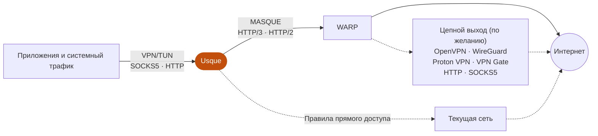

  <picture>
    <source media="(prefers-color-scheme: dark)" srcset="assets/branding/usque-readme-banner-dark.png">
    
  </picture>

  <a href="README.md">English</a>
  ·
  <a href="README.zh-CN.md">简体中文</a>
  ·
  <a href="README.ja.md">日本語</a>
  ·
  <a href="README.ko.md">한국어</a>
  ·
  Русский
  ·
  <a href="README.fa.md">فارسی</a>

  Неофициальный клиент, совместимый с сервисами Cloudflare® WARP®, для Windows, Linux и Android / Android TV, 
  с нативным интерфейсом Flutter и движком MASQUE на Rust.

  

  
  
  

  Независимый проект. Не принадлежит Cloudflare, Inc., не спонсируется и не одобрен этой компанией.

<table>
  <tr>
    <td align="center" valign="top">
      
<strong>Windows</strong>

      <picture>
        <source media="(prefers-color-scheme: dark)" srcset="assets/screenshots/usque-windows-home-dark.png">
        
      </picture>
    </td>
    <td align="center" valign="top">
      
<strong>Android</strong>

      <picture>
        <source media="(prefers-color-scheme: dark)" srcset="assets/screenshots/usque-android-connect-dark.gif">
        
      </picture>
    </td>
  </tr>
</table>

Снимки английского интерфейса отрисованы из текущих исходников с примерными данными.

## Обзор

- **Производительность** — движок MASQUE на Rust поверх HTTP/3 с автоматическим откатом на HTTP/2, пакетным вводом-выводом UDP на Android и Linux, увеличенным буфером приёма UDP в Windows и Android и выбором контроля перегрузки, включая BBRv2 и экспериментальный BBRv3.
- **VPN и локальные прокси** — системный VPN (TUN), SOCKS5 и HTTP-прокси используют одно подключение WARP и могут работать одновременно.
- **Цепной прокси** — выход после WARP через OpenVPN, WireGuard, Proton VPN, VPN Gate, HTTP или SOCKS5.
- **Маршрутизация и блокировка рекламы** — правила DIRECT/REJECT/PROXY для доменов и CIDR, Ads и прямая маршрутизация по странам.
- **Шифрованный DNS** — DoH или DoT для выхода WARP и для запросов правил прямого доступа.
- **Диагностика сети** — задержка, потери пакетов и тенденции за 60 секунд; глубокие проверки только после подтверждения.
- **Сценарии** — сохраняйте привычные сетевые настройки в разделе **Профили** и переключайтесь между ними.
- **Конфиденциальность** — обязательная проверка ключа сервера, системные хранилища учётных данных, локальная обезличенная диагностика и отсутствие аналитики.
- **Интеграция с платформами** — значок в области уведомлений Windows, плитка быстрых настроек Android и навигация на телевизоре; 21 язык, светлая и тёмная темы.

## Экраны

<table>
  <tr>
    <td align="center" valign="top" width="25%">
      <picture>
        <source media="(prefers-color-scheme: dark)" srcset="assets/screenshots/usque-gallery-scenes-dark.png">
        
      </picture>
       <strong>Сценарии</strong>
       Переключение сохранённых настроек
    </td>
    <td align="center" valign="top" width="25%">
      <picture>
        <source media="(prefers-color-scheme: dark)" srcset="assets/screenshots/usque-gallery-chain-dark.png">
        
      </picture>
       <strong>Цепной прокси</strong>
       Выходы OpenVPN, WireGuard и прокси
    </td>
    <td align="center" valign="top" width="25%">
      <picture>
        <source media="(prefers-color-scheme: dark)" srcset="assets/screenshots/usque-gallery-routing-dark.png">
        
      </picture>
       <strong>Настройки обхода</strong>
       Напрямую, блок или прокси по правилам
    </td>
    <td align="center" valign="top" width="25%">
      <picture>
        <source media="(prefers-color-scheme: dark)" srcset="assets/screenshots/usque-gallery-quality-dark.png">
        
      </picture>
       <strong>Качество сети</strong>
       Задержка, потери и скорость
    </td>
  </tr>
</table>

## Как это работает

Приложения обращаются к Usque через включённые вами VPN или прокси. Usque передаёт их трафик в WARP по MASQUE, откуда он выходит напрямую или через необязательный цепной выход. Явные правила прямого доступа направляют подходящий трафик через текущую сеть.

## Загрузка

В **v0.3.4** добавлены локальные сценарии подключения и улучшены настройка, маршрутизация и работа на компьютере и Android. Для установленной версии сверяйтесь с примечаниями к выпуску и документацией на её теге.

| Платформа | Минимальная ОС | Пакеты |
| --- | --- | --- |
| Windows | Windows 10 2004, сборка 19041 | установщик EXE для x64-v2 или ARM64 |
| Linux (начиная с v0.3.3) | Ubuntu 22.04+, Debian 12+, поддерживаемая Fedora; systemd | AppImage, deb или rpm для amd64 или arm64 |
| Android / Android TV | Android 8.0, API 26 | APK arm64-v8a, x86_64 или armeabi-v7a либо универсальный APK |

Windows x64 требует процессор с поддержкой **x86-64-v2**; для ARM64 Windows используйте нативный пакет ARM64. Если ABI Android неизвестен, возьмите универсальный APK большего размера со всеми тремя ABI. Каждый выпуск также содержит два Windows MSI только для обновления из приложения; для ручной установки Windows используйте EXE.

> [!IMPORTANT]
> **Скачивайте официальные пакеты только из [GitHub Releases](https://github.com/GeorgeXie2333/usque-app/releases).** Артефакты Pull Request, локальные сборки и двоичные файлы без тега не являются официальными.
>
> **Проверяйте перед установкой.** Сравните SHA-256 пакета с `SHA256SUMS` и дайджестом файла на GitHub, затем проверьте отпечаток подписанта из примечаний к выпуску. В Linux также проверьте подпись манифеста Ed25519. Если любое значение не совпадает, остановитесь.
>
> **Не обходите предупреждения.** Пакеты Windows/Android до версии 1.0 используют фиксированные самоподписанные сертификаты под управлением проекта: Windows может показать предупреждение о неизвестном издателе, а пакеты Android ставятся вне Google Play. Не отключайте антивирус или брандмауэр и не импортируйте сертификаты из неофициальных пакетов, чтобы обойти предупреждение.

- **Обновление переносит конфигурацию только в одну сторону.** v0.3.2 и v0.3.3 используют схему конфигурации 26. При обновлении с v0.3.1 схема меняется с 24 на 26; v0.3.1 и более ранние версии её не читают. v0.3.4 переводит схему с 26 на 27; v0.3.3 и более ранние версии её не читают. Переустановка старой версии не отменяет миграцию, поэтому заранее изучите [совместимость конфигурации](docs/INSTALLATION.md#configuration-compatibility-when-upgrading) и подготовьте нужную резервную копию.
- **Linux:** при первой настройке VPN через AppImage фоновая служба устанавливается с разрешения администратора; для учётных данных нужна разблокированная связка ключей Secret Service. GNOME/KDE, X11/Wayland, восстановление и объём тестирования описаны в [руководстве Linux](docs/LINUX_DESKTOP.md).
- **Обновление** нужно подтвердить до загрузки, и оно ставится установщиком платформы; установки без участия пользователя нет.
- Обновление, удаление, восстановление и проверка разработчика Android описаны в документе [Установка и удаление](docs/INSTALLATION.md), официальные удостоверения — в документе [Подпись кода](docs/CODE_SIGNING.md).

## Быстрый старт

1. Установите [проверенный официальный пакет](docs/INSTALLATION.md#verify-before-installing) и откройте Usque.
2. Пройдите шаги разрешений и условий при первом запуске, затем зарегистрируйте потребительский аккаунт WARP®, при желании с лицензионным ключом WARP. После прерывания сначала проверьте сохранённый результат, прежде чем регистрироваться снова. Usque не принимает импорт новых WARP Secret.
3. Откройте **Прокси**. Включите **Виртуальный сетевой адаптер** (Windows/Linux) или **VPN** (Android) в разделе **Трафик устройства**, а **Прокси SOCKS5** или **Прокси HTTP** — переключателем в начале его раздела, затем подключитесь со страницы **Главная**.

При настройке Android запрашивает только необязательные уведомления. Разрешение VPN запрашивается при подключении с выходом VPN и может отключить другой VPN; для подключения только через локальный прокси оно не требуется. Эти переключатели действуют сразу; изменения адресов и портов прослушивания требуют **Применить изменения**.

| Вариант подключения | Когда использовать |
| --- | --- |
| VPN/TUN | Направлять системный трафик через туннель, с вашими правилами обхода и правилами Android по приложениям. |
| SOCKS5 | Дать совместимым приложениям локальный прокси TCP/UDP; по умолчанию используется удалённый DNS. |
| HTTP-прокси | Дать совместимым приложениям локальный HTTP-прокси, в том числе HTTPS через CONNECT. |
| Системный прокси (Windows/Linux) | Направить параметры прокси Windows или GNOME/KDE на HTTP-прокси Usque; HTTP-прокси должен быть включён. |

VPN, SOCKS5 и HTTP включены по умолчанию, системный прокси выключен. Они используют одно общее подключение WARP и могут работать одновременно. Если отключить все эти варианты, подключение WARP сохраняется, но трафик приложений через него не идёт. Каждый аккаунт хранит свои учётные данные; одновременно подключён только один аккаунт. Сетевые настройки общие для всех аккаунтов.

## Возможности подробно

### Производительность и транспорт

- **Пропускная способность:** движок отправляет и принимает UDP пакетами (`sendmmsg`/`recvmmsg`) на Android и Linux, запрашивает увеличенный [буфер приёма UDP](docs/UDP_RECEIVE_BUFFER.md) в Windows и Android и предлагает [выбор контроля перегрузки HTTP/3](docs/congestion-control.md): по умолчанию Cubic, а также BBRv2, экспериментальный BBRv3 и Reno.
- **Автоматический транспорт:** HTTP/3 с откатом на HTTP/2. Попытки по IPv4 и IPv6 помогают найти доступную конечную точку; при поддерживаемой смене сети соединение H3 может мигрировать. См. [поведение пути](docs/h3-path-infrastructure.md).
- **[Экспериментальный режим L4](docs/L4_PROXY.md)** (включается по желанию) проксирует TCP поверх HTTP/3. Без цепочки OpenVPN по TCP он не пересылает обычный UDP; приложениям, которым нужен UDP, он может не подойти. Режим «Авто» не выбирает L4.

### Сценарии и аккаунты

- **[Локальные сценарии подключения](docs/SCENARIOS.md)** хранятся в разделе **Профили** и сохраняют привязку аккаунта, цепной прокси, конечные точки, предпочтение IP конечной точки и транспорт. Перед применением можно проверить изменения и восстановить предыдущее переключение; переключатели виртуального адаптера и прокси, маршрутизация и DNS остаются общими. Сохранение сценария не меняет текущее соединение; сохранённое состояние отделено от применённого. Аккаунтами управляют в **Управление аккаунтами → Аккаунты**.
- **Экспорт данных входа WARP:** после подтверждения потребительские данные входа WARP (WARP Secret) можно экспортировать в выбранный файл. Usque не может импортировать этот файл, чтобы восстановить аккаунт после переустановки.

### Цепной прокси

- Откройте **Прокси → Цепной прокси** и выберите выход после WARP: **OpenVPN**, **WireGuard**, [**WARP via WireGuard**](docs/WARP_WIREGUARD.md), [**Proton VPN**](docs/PROTON_VPN.md), **VPN Gate**, **HTTP** или **SOCKS5**. Импортируйте конфигурацию VPN или добавьте прокси-сервер, затем выберите одну и примените её. По умолчанию выключено; см. [руководство по цепному прокси](docs/CHAIN_PROXY.md).
- VPN, SOCKS5 и HTTP используют общий выход; явные правила прямого доступа по-прежнему действуют.
- Нативная поддержка Proton ещё проверяется: реальный вход, ручная головоломка и полный туннель не испытаны.

### Маршрутизация, блокировка и DNS

- VPN с полным туннелем, DNS внутри туннеля, Kill Switch, доступ к локальной сети и [правила DIRECT/REJECT/PROXY с Ads](docs/ROUTING.md). Домены и CIDR поддерживают более точные исключения; конфликты проверяются перед сохранением.
- При стабильном соединении изменения пользовательских правил применяются к новым потокам без переподключения. Существующие TCP/CONNECT-соединения и активные UDP-цели сохраняют свой путь. Проверяйте результат применения: изменения могут ожидать применения или завершиться ошибкой.
- При включении и применении блокировки рекламы правила подготавливаются автоматически и проверяются каждые семь дней при работающем приложении. Новые запросы используют их без переподключения; **Сведения о правилах** содержат состояние, источник и ручное обновление.
- Необязательная прямая маршрутизация по странам. Данные GeoIP выбранных стран и глобальный каталог GeoSite скачиваются отдельно. Если имя домена видно, Usque применяет правила доменов, иначе правила IP; неизвестные назначения остаются в туннеле.
- Пользовательский [DNS выхода WARP](docs/WARP_DNS.md): откройте **Настройки → Дополнительные сетевые настройки → DNS WARP**, выберите обычный DNS, DoH или DoT и нажмите **Применить изменения**. Изменение DNS переподключает активную сессию; конечный выход цепочки сохраняет собственную политику DNS.

### Диагностика

- Локальная [диагностика сети](docs/network-doctor.md) и страница **Качество сети**: задержка, показания потери пакетов и их доступность, очереди и тенденции за 60 секунд. Проверки **Стандартная** читают локальное состояние; проверки **Глубокая** отправляют тестовые запросы только после подтверждения.

### Компьютер и Android

- **Windows:** значок в области уведомлений с индикатором состояния, переключателями виртуального сетевого адаптера и системного прокси; пока окно в фоне, уведомления о переподключении длительностью пять секунд, ошибке подключения и восстановлении после объявленного прерывания; активация единственного экземпляра, запуск при входе, закрытие окна в область уведомлений и запоминание положения окна. **Ctrl+1–4** выбирает страницы, **Ctrl+S** применяет изменения, **F5** обновляет VPN Gate или диагностику. См. [управление через область уведомлений и клавиатуру](docs/INSTALLATION.md#tray-and-keyboard-controls).
- **Android:** плитка быстрых настроек, ярлыки запуска, восстановление после загрузки и навигация на телевизоре.
- **Прокси по приложениям** на Android действует на всё приложение и на все аккаунты. Когда он выключен, VPN используют все приложения. Когда включён — только выбранные; новые установленные приложения нужно выбрать. Если в Android включено **Блокировать соединения без VPN**, невыбранные приложения блокируются, а не обходят туннель.
- **Везде:** двадцать один язык, светлая и тёмная темы.

## Конфиденциальность и безопасность

- **Проверка сервера.** Usque требует, чтобы открытый ключ сервера WARP совпадал с зарегистрированным ключом. Пропустить эту проверку нельзя.
- **Защита учётных данных.** Учётные данные остаются в диспетчере учётных данных Windows, связке ключей Linux Secret Service или в Android Keystore. В Windows и Linux привилегированные сетевые операции выполняет отдельный Agent; на Android VPN работает в отдельном процессе.
- **Локальные прокси.** По умолчанию прокси слушают только loopback. SOCKS5 и HTTP поддерживают необязательную проверку имени пользователя и пароля; если учётные данные не заданы, проверка не требуется. Режим только прокси не даёт системного Kill Switch для VPN.
- **Без аналитики.** Диагностика формируется локально, и секретные данные из неё удаляются. Нет аналитики использования и автоматической отправки, а история качества остаётся только в памяти. Журналы по умолчанию ведутся на уровне INFO и ограничены 7 днями или 20 MiB. Не публикуйте учётные данные или необработанные пакеты диагностики в открытых Issues; об уязвимостях сообщайте через [SECURITY.md](SECURITY.md).

### Ограничения

- Встроенный Kill Switch Android не защищает трафик после завершения процесса VPN. Окончательный сбой VPN Gate тоже завершает подключение. Чтобы приложения оставались заблокированы после завершения VPN, включите в системе и **Постоянная VPN**, и **Блокировать соединения без VPN**. См. [настройку Android](docs/INSTALLATION.md#android-and-android-tv).
- Usque не объединяет несколько путей, чтобы получить дополнительную пропускную способность. Некоторые показания качества, в том числе потеря пакетов HTTP/2 и PMTU, недоступны. Локальная диагностика не может обнаружить утечки трафика.

### Конфиденциальность DNS

- **Правила прямого доступа по умолчанию используют DNS текущей сети.** Правила прямого доступа по странам и пользовательским доменам по умолчанию используют **DNS текущей сети**: запросы подходящих доменов уходят DNS-серверам текущей сети, вне VPN. Вместо этого можно выбрать **DoH** с полным HTTPS URL или **DoT** с именем сервера и портом. Новые черновики используют Cloudflare; сохранённые пользовательские настройки сохраняются. Запросы получает этот резолвер; при сбое подключения они не переходят на DNS в открытом виде. См. [шаги настройки и примеры](docs/encrypted-direct-dns.md).
- **Остальные удалённые запросы VPN** используют туннель WARP или выбранный конечный выход. DNS цепочки HTTP/SOCKS5 по умолчанию использует Cloudflare® DoH с проверкой TLS через этот прокси; пользовательский или унаследованный DNS, отличный от стандартного, сохраняет TCP DNS. С этими выходами запросы UDP/53 к выбранному приложением резолверу передаются ему по TCP без отката на физический DNS. См. [настройки DNS цепочки](docs/CHAIN_PROXY.md#http-and-socks5-exits--http-与-socks5-出口).
- **Приложения со своим шифрованным DNS** скрывают доменные имена от Usque, поэтому прямая маршрутизация опирается на правила IP.
- Пока подключения нет, загрузка правил также подчиняется Android Lockdown и ещё не снятому Kill Switch Windows.

### Экспериментальные и неподдерживаемые возможности

[Регистрация Zero Trust](docs/ZERO_TRUST_EXPERIMENTAL.md) экспериментальна. Для интернет-туннеля MASQUE используется удостоверение организации; полной совместимости с Cloudflare One™ Client нет. Исходный код macOS сохранён, но не собирается и не публикуется. iOS, распространение через магазины приложений и публичный CLI в этот выпуск не входят.

## Сетевые параметры по умолчанию

| Параметр | По умолчанию |
| --- | --- |
| Выбор конечной точки | Автоматический; прежние настройки сохраняют ручной режим |
| Сохранённая ручная точка IPv4 | `162.159.198.2` |
| Сохранённая ручная точка IPv6 | `2606:4700:103::2` |
| Порт / SNI | `443` / `speed.cloudflare.com` |
| Транспорт | Авто: HTTP/3, затем HTTP/2 |
| Контроль перегрузки HTTP/3 | `cubic`; можно выбрать BBRv2, экспериментальный BBRv3 и `reno` |
| Буфер приёма UDP для QUIC | [цель 2 MiB](docs/UDP_RECEIVE_BUFFER.md) в Windows и Android для H3 и L4; фактический объём зависит от ОС |
| TUN MTU | `1280` |
| Резервный DNS | `1.1.1.1`, `2606:4700:4700::1111` |
| SOCKS5 | `127.0.0.1:1080`, `[::1]:1080` |
| HTTP-прокси | `127.0.0.1:8080`, `[::1]:8080` |

<strong>Когда вступают в силу изменения прокси, конечных точек и контроля перегрузки</strong>

 

Правки адреса прокси и порта остаются черновиком, пока их не применят. По умолчанию DNS прокси использует текущий выход: настройте [WARP DNS](docs/WARP_DNS.md) в дополнительных настройках или DNS конечного выхода в настройках цепочки. На странице прокси нет настроек DNS; настройка DNS прокси, сохранённая в старой версии, продолжает действовать.

Сброс в дополнительных настройках только подставляет значения по умолчанию в черновик и не применяет их сразу.

В дополнительных сетевых настройках автоматический режим параллельно проверяет доступные аккаунту точки, а ручной сохраняет введённые адреса. Порт и SNI доступны в обоих режимах. См. [выбор конечных точек](docs/NETWORK_SETTINGS.md#automatic-endpoints--自动选择端点).

Zero Trust изначально использует зарегистрированные адреса. В дополнительных сетевых настройках выберите **Изменить адреса Zero Trust**, прочитайте красное полноэкранное предупреждение и подтвердите риски и право доступа, затем измените IPv4/IPv6 и нажмите **Применить изменения**. Сброс возвращает зарегистрированные адреса в черновик; повторный вход восстанавливает их и удаляет собственные адреса. Если у выбранного аккаунта настроены собственные адреса Zero Trust или текущая ZT-сессия ещё использует их, на главной странице постоянно отображается предупреждение о рисках, которое нельзя закрыть.

Изменения контроля перегрузки сохраняются до следующего ручного подключения или повтора и не применяются к текущему сеансу и его автоматическим переподключениям. HTTP/2 использует системный TCP. См. [контроль перегрузки HTTP/3](docs/congestion-control.md).

## Документация и разработка

Для установки и практических руководств начните с [Wiki](https://github.com/GeorgeXie2333/usque-app/wiki/Home). Полный справочник — [указатель документации](docs/README.md); большая часть технических документов на английском.

| Задача | Документ |
| --- | --- |
| Установка, обновление, удаление или восстановление | [Установка](docs/INSTALLATION.md) |
| Нативная настройка гостя или аккаунта Proton | [Руководство Proton VPN и текущие ограничения](docs/PROTON_VPN.md) |
| Подключение к Proton VPN через WARP | [Руководство WireGuard over MASQUE](https://github.com/GeorgeXie2333/usque-app/wiki/Proton-VPN-over-MASQUE) |
| Локальные проверки качества | [Network Doctor](docs/network-doctor.md) |
| Безопасная сборка и проверка изменений | [Участие в разработке](CONTRIBUTING.md) |
| Состояние реализации и проверок | [Реализация](docs/IMPLEMENTATION.md) |
| Сопровождение официального выпуска | [Процесс выпуска](docs/RELEASE.md) |

Используйте закреплённые инструментальные цепочки и проверки по области изменения из руководства для участников. Сборки только для компиляции и детерминированные тесты можно безопасно выполнять на рабочей станции; установка пакетов разработки и проверка жизненного цикла VPN требуют назначенных изолированных сред.

## Апстрим и лицензия

Поведение протокола следует [Diniboy1123/usque](https://github.com/Diniboy1123/usque). В этом репозитории снимок того клиента лежит в `oracle/go` и нужен для тестов совместимости. Интерфейс Flutter и движок Rust — новый код. Авторские права апстрима указаны в лицензии.

Собственный исходный код распространяется по лицензии [MIT](LICENSE.md). Сторонние компоненты сохраняют свои лицензии. Необязательный [цепной прокси](docs/CHAIN_PROXY.md) включает OpenVPN 3 Core на условиях MPL-2.0 и Mbed TLS на условиях Apache-2.0. Соответствующие исходники, проверенные исправления и тексты лицензий лежат в `third_party`; приложение показывает эти уведомления на странице VPN Gate. WireGuard использует BoringTun 0.7.1 (BSD-3-Clause), а локальные значки SVG — flutter_svg 2.3.0 (MIT); уведомления о них есть в реестре лицензий приложения.

Независимая реализация Proton SRP использует Proton go-srp (MIT) как эталон. [Уведомление об авторских правах и полный текст лицензии](apps/usque_gui/assets/licenses/proton-srp.txt) сохранены в исходниках, тестовых векторах и реестре лицензий приложения.

---

Usque — независимый проект. Он не принадлежит Cloudflare, Inc., не спонсируется и не одобрен этой компанией. Использование потребительского сервиса WARP по-прежнему подчиняется условиям и политике конфиденциальности Cloudflare. Cloudflare, WARP и Cloudflare One — товарные знаки и/или зарегистрированные товарные знаки Cloudflare, Inc. в США и других юрисдикциях.
