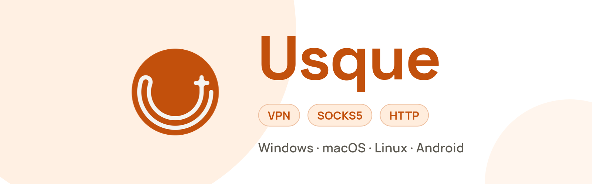
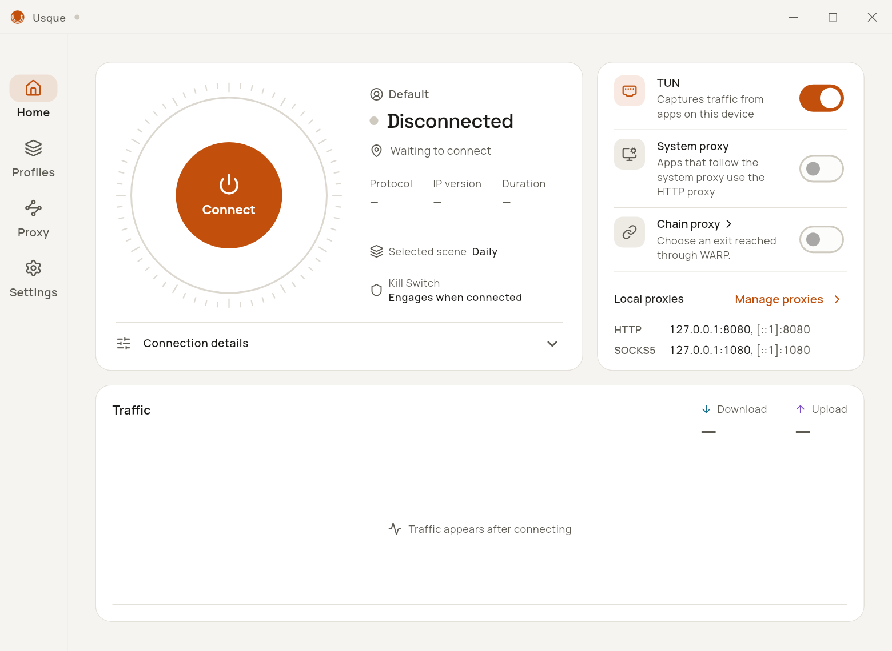
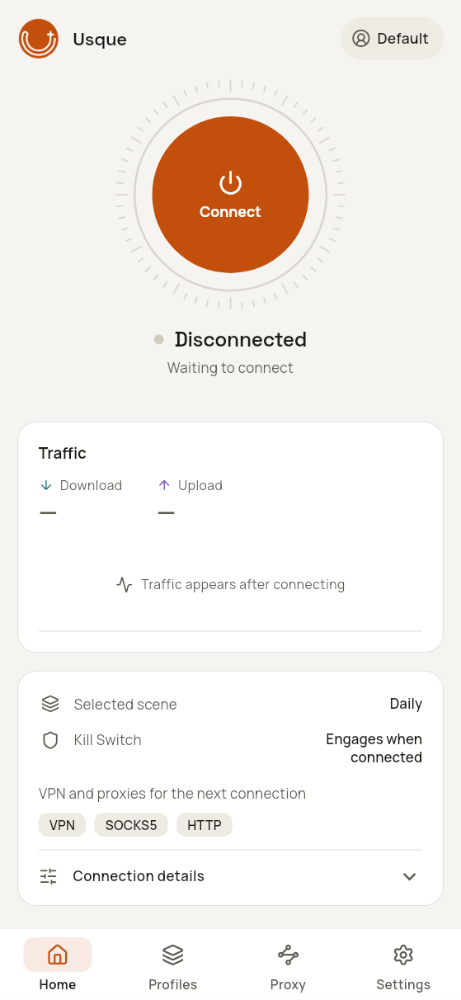
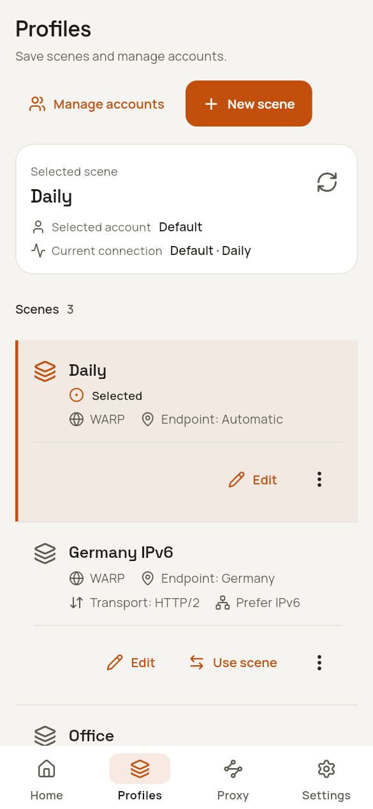
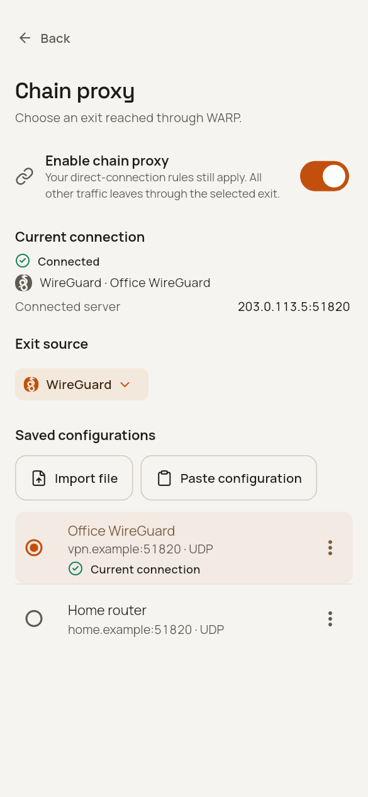
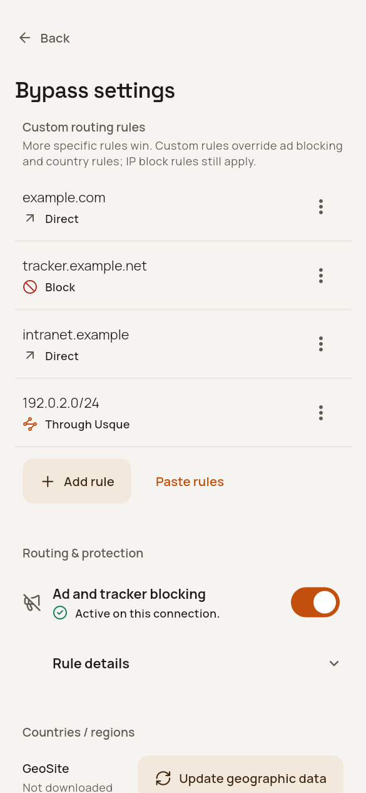
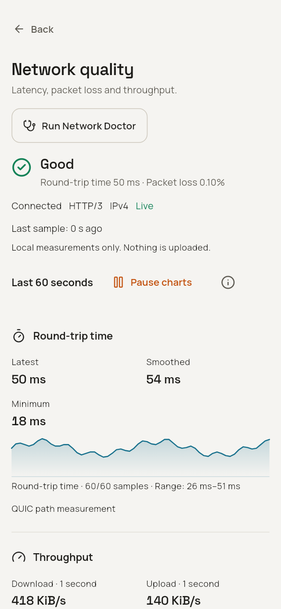
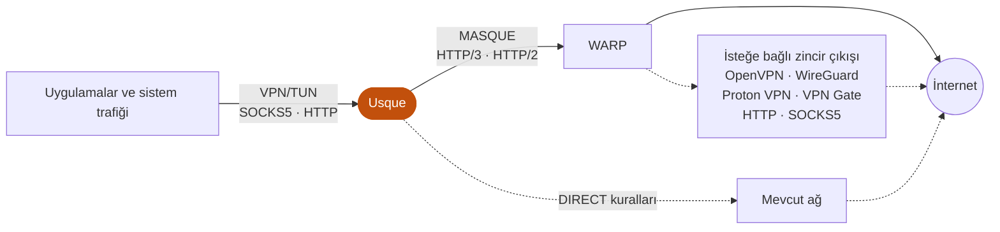

  <picture>
    <source media="(prefers-color-scheme: dark)" srcset="assets/branding/usque-readme-banner-dark.png">
    
  </picture>

  <a href="README.md">English</a>
  ·
  <a href="README.zh-CN.md">简体中文</a>
  ·
  <a href="README.zh-Hant.md">繁體中文</a>
  ·
  <a href="README.ja.md">日本語</a>
  ·
  <a href="README.ko.md">한국어</a>
  ·
  <a href="README.ru.md">Русский</a>
  ·
  <a href="README.fa.md">فارسی</a>
  ·
  Türkçe

  Windows, macOS, Linux ve Android / Android TV için Cloudflare® WARP® hizmetleriyle uyumlu resmi olmayan bir istemci; 
  yerel Flutter arayüzü ve Rust MASQUE motoruyla.

  

  
  
  

  Bağımsız bir projedir. Cloudflare, Inc. ile bağlantılı değildir, onun tarafından desteklenmez veya onaylanmaz.

<table>
  <tr>
    <td align="center" valign="top">
      
<strong>Windows</strong>

      <picture>
        <source media="(prefers-color-scheme: dark)" srcset="assets/screenshots/usque-windows-home-dark.png">
        
      </picture>
    </td>
    <td align="center" valign="top">
      
<strong>Android</strong>

      <picture>
        <source media="(prefers-color-scheme: dark)" srcset="assets/screenshots/usque-android-connect-dark.gif">
        
      </picture>
    </td>
  </tr>
</table>

Örnek verilerle mevcut kaynaktan oluşturulmuş İngilizce arayüz önizlemeleri.

## Genel Bakış

- **Performans** — otomatik HTTP/2 geri dönüşlü HTTP/3 üzerinde çalışan bir Rust MASQUE motoru, Android ve Linux'ta toplu UDP G/Ç, Windows ve Android'de daha büyük bir UDP alım arabelleği ve BBRv2 ile deneysel BBRv3 dahil seçilebilir tıkanıklık kontrolü.
- **VPN ve yerel vekil sunucular (proxy)** — sistem VPN'i (TUN), SOCKS5 ve HTTP vekil sunucusu tek bir WARP bağlantısını paylaşır ve birlikte çalışabilir.
- **Zincirleme vekil sunucu (Chain proxy)** — WARP çıkışını OpenVPN, WireGuard, Proton VPN, VPN Gate, HTTP veya SOCKS5 üzerinden yapın.
- **Yönlendirme ve reklam engelleme** — alan adları ve CIDR'ler için DIRECT / REJECT / PROXY kuralları, reklam (Ads) kuralları ve ülke tabanlı doğrudan yönlendirme.
- **Şifreli DNS** — WARP çıkışı ve doğrudan kural sorguları için DoH veya DoT.
- **Ağ tanılaması** — gecikme, paket kaybı ve 60 saniyelik eğilimler; derin kontroller yalnızca onaydan sonra yapılır.
- **Sahneler (Scenes)** — yaygın ağ kurulumlarını **Profiles** içinde kaydedin ve aralarında geçiş yapın.
- **Gizlilik** — atlanamayan bir sunucu anahtarı doğrulaması, sistem kimlik bilgisi depoları, hassas verileri gizlenmiş yerel tanılama ve sıfır analitik.
- **Platform entegrasyonu** — Windows sistem tepsisi, Android Hızlı Ayarlar kutucuğu ve TV gezinmesi; açık ve koyu temalarla 21 dil.

## Ekranlar

<table>
  <tr>
    <td align="center" valign="top" width="25%">
      <picture>
        <source media="(prefers-color-scheme: dark)" srcset="assets/screenshots/usque-gallery-scenes-dark.png">
        
      </picture>
       <strong>Sahneler</strong>
       Kayıtlı ağ kurulumlarını değiştirin
    </td>
    <td align="center" valign="top" width="25%">
      <picture>
        <source media="(prefers-color-scheme: dark)" srcset="assets/screenshots/usque-gallery-chain-dark.png">
        
      </picture>
       <strong>Zincirleme vekil sunucu</strong>
       OpenVPN, WireGuard ve vekil sunucu çıkışları
    </td>
    <td align="center" valign="top" width="25%">
      <picture>
        <source media="(prefers-color-scheme: dark)" srcset="assets/screenshots/usque-gallery-routing-dark.png">
        
      </picture>
       <strong>Atlama ayarları</strong>
       Kurala göre doğrudan, engelle veya vekil sunucu
    </td>
    <td align="center" valign="top" width="25%">
      <picture>
        <source media="(prefers-color-scheme: dark)" srcset="assets/screenshots/usque-gallery-quality-dark.png">
        
      </picture>
       <strong>Ağ kalitesi</strong>
       Gecikme, kayıp ve aktarım hızı
    </td>
  </tr>
</table>

## Nasıl çalışır

Uygulamalar Usque'ye açtığınız VPN veya vekil sunucular üzerinden ulaşır. Usque bunların trafiğini MASQUE üzerinden WARP'a taşır; trafik buradan doğrudan veya isteğe bağlı bir zincirleme çıkış üzerinden dışarı çıkar. Açık doğrudan kurallar ise eşleşen trafiği bunun yerine mevcut ağınız üzerinden gönderir.

## İndirme

**v0.3.5** sürümü macOS masaüstü desteği ile yapılandırılabilir paralel bağlantılar ekler ve sahneler arasında geçişi kolaylaştırır. Kurulu bir sürüm için sürüm notlarını ve ilgili etiketteki belgeleri takip edin.

| Platform | Minimum sistem | Paket |
| --- | --- | --- |
| Windows | Windows 10 2004, derleme 19041 | x64-v2 veya ARM64 yükleyici EXE |
| macOS | macOS 13 veya üzeri | Apple Silicon (arm64) ve Intel (x86_64) için DMG'ler |
| Linux (v0.3.3'ten beri) | Ubuntu 22.04+, Debian 12+, desteklenen Fedora; systemd | amd64 veya arm64 AppImage, deb ya da rpm |
| Android / Android TV | Android 8.0, API 26 | arm64-v8a, x86_64 veya armeabi-v7a APK ya da evrensel APK |

Windows x64, **x86-64-v2** destekleyen bir CPU gerektirir; ARM64 Windows yerel ARM64 paketini kullanır. Android ABI bilinmiyorsa, her üç ABI'yi de içeren daha büyük evrensel APK'yı kullanın. Her sürümde uygulama içi güncellemeler için ayrılmış iki Windows MSI dosyası da bulunur; Windows'a elle kurulumu EXE ile yapın.

> [!IMPORTANT]
> **Resmi paketleri yalnızca [GitHub Releases](https://github.com/GeorgeXie2333/usque-app/releases) üzerinden indirin.** Pull Request yapıtları, yerel derlemeler ve etiketlenmemiş ikili dosyalar resmi değildir.
>
> **Kurmadan önce doğrulayın.** Paket SHA-256 değerini `SHA256SUMS` ve GitHub'ın varlık özetiyle karşılaştırın, ardından sürüm notlarında yayımlanan imzalayıcı parmak izini doğrulayın. Linux'ta Ed25519 manifestini de doğrulayın. Herhangi bir değer farklıysa durun.
>
> **Bir uyarıyı asla atlamayın.** 1.0 öncesi Windows ve Android paketleri sabit, proje kontrollü kendinden imzalı sertifikalar kullanır: Windows bilinmeyen yayıncı uyarısı gösterebilir ve Android paketleri Google Play dışından kurulur. Bir uyarıyı atlamak için antivirüsü veya güvenlik duvarını devre dışı bırakmayın ya da resmi olmayan paketlerden sertifika içe aktarmayın.

- **Yükseltmeler yapılandırmayı tek yönlü geçirir.** v0.3.2 ve v0.3.3, yapılandırma şeması 26'yı kullanır; v0.3.1'den yükseltme şema 24'ü 26'ya geçirir ve v0.3.1 ile daha eski istemciler bunu okuyamaz. v0.3.4 şema 26'yı 27'ye geçirir; v0.3.3 ve daha eski istemciler okuyamaz. Eski bir paketi yeniden kurmak geçişi geri almaz, bu nedenle önce [yapılandırma uyumluluğunu](docs/INSTALLATION.md#configuration-compatibility-when-upgrading) ve gerekli yükseltme öncesi yedeklemeyi inceleyin. v0.3.5, v0.3.4 ve daha eski istemcilerin okuyamadığı şema 28'e geçirir.
- **Linux:** ilk AppImage VPN kurulumu yönetici yetkilendirmesiyle bir arka plan servisi kurar ve kimlik bilgileri kilidi açılmış bir Secret Service anahtarlığı gerektirir. [Linux masaüstü kılavuzu](docs/LINUX_DESKTOP.md) GNOME/KDE, X11/Wayland, kurtarma ve test edilen kapsamı ele alır.
- **Güncellemeler** indirmeden önce onay gerektirir ve platform yükleyicisini kullanır; katılımsız kurulum yoktur.
- [Kurulum ve kaldırma](docs/INSTALLATION.md) yükseltmeleri, kaldırmayı, kurtarmayı ve Android geliştirici doğrulamasını kapsar; [Kod imzalama](docs/CODE_SIGNING.md) resmi kimlikleri listeler.

## Hızlı başlangıç

1. [Doğrulanmış bir resmi paket](docs/INSTALLATION.md#verify-before-installing) kurun ve Usque'yi açın.
2. İlk çalıştırma izinlerini ve koşullar adımlarını tamamlayın, ardından isteğe bağlı olarak bir WARP Lisans Anahtarı ile bir Consumer WARP® hesabı kaydedin. Kurulum kesintiye uğradıysa, yeniden kaydetmeden önce kaydedilen sonucu kontrol edin. Usque yeni WARP Secret içe aktarımlarını kabul etmez.
3. **Proxy** sayfasını açın. **Device traffic** altında **TUN** (Windows/Linux) veya **VPN** (Android) anahtarını ve kendi bölümünün üstündeki **SOCKS5 proxy** ya da **HTTP proxy** anahtarını açın, ardından **Home** üzerinden bağlanın.

Android kurulumu yalnızca isteğe bağlı bildirim izni ister. VPN yetkilendirmesi yalnızca VPN çıkışıyla bağlanırken istenir ve başka bir VPN'in bağlantısını kesebilir; yalnızca vekil sunucu bağlantıları bunu istemez. Bu anahtarlar hemen etkili olur; dinleyici adresi ve port düzenlemeleri **Apply changes** gerektirir.

| Bağlantı seçeneği | Ne zaman kullanılır |
| --- | --- |
| VPN/TUN | Atlama kurallarınız ve Android uygulama bazlı kurallarla sistem trafiğini tünelden yönlendirir. |
| SOCKS5 | Uyumlu uygulamalara yerel bir TCP/UDP vekil sunucusu sağlar; varsayılan olarak uzak DNS kullanılır. |
| HTTP proxy | CONNECT üzerinden HTTPS dahil olmak üzere uyumlu uygulamalara yerel bir HTTP vekil sunucusu sağlar. |
| System proxy (Windows/Linux) | Windows veya GNOME/KDE vekil sunucu ayarlarını Usque'nin HTTP vekil sunucusuna yönlendirir; HTTP çıkışı etkin olmalıdır. |

VPN, SOCKS5 ve HTTP varsayılan olarak etkindir; sistem vekil sunucusu kapalıdır. Tek bir WARP bağlantısını paylaşırlar ve birlikte çalışabilirler. Tüm çıkışları kapatmak WARP bağlantısını açık tutar ancak hiçbir uygulama trafiği bunu kullanmaz. Her hesap kendi kimlik bilgilerini saklar; aynı anda yalnızca bir hesap bağlanır. Ağ ayarları tüm hesaplar tarafından paylaşılır.

## Özellikler

### Performans ve aktarım

- **Aktarım hızı:** motor Android ve Linux'ta UDP gönderme ve alma işlemlerini toplu yapar (`sendmmsg`/`recvmmsg`), Windows ve Android'de daha büyük bir [UDP alım arabelleği](docs/UDP_RECEIVE_BUFFER.md) ister ve [seçilebilir HTTP/3 tıkanıklık kontrolü](docs/congestion-control.md) sunar: varsayılan olarak Cubic, BBRv2, deneysel BBRv3 ve Reno.
- **Otomatik aktarım:** HTTP/2 geri dönüşlü HTTP/3. IPv4 ve IPv6 bağlantı denemeleri ulaşılabilir bir uç nokta bulmaya yardımcı olur ve desteklenen H3 ağ değişiklikleri bağlantıyı taşıyabilir. Bkz. [yol davranışı](docs/h3-path-infrastructure.md).
- **[Deneysel L4 modu](docs/L4_PROXY.md)** (isteğe bağlı) TCP'yi HTTP/3 üzerinden vekil sunucudan geçirir. OpenVPN TCP zinciri olmadan sıradan UDP'yi iletmez, bu nedenle UDP gerektiren uygulamalar çalışmayabilir. Otomatik mod L4'ü seçmez.

### Sahneler ve hesaplar

- **Profiles** içindeki **[Yerel bağlantı sahneleri](docs/SCENARIOS.md)** hesap bağlamayı, zincirleme vekil sunucuyu, uç noktaları, uç nokta IP tercihini ve aktarımı kaydeder. Kullanmadan önce değişiklikleri inceleyin ve son anahtarı geri yükleyin; TUN/VPN ve vekil sunucu anahtarları, yönlendirme ve DNS genel kalır. Bir sahneyi kaydetmek çalışan bağlantıyı değiştirmez; kaydedilen ve uygulanan durumlar ayrı kalır. Hesaplar **Manage accounts → Accounts** altındadır.
- **WARP giriş bilgisi dışa aktarma:** onaydan sonra Consumer WARP giriş bilgilerinizi (WARP Secret) seçtiğiniz bir dosyaya dışa aktarın. Usque yeniden kurulumdan sonra hesabı geri yüklemek için bu dosyayı içe aktaramaz.

### Zincirleme vekil sunucu

- WARP çıkışını **OpenVPN**, **WireGuard**, [**WARP via WireGuard**](docs/WARP_WIREGUARD.md), [**Proton VPN**](docs/PROTON_VPN.md), **VPN Gate**, **HTTP** veya **SOCKS5** üzerinden yapmak için **Proxy → Chain proxy** sayfasını açın. Bir VPN yapılandırması içe aktarın veya bir vekil sunucu ekleyin, ardından birini seçip uygulayın. Varsayılan olarak kapalıdır; bkz. [zincirleme vekil sunucu kılavuzu](docs/CHAIN_PROXY.md).
- VPN, SOCKS5 ve HTTP çıkışı paylaşır; açık doğrudan kurallar yine uygulanır.
- Yerel Proton kurulumu doğrulama aşamasındadır; canlı oturum açma, insan doğrulama bulmacası ve tam tünel henüz test edilmemiştir.

### Yönlendirme, engelleme ve DNS

- Tam tünelli VPN, tünellenmiş DNS, Kill Switch, LAN erişimi ve [Reklam kurallarıyla birlikte DIRECT/REJECT/PROXY yönlendirme kuralları](docs/ROUTING.md). Özel alan adları ve CIDR'ler daha spesifik istisnaları destekler; kaydetmeden önce çakışmalar kontrol edilir.
- Özel yönlendirme kuralı düzenlemeleri, kararlı bir bağlantı sırasında yeniden bağlanmadan yeni akışlara uygulanır. Mevcut TCP/CONNECT akışları ve etkin UDP hedefleri yollarını korur; bekleyen veya başarısız değişiklikler için uygulama sonucunu kontrol edin.
- Reklam kuralları etkinleştirilip uygulandığında otomatik olarak hazırlanır, uygulama çalışırken yedi günde bir kontrol edilir ve yeniden bağlanmadan yeni isteklerde etkili olur. **Rule details** durum, kaynak ve manuel güncellemeleri sağlar.
- İsteğe bağlı ülke tabanlı doğrudan yönlendirme, seçilen ülkelerin GeoIP verilerini ve küresel GeoSite kataloğunu ayrı ayrı indirir. Usque ad görünür olduğunda alan adı kurallarını, aksi halde IP kurallarını kullanır; bilinmeyen hedefler tünelde kalır.
- Özel [WARP çıkış DNS'i](docs/WARP_DNS.md): **Settings → Advanced network settings → WARP DNS** yolunu açın, Plain DNS, DoH veya DoT seçin ve **Apply changes**'a basın. DNS'i değiştirmek kurulu bir oturumu yeniden bağlar; son zincir çıkışı kendi DNS politikasını korur.

### Tanılama

- Yerel [ağ tanılaması](docs/network-doctor.md) ve gecikme, paket kaybı okumaları ile kullanılabilirlik, kuyruklar ve 60 saniyelik eğilimleri gösteren bir **Network Quality** sayfası. Standart kontroller yerel durumu okur; Derin kontroller yalnızca onaydan sonra test istekleri gönderir.

### Masaüstü ve Android

- **Windows:** durum rozetli sistem tepsisi ve TUN ile sistem vekil sunucusu anahtarları; beş saniye süren yeniden bağlanma, bağlantı hatası ve bildirilen bir kesinti sonrası kurtarma için arka plan bildirimleri; tek örnek etkinleştirme, başlangıçta çalıştırma, tepsiye kapatma ve hatırlanan pencere konumu. **Ctrl+1–4** sayfaları seçer, **Ctrl+S** değişiklikleri uygular ve **F5** VPN Gate veya tanılamayı yeniler. Bkz. [tepsi ve klavye kontrolleri](docs/INSTALLATION.md#tray-and-keyboard-controls).
- **Android:** Hızlı Ayarlar kutucuğu, başlatıcı kısayolları, önyükleme kurtarma ve TV gezinmesi.
- **Android uygulama bazlı vekil sunucu** hesaplar genelinde tüm uygulamaya uygulanır. Kapalıyken tüm uygulamalar VPN'i kullanır. Açıkken yalnızca seçilen uygulamalar kullanır; yeni kurulan uygulamalar seçilmelidir. Android **Block connections without VPN** ile seçilmeyen uygulamalar tüneli atlamak yerine engellenir.
- **Her yerde:** açık ve koyu temalarla yirmi bir dil.

## Gizlilik ve güvenlik

- **Doğrulanmış sunucu.** Usque, WARP sunucusunun açık anahtarının kayıtlı anahtarla eşleşmesini gerektirir. Bu kontrolü atlamanın bir yolu yoktur.
- **Korunan kimlik bilgileri.** Kimlik bilgileri Windows Kimlik Bilgisi Yöneticisi, Linux Secret Service anahtarlığı veya Android Keystore içinde saklanır. Windows ve Linux ayrıcalıklı ağ işlemleri için ayrı bir Agent kullanır; Android VPN'i özel bir işlemde çalıştırır.
- **Yerel vekil sunucular.** Vekil sunucular varsayılan olarak geri döngü (loopback) adresinde dinler. SOCKS5 ve HTTP isteğe bağlı kullanıcı adı/parola kimlik doğrulamasını destekler; yapılandırılmış kimlik bilgileri olmadan kimlik doğrulaması gerektirmezler. Yalnızca vekil sunucu modu sistem genelinde bir VPN Kill Switch sağlamaz.
- **Analitik yok.** Tanılamalar yerel olarak oluşturulur ve hassas veriler gizlenir. Kullanım analitiği veya otomatik yükleme yoktur ve kalite geçmişi bellekte kalır. Günlükler varsayılan olarak INFO düzeyindedir ve 7 gün veya 20 MiB ile sınırlıdır. Herkese açık Issue'larda kimlik bilgilerini veya ham tanılama paketlerini paylaşmayın; güvenlik açıklarını [SECURITY.md](SECURITY.md) üzerinden bildirin.

### Sınırlar

- Android'in uygulama içi Kill Switch'i, VPN işlemi sonlandıktan sonra trafiği koruyamaz. VPN Gate ölümcül hataları da bağlantıyı sonlandırır. VPN bittikten sonra da uygulamaları engelli tutmak için hem sistem **Always-on VPN** hem de **Block connections without VPN** seçeneklerini etkinleştirin. Bkz. [Android kurulumu](docs/INSTALLATION.md#android-and-android-tv).
- Usque ek bant genişliği için birden fazla yolu birleştirmez. HTTP/2 paket kaybı ve PMTU dahil bazı kalite okumaları kullanılamaz. Yerel tanılamalar trafik sızıntılarını tespit edemez.

### DNS gizliliği

- **Doğrudan kurallar varsayılan olarak mevcut ağınızın DNS'ini kullanır.** Ülke tabanlı ve özel alan adı doğrudan kuralları **Current network DNS** kullanır: eşleşen alan adı sorguları VPN dışında mevcut ağınızdaki DNS sunucularına gider. Bunun yerine tam bir HTTPS URL'si ile **DoH** veya sunucu adı ve port ile **DoT** seçebilirsiniz. Yeni taslaklar Cloudflare'i önceden doldurur; kaydedilmiş özel ayarlar korunur. Sorguları bu çözümleyici alır; bağlantı hataları bunları düz metin DNS'e geçirmez. Bkz. [yapılandırma adımları ve örnekler](docs/encrypted-direct-dns.md).
- **Diğer uzak VPN sorguları** WARP tünelini veya seçilen son zincir çıkışını kullanır. HTTP/SOCKS5 zincir DNS'i varsayılan olarak o vekil sunucu üzerinden doğrulanmış Cloudflare® DoH kullanır; özel veya varsayılan olmayan devralınmış DNS, TCP DNS'i korur. Bu çıkışlarda, uygulama tarafından seçilen UDP/53 sorguları fiziksel DNS geri dönüşü olmadan o çözümleyiciye TCP kullanır. Bkz. [zincir DNS seçenekleri](docs/CHAIN_PROXY.md#http-and-socks5-exits--http-与-socks5-出口).
- **Kendi şifreli DNS'ini kullanan uygulamalar** alan adlarını Usque'den gizler, bu nedenle doğrudan yönlendirme IP kurallarını kullanır.
- Kural indirmeleri bağlantısı kesilmişken bile Android Lockdown'a ve kalan herhangi bir Windows Kill Switch'e saygı duyar.

### Deneysel ve desteklenmeyenler

[Zero Trust kaydı](docs/ZERO_TRUST_EXPERIMENTAL.md) deneyseldir. MASQUE İnternet tüneli için bir kuruluş kimliği kullanır ve tam Cloudflare One™ İstemci uyumluluğu sağlamaz. iOS, mağaza dağıtımı ve genel bir CLI bu sürümün kapsamı dışındadır.

### v0.3.5 sürümünde macOS

macOS sürümü, macOS 13 ve üzeri sürümlerde yerel HTTP ve SOCKS5 vekil sunucularını destekler. Sistem genelinde TUN, sürüm DMG'lerinde devre dışı bırakılmaya devam etmektedir. Bkz. [macOS özellik matrisi](docs/MACOS_WINDOWS_PARITY.md) ve [kurulum kılavuzu](docs/INSTALLATION.md#choose-a-package).

macOS 13+ için geçmiş **resmi olmayan v0.3.3 geliştirici ön sürümü**:
[Apple Silicon (arm64)](https://github.com/JustinL330/usque-app/releases/download/macos-dev-v0.3.3-compact-12636756/usque-v0.3.3-macos-arm64.dmg)
veya [Intel (x86_64)](https://github.com/JustinL330/usque-app/releases/download/macos-dev-v0.3.3-compact-12636756/usque-v0.3.3-macos-x86_64.dmg).
Bu geçici (ad-hoc) imzalı paketler noter onaylı değildir ve üretim sürümü değildir. Test etmeden önce
[sürüm notlarını, sağlama toplamlarını ve manifestleri](https://github.com/JustinL330/usque-app/releases/tag/macos-dev-v0.3.3-compact-12636756)
okuyun; sistem VPN etkinleştirmesi devre dışı kalmaya devam etmektedir.
Sıkıştırılmış görüntüler indirmeleri %46,6 / %43,2 oranında azaltır; bkz.
[boyut açıklaması ve doğrulama](docs/MACOS_PACKAGE_SIZE.md). Bu eski
indirmeler CEF doğrulamasını ve tüm uygulama dillerini içerir.

Yukarıdaki geçmiş indirmeler mevcut macOS sahnelerinden ve kurtarmadan öncesine aittir. macOS
Proton hesabı oturum açmayı destekler, ancak misafir kaydını veya gömülü
doğrulama tarayıcısını desteklemez; tarayıcı doğrulaması gerektiğinde bir Proton yapılandırması içe aktarın.
Güncel paketler için resmi sürümleri kullanın.

[macOS test kontrol listesi](docs/MACOS_QA_CHECKLIST.md) yalıtılmış testleri
gerçek aygıt kabulünden ayırır. Aşağıdaki öğeler açık kalmaya devam etmektedir:

- **Sistem VPN/TUN:** sıradan DMG'ler bunu devre dışı tutar. Agent hâlâ
  yönlendirme, DNS ve Kill Switch koruması için aygıt kabulü gerektirir. Yalnızca vekil sunucu
  modu, uygulamaların vekil sunucuya gönderdiği trafiği korur.
- **Sistem vekil sunucusu ve zincir çıkışları:** yalıtılmış yapılandırma, kurtarma ve aktarım
  testleri başarılı bir canlı bağlantı kurmaz. Gerçek yetkilendirme ve
  her harici çıkış hâlâ aygıt testlerine ihtiyaç duyar. Mevcut macOS kaynağı WARP'ı yeniden kullanır
  veya VPN Gate için geçici bir WARP bağlantısı açarak kaydedilen zincir
  ayarlarını korur; doğrudan fiziksel ağ katalog geri dönüşü devre dışı kalmaya devam eder.
- **Zero Trust:** geri arama doğrulaması ve iptal/yeniden deneme testleri sentetik veriler kullanır;
  gerçek bir kuruluş oturum açma ve geri araması doğrulanmamış kalır.
- **Proton hesapları:** macOS'ta misafir kaydı veya gömülü doğrulama
  tarayıcısı yoktur. Hesap oturum açma, kimlik doğrulayıcı kodları ve kayıtlı hesap yönetimi
  kullanılabilir kalır; canlı oturum açma ve trafik hâlâ aygıt testi gerektirir.
- **Masaüstü ve donanım:** düzen kontrolleri başsız (headless) Windows/macOS widget
  çizimlerini kullanır. Gerçek yerel pencere etkileşimi, Intel yürütmesi ve macOS 13 donanımı
  henüz test edilmemiştir. Varsayılan Mac içerik alanı artık 1040×760 ile Windows'la eşleşir,
  kullanılabilir ekrana sığar ve kaydedilen pencere geometrisini korur.

Bu arka plan doğrulaması tarafından hiçbir uygulama, tarayıcı, izin penceresi veya ana bilgisayar ağ ayarı açılmaz ya da
değiştirilmez. Geliştirme paketleri noter onaylı değildir.

## Varsayılan ağ ayarları

| Ayar | Varsayılan |
| --- | --- |
| Consumer uç nokta seçimi | Otomatik seçim; mevcut yapılandırmalar Özel (Custom) değerini korur |
| Kayıtlı özel uç nokta IPv4 | `162.159.198.2` |
| Kayıtlı özel uç nokta IPv6 | `2606:4700:103::2` |
| Port / SNI | `443` / `speed.cloudflare.com` |
| Aktarım | Otomatik: HTTP/3, ardından HTTP/2 |
| HTTP/3 tıkanıklık kontrolü | `cubic`; BBRv2, deneysel BBRv3 ve `reno` seçilebilir |
| MASQUE çoklanmış bağlantılar | `1`; HTTP/2 ve HTTP/3 / L4 için `1` ile `8` arasında elle yapılandırılabilir |
| QUIC UDP alım arabelleği | H3 ve L4 için Windows/Android'de [2 MiB hedefi](docs/UDP_RECEIVE_BUFFER.md); gerçek kapasite işletim sistemine bağlıdır |
| TUN MTU | `1280` |
| Geri dönüş DNS'i | `1.1.1.1`, `2606:4700:4700::1111` |
| SOCKS5 | `127.0.0.1:1080`, `[::1]:1080` |
| HTTP proxy | `127.0.0.1:8080`, `[::1]:8080` |

<strong>Vekil sunucu, uç nokta ve tıkanıklık kontrolü değişiklikleri nasıl uygulanır</strong>

 

Vekil sunucu adresi ve port düzenlemeleri uygulanana kadar taslaktır. Vekil sunucu DNS'i varsayılan olarak mevcut çıkışı kullanır: Gelişmiş ayarlarda [WARP DNS](docs/WARP_DNS.md)'i veya zincir yapılandırmasında son DNS'i yapılandırın. Proxy sayfasında DNS ayarı yoktur; daha eski bir sürüm tarafından kaydedilen bir vekil sunucu DNS seçimi çalışmaya devam eder.

Gelişmiş ayarları sıfırlamak varsayılanları taslağa yükler; bunları hemen uygulamaz.

**Advanced network settings → MASQUE multiplexed connections** içinde **1–8** (varsayılan **1**) girin, ardından **Apply changes**'a basın. Değiştirilen bir sayı oturumu yeniden bağlar. Ayrı akışlar farklı MASQUE bağlantıları kullanır; her akış tek bir bağlantıda kalır. Ayar HTTP/2/HTTP/3 CONNECT-IP ve L4 (HTTP/3 TCP CONNECT) için geçerlidir. Bkz. [bağlantı davranışı](docs/NETWORK_SETTINGS.md#parallel-masque-connections).

Gelişmiş ağ ayarlarında Otomatik seçim uygun hesap uç noktalarını yarıştırır; Özel (Custom) elle girilen adresleri korur. Port ve SNI düzenlenebilir kalır. Bkz. [otomatik uç noktalar](docs/NETWORK_SETTINGS.md#automatic-endpoints--自动选择端点).

Zero Trust uç nokta adresleri kayıtlı değerlerle başlar. Gelişmiş ağ ayarlarında **Edit Zero Trust endpoints**'i seçin, kırmızı tam ekran uyarısını okuyun ve IPv4/IPv6 düzenlemeden önce riskleri ve yetkilendirmenizi onaylayın; ardından **Apply changes**'a basın. Sıfırlama kayıtlı adresleri hazırlar; tekrar oturum açmak bunları geri yükler ve özel adresleri kaldırır. Seçili hesapta özel Zero Trust adresleri varken veya çalışan bir ZT oturumu bunları kullanırken Ana Sayfa bir risk bildirimini görünür tutar; bildirim kapatılamaz.

Tıkanıklık kontrolü değişiklikleri mevcut oturuma veya otomatik yeniden bağlanmalarına uygulanmaz, bir sonraki manuel bağlantı veya yeniden deneme için kaydedilir. HTTP/2 sistem TCP'sini kullanır. Bkz. [HTTP/3 tıkanıklık kontrolü](docs/congestion-control.md).

## Belgeler ve geliştirme

Kurulum ve pratik eğitimler için [Wiki](https://github.com/GeorgeXie2333/usque-app/wiki/Home) ile başlayın. Tam referans için [belge dizinini](docs/README.md) kullanın; çoğu teknik belge İngilizcedir.

| İhtiyaç | Okuyun |
| --- | --- |
| Kurulum, güncelleme, kaldırma veya kurtarma | [Kurulum](docs/INSTALLATION.md) |
| Yerel Proton misafir/hesap kurulumu | [Proton VPN kılavuzu ve mevcut sınırlar](docs/PROTON_VPN.md) |
| WARP tüneli üzerinden Proton VPN'e bağlanma | [MASQUE üzerinden WireGuard eğitimi](https://github.com/GeorgeXie2333/usque-app/wiki/Proton-VPN-over-MASQUE) |
| Yerel kalite kontrollerini anlama | [Network Doctor](docs/network-doctor.md) |
| Değişiklikleri güvenle derleme ve test etme | [Katkıda Bulunma](CONTRIBUTING.md) |
| Uygulama ve doğrulama durumunu anlama | [Uygulama](docs/IMPLEMENTATION.md) |
| Resmi bir sürümü sürdürme | [Sürüm süreci](docs/RELEASE.md) |

Katkı kılavuzundaki sabitlenmiş araç zincirlerini ve değişiklik kapsamlı kontrolleri kullanın. Yalnızca derleme yapıları ve deterministik testler güvenli iş istasyonu kontrolleridir; geliştirme paketlerini kurmak veya VPN yaşam döngüsünü çalıştırmak belirlenen yalıtılmış ortamları gerektirir.

## Yukarı akış ve lisans

Protokol davranışı [Diniboy1123/usque](https://github.com/Diniboy1123/usque) projesini izler. Bu depo, birlikte çalışabilirlik testleri için o istemcinin bir anlık görüntüsünü `oracle/go` içinde tutar. Flutter arayüzü ve Rust motoru yeni koddur. Yukarı akış telif hakkı lisansta kalır.

Birinci taraf kaynak [MIT](LICENSE.md) lisanslıdır. Üçüncü taraf bileşenler kendi lisanslarını korur. İsteğe bağlı [zincirleme vekil sunucu](docs/CHAIN_PROXY.md), MPL-2.0 altında OpenVPN 3 Core ve Apache-2.0 altında Mbed TLS gömer. İlgili kaynak, incelenmiş yamalar ve lisans metinleri `third_party` içine dahildir; uygulama bildirimleri VPN Gate sayfasından gösterir. WireGuard BoringTun 0.7.1 (BSD-3-Clause), yerel SVG simgeler ise flutter_svg 2.3.4 (MIT) kullanır; bildirimleri uygulamanın lisans kaydındadır.

Bağımsız Proton SRP uygulaması Proton go-srp'yi (MIT) referans alır; [telif hakkı ve tam lisansı](apps/usque_gui/assets/licenses/proton-srp.txt) kaynakta, test vektörlerinde ve uygulama lisans kaydında tutulur.

---

Usque bağımsız bir projedir. Cloudflare, Inc. ile bağlantılı değildir, onun tarafından desteklenmez veya onaylanmaz. Consumer WARP hizmetlerinin kullanımı Cloudflare'in koşullarına ve gizlilik politikasına tabidir. Cloudflare, WARP ve Cloudflare One, Amerika Birleşik Devletleri ve diğer yargı bölgelerinde Cloudflare, Inc. şirketinin ticari markaları ve/veya tescilli ticari markalarıdır.
