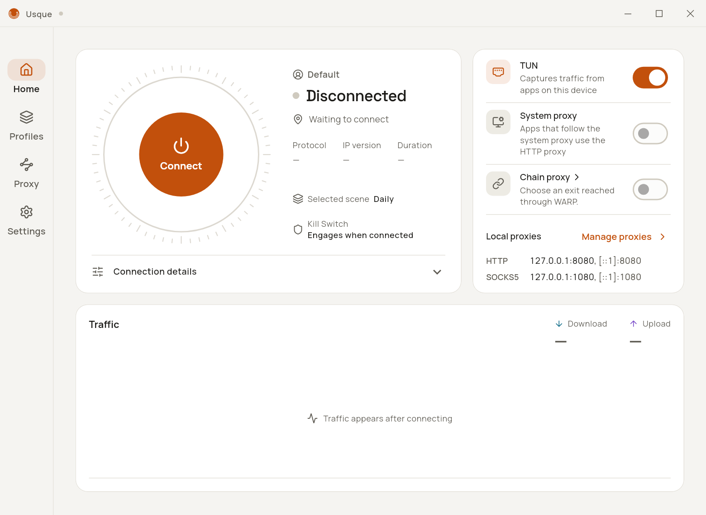
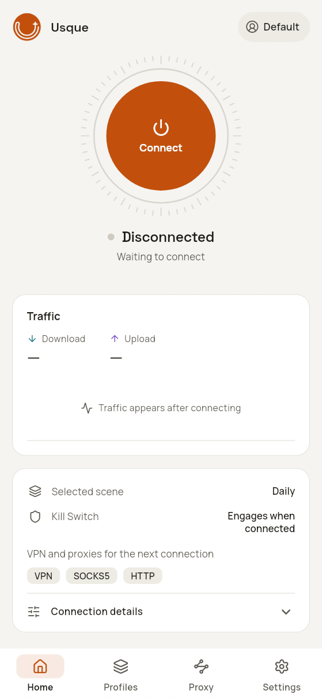
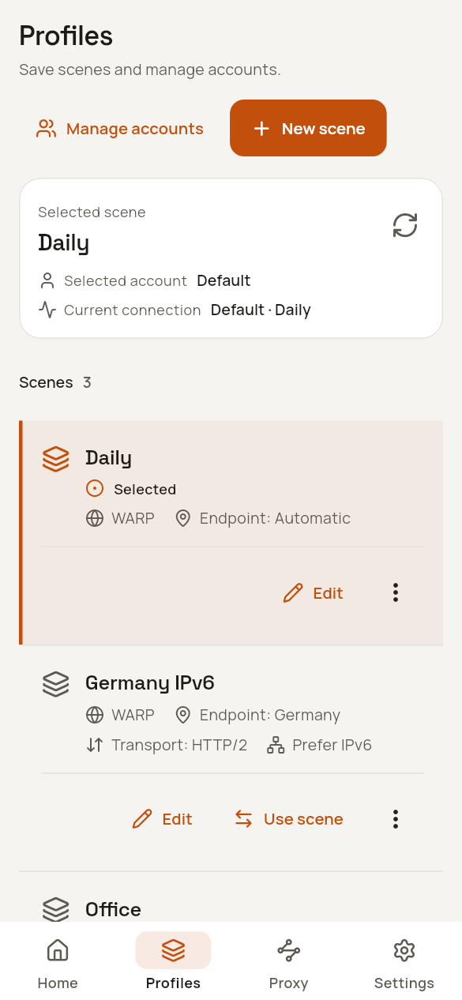
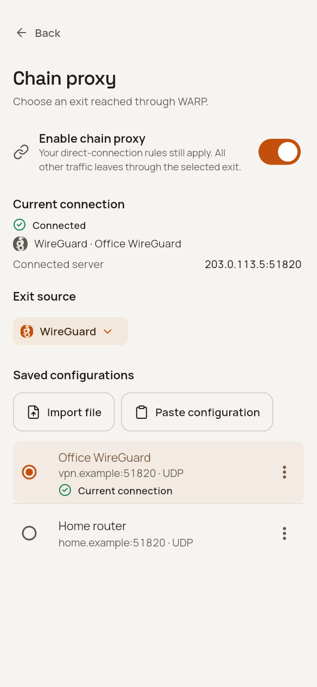
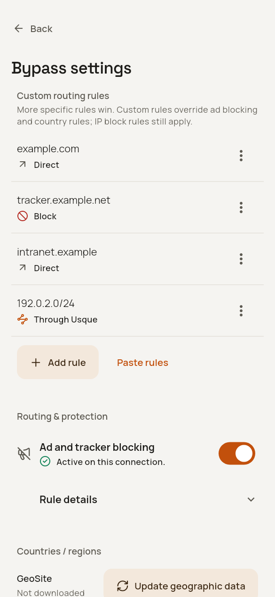
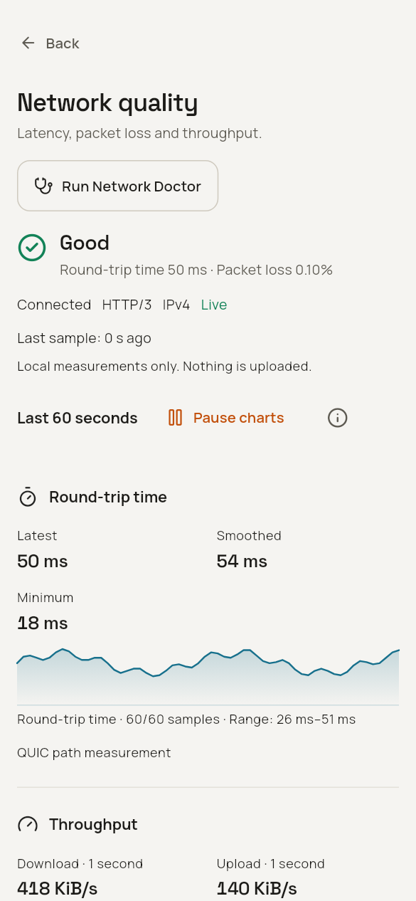
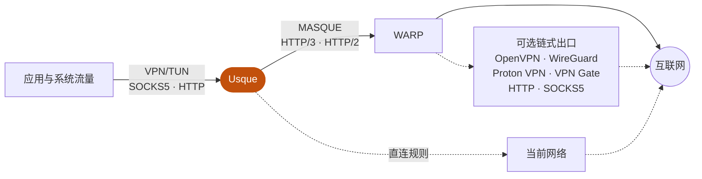

  <picture>
    <source media="(prefers-color-scheme: dark)" srcset="assets/branding/usque-readme-banner-dark.png">
    
  </picture>

  <a href="README.md">English</a>
  ·
  简体中文
  ·
  <a href="README.ja.md">日本語</a>
  ·
  <a href="README.ko.md">한국어</a>
  ·
  <a href="README.ru.md">Русский</a>
  ·
  <a href="README.fa.md">فارسی</a>

  兼容 Cloudflare® WARP® 服务的非官方客户端，支持 Windows、Linux 和 Android / Android TV， 
  采用原生 Flutter 界面与 Rust MASQUE 引擎。

  

  
  
  

  独立项目，与 Cloudflare, Inc. 无隶属、赞助或背书关系。

<table>
  <tr>
    <td align="center" valign="top">
      
<strong>Windows</strong>

      <picture>
        <source media="(prefers-color-scheme: dark)" srcset="assets/screenshots/usque-windows-home-dark.png">
        
      </picture>
    </td>
    <td align="center" valign="top">
      
<strong>Android</strong>

      <picture>
        <source media="(prefers-color-scheme: dark)" srcset="assets/screenshots/usque-android-connect-dark.gif">
        
      </picture>
    </td>
  </tr>
</table>

当前源码渲染的英文界面预览，使用示例数据。

## 概览

- **性能** — Rust 编写的 MASQUE 引擎，基于 HTTP/3 并自动回退到 HTTP/2；Android 与 Linux 批量收发 UDP，Windows 与 Android 申请更大的 UDP 接收缓冲，拥塞控制可选 BBRv2 和实验性 BBRv3。
- **VPN 与本地代理** — 系统 VPN（虚拟网卡）、SOCKS5 和 HTTP 代理共用一条 WARP 连接，可以同时使用。
- **链式代理** — 在 WARP 之后经 OpenVPN、WireGuard、Proton VPN、VPN Gate、HTTP 或 SOCKS5 出口访问网络。
- **分流与广告拦截** — 针对域名和 CIDR 的 DIRECT／REJECT／PROXY 规则、Ads 广告拦截和按国家直连。
- **加密 DNS** — WARP 出口和直连规则的域名查询都可以使用 DoH 或 DoT。
- **网络诊断** — 延迟、丢包和最近 60 秒趋势；深度检查需要你确认后才会执行。
- **场景** — 在 **配置** 页保存常用网络配置并随时切换。
- **隐私** — 强制校验服务端公钥，凭据存放在系统凭据库，诊断在本地生成并脱敏，不做使用统计。
- **平台集成** — Windows 托盘、Android 快捷设置磁贴和电视遥控器导航；21 种语言，浅色、深色主题。

## 界面一览

<table>
  <tr>
    <td align="center" valign="top" width="25%">
      <picture>
        <source media="(prefers-color-scheme: dark)" srcset="assets/screenshots/usque-gallery-scenes-dark.png">
        
      </picture>
       <strong>场景</strong>
       切换已保存的网络配置
    </td>
    <td align="center" valign="top" width="25%">
      <picture>
        <source media="(prefers-color-scheme: dark)" srcset="assets/screenshots/usque-gallery-chain-dark.png">
        
      </picture>
       <strong>链式代理</strong>
       OpenVPN、WireGuard 与代理出口
    </td>
    <td align="center" valign="top" width="25%">
      <picture>
        <source media="(prefers-color-scheme: dark)" srcset="assets/screenshots/usque-gallery-routing-dark.png">
        
      </picture>
       <strong>分流设置</strong>
       按规则直连、拦截或代理
    </td>
    <td align="center" valign="top" width="25%">
      <picture>
        <source media="(prefers-color-scheme: dark)" srcset="assets/screenshots/usque-gallery-quality-dark.png">
        
      </picture>
       <strong>网络质量</strong>
       延迟、丢包与吞吐量
    </td>
  </tr>
</table>

## 工作原理

应用通过你开启的 VPN 或代理接入 Usque。Usque 经 MASQUE 将流量送到 WARP，再直接访问网络，或经可选的链式出口离开。显式直连规则会让匹配的流量改走当前网络。

## 下载

**v0.3.4** 新增本机连接场景，并改进设置、分流及桌面和 Android 使用体验。安装的版本请以对应发布说明和标签下文档为准。

| 平台 | 最低系统 | 安装包 |
| --- | --- | --- |
| Windows | Windows 10 2004，Build 19041 | x64-v2 或 ARM64 安装程序 EXE |
| Linux（自 v0.3.3 起） | Ubuntu 22.04+、Debian 12+、受支持的 Fedora；systemd | amd64 或 arm64 的 AppImage、deb 或 rpm |
| Android / Android TV | Android 8.0，API 26 | arm64-v8a、x86_64 或 armeabi-v7a APK，或通用 APK |

Windows x64 需要支持 **x86-64-v2** 的 CPU；ARM64 Windows 使用原生 ARM64 安装包。不清楚 Android 设备架构时，可使用体积更大、包含全部三种 ABI 的通用 APK。每个版本另有两个仅供应用内更新使用的 Windows MSI 文件；手动安装 Windows 版请使用 EXE。

> [!IMPORTANT]
> **请仅从 [GitHub Releases](https://github.com/GeorgeXie2333/usque-app/releases) 下载正式安装包。** Pull Request 构建、本地构建及未打标签的二进制均非正式发布。
>
> **安装前先核验。** 将软件包 SHA-256 与 `SHA256SUMS` 及 GitHub 显示的文件校验值比对，再核验发布说明中的签名者指纹；Linux 还需验证 Ed25519 签名清单。任何一项不一致都应停止安装。
>
> **不要绕过安全警告。** 1.0 之前的 Windows/Android 安装包使用项目自行管理的固定自签名证书：Windows 可能显示“未知发布者”警告，Android 安装包不通过 Google Play 分发。不要通过关闭杀毒软件、防火墙或导入非官方安装包提供的证书来绕过警告。

- **升级会单向迁移配置。** v0.3.2 和 v0.3.3 使用配置 schema 26；从 v0.3.1 升级会将 schema 24 迁移至 26，v0.3.1 及更早客户端无法读取。v0.3.4 会将 schema 26 迁移至 27，v0.3.3 及更早客户端无法读取。重新安装旧版不会逆转迁移，请先查看[配置兼容性](docs/INSTALLATION.md#configuration-compatibility-when-upgrading)并安排所需备份。
- **Linux：** AppImage 首次使用 VPN 时需要管理员授权安装后台服务；凭据依赖已解锁的 Secret Service 钥匙串。[Linux 桌面指南](docs/LINUX_DESKTOP.md) 说明 GNOME/KDE、X11/Wayland、恢复流程与已测试范围。
- **更新**下载需要用户确认，安装通过平台安装程序完成，不会未经确认自动安装。
- 升级、卸载、恢复及 Android 开发者验证说明见[安装指南](docs/INSTALLATION.md)，官方签名身份见[代码签名策略](docs/CODE_SIGNING.md)。

## 快速上手

1. 按[安装指南](docs/INSTALLATION.md#verify-before-installing)核验正式安装包，安装后打开 Usque。
2. 完成首次启动的权限与条款步骤，然后注册个人版 WARP® 账号，也可以填写 WARP 许可证密钥。若设置中断，先检查已保存结果再重新注册。目前不支持导入新的 WARP Secret。
3. 打开 **代理**，在 **本机流量** 中开启 **虚拟网卡**（Windows/Linux）或 **VPN**（Android），并在各自分组顶部开启 **SOCKS5 代理** 或 **HTTP 代理**，然后在 **首页** 连接。

Android 引导只申请可选通知权限，连接需要 VPN 输出时才申请系统授权，授权可能断开其他 VPN；仅本地代理连接不申请。这些开关立即生效，监听地址和端口的修改需要点击 **应用修改**。

| 联网方式 | 用途 |
| --- | --- |
| VPN/TUN | 让系统流量经过隧道，并遵循直连规则和 Android 分应用设置。 |
| SOCKS5 | 为支持它的应用提供本地 TCP/UDP 代理，默认通过远程 DNS 查询域名。 |
| HTTP 代理 | 为支持它的应用提供本地 HTTP 代理，也支持通过 CONNECT 访问 HTTPS。 |
| 系统代理（Windows/Linux） | 将 Windows 或 GNOME/KDE 的代理设置指向 Usque；需同时启用 HTTP 代理。 |

VPN、SOCKS5 和 HTTP 默认开启，系统代理默认关闭。它们共用一条 WARP 连接，可以同时使用。全部关闭后，WARP 连接仍会保持，但不再承载任何应用流量。每个账号单独保存凭据，一次只能使用一个账号连接；网络设置由所有账号共享。

## 功能详解

### 性能与传输

- **吞吐：** 引擎在 Android 和 Linux 上批量收发 UDP（`sendmmsg`/`recvmmsg`），在 Windows 和 Android 上申请更大的 [UDP 接收缓冲](docs/UDP_RECEIVE_BUFFER.md)，并提供[可选的 HTTP/3 拥塞控制](docs/congestion-control.md)：默认 Cubic，另有 BBRv2、实验性 BBRv3 和 Reno。
- **自动传输：** 先尝试 HTTP/3，失败时回退到 HTTP/2，并尝试通过 IPv4 和 IPv6 寻找可达端点；H3 在支持的网络切换场景下可以迁移连接，详见[路径行为](docs/h3-path-infrastructure.md)。
- **[实验性 L4 模式](docs/L4_PROXY.md)**（需手动启用）通过 HTTP/3 代理 TCP 流量。未启用 OpenVPN TCP 链式出口时，它不转发普通 UDP 流量，需要 UDP 的应用可能无法正常使用。自动模式不会选择 L4。

### 场景与账号

- **[本机网络场景](docs/SCENARIOS.md)**在 **配置** 页保存账号绑定、链式代理、端点、端点 IP 偏好与传输协议。可预览后使用，并恢复最近一次切换；虚拟网卡与代理开关、分流与 DNS 保持全局。保存场景不改变当前连接，页面明确区分已保存和已应用。账号在 **账号管理 → 账号** 中管理。
- **导出 WARP 登录信息：** 确认后可将个人版 WARP 登录信息（WARP Secret）导出到指定文件。Usque 目前无法重新导入该文件，因此它不能用于重装后的账号恢复。

### 链式代理

- 在 **代理 → 链式代理** 中选择 **OpenVPN**、**WireGuard**、[**WARP via WireGuard**](docs/WARP_WIREGUARD.md)、[**Proton VPN**](docs/PROTON_VPN.md)、**VPN Gate**、**HTTP** 或 **SOCKS5** 作为 WARP 之后的出口。VPN 配置支持文件或文本导入，HTTP/SOCKS5 通过表单添加，保存后选用并应用。此功能默认关闭，详见[链式代理指南](docs/CHAIN_PROXY.md)。
- VPN、SOCKS5 和 HTTP 共用最终出口，显式直连规则仍然生效。
- 原生 Proton 来源仍在验证中；实网登录、真人拼图和完整隧道尚未实测。

### 分流、拦截与 DNS

- 全隧道 VPN、隧道内 DNS、Kill Switch（断网保护）、局域网访问和 [DIRECT／REJECT／PROXY 分流及 Ads 广告拦截](docs/ROUTING.md)。自定义域名、IP 和 CIDR 支持更具体的例外规则，保存时检查冲突。
- 连接稳定时，自定义分流规则直接用于新流，无需重连；已有 TCP／CONNECT 连接和活跃 UDP 目标保持原路径。请查看应用结果，确认是否仍待应用或应用失败。
- 开启广告拦截并应用后自动准备规则，应用运行期间每 7 天检查更新，新请求无需重连即可生效；**规则详情** 提供状态、来源和手动更新。
- 可选的按国家直连：单独下载所选国家的 GeoIP 数据和全局 GeoSite 域名规则。能看到域名时按域名判断，否则按 IP 判断；无法识别的目标继续走隧道。
- 自定义 [WARP 出口 DNS](docs/WARP_DNS.md)：打开 **设置 → 高级网络设置 → WARP DNS**，选择普通 DNS、DoH 或 DoT，再点击 **应用修改**。修改 DNS 会重新连接当前会话；最终链式出口仍使用自己的 DNS 策略。

### 诊断

- 本地[网络诊断](docs/network-doctor.md)和 **网络质量** 页面，展示延迟、丢包率及其测量状态、队列和最近 60 秒的趋势。**标准** 检查只读取本地状态；**深度** 检查会在你确认后发送测试请求。

### 桌面与 Android

- **Windows：** 托盘提供状态角标、虚拟网卡与系统代理开关；窗口在后台时，持续五秒的重连、连接错误和已通知中断后的恢复会弹出通知；另支持单实例、开机启动、关闭窗口后最小化到托盘和记住窗口位置。**Ctrl+1～4** 切换页面，**Ctrl+S** 应用修改，**F5** 刷新 VPN Gate 或诊断。详见[托盘与快捷键操作](docs/INSTALLATION.md#tray-and-keyboard-controls)。
- **Android：** 快捷设置磁贴、启动器快捷方式、开机恢复和电视遥控器导航。
- **Android 分应用代理** 对所有账号生效。关闭时，所有应用都使用 VPN；开启后，只有勾选的应用使用 VPN，新安装的应用需要手动勾选。如果同时启用了系统的“屏蔽未使用 VPN 的所有连接”，未勾选的应用将无法联网。
- **全平台：** 提供 21 种语言，以及浅色、深色主题。

## 隐私与安全

- **校验服务端。** 强制校验 WARP 服务端公钥，不提供跳过校验的选项。
- **保护凭据。** 凭据保存在 Windows 凭据管理器、Linux Secret Service 钥匙串或 Android Keystore 中。Windows 和 Linux 由独立 Agent 执行需要管理员权限的网络操作；Android 使用独立的 VPN 进程。
- **本机代理。** 代理默认仅供本机使用。SOCKS5 和 HTTP 支持可选的用户名、密码认证；未配置凭据时不要求认证。仅使用代理不能提供系统级 VPN 断网保护。
- **不做统计。** 诊断在本地生成并脱敏，不进行用户行为统计，也不自动上传。网络质量历史只保留在内存中。日志默认为 INFO，最多保留 7 天或 20 MiB。不要将凭据或原始诊断包放入公开 Issue；漏洞请通过 [SECURITY.md](SECURITY.md) 私密报告。

### 限制

- Android 应用内的断网保护无法在 VPN 进程结束后继续工作。VPN Gate 无法继续连接时，也会断开 VPN。如果需要在 VPN 结束后继续阻止应用联网，请同时开启系统的“始终开启的 VPN”和“屏蔽未使用 VPN 的所有连接”。操作方法见 [Android 安装说明](docs/INSTALLATION.md#android-and-android-tv)。
- Usque 不会通过多条路径叠加带宽。部分指标无法测量，例如 HTTP/2 的丢包率和 PMTU。本地诊断无法检测流量泄漏。

### DNS 隐私

- **直连规则默认使用当前网络的 DNS。** 按国家及自定义域名直连默认使用 **当前网络的 DNS**：匹配规则的域名查询会发送给当前网络使用的 DNS 服务器，位于 VPN 隧道之外。也可以选择 **DoH** 并填写完整 HTTPS 地址，或选择 **DoT** 并填写服务器域名和端口。新草稿预填 Cloudflare，已保存的自定义配置保持不变。查询会发送给该服务器；连接失败时不会改用明文 DNS。详见[配置步骤与示例](docs/encrypted-direct-dns.md)。
- **其他远程 VPN 查询**使用 WARP 隧道或所选最终链式出口。HTTP/SOCKS5 链 DNS 默认经该代理使用校验 TLS 的 Cloudflare® DoH；自定义或非默认继承 DNS 保留 TCP。在这两种出口下，应用指定的 UDP/53 查询转换为发往该解析器的 TCP，不回退到物理 DNS。详见[链 DNS 选择](docs/CHAIN_PROXY.md#http-and-socks5-exits--http-与-socks5-出口)。
- **应用自行使用加密 DNS 时**，Usque 看不到域名，此时按 IP 判断是否直连。
- 断开连接后下载规则，也仍受 Android 系统阻断设置和尚未解除的 Windows 断网保护约束。

### 实验性功能与支持范围

[Zero Trust 注册](docs/ZERO_TRUST_EXPERIMENTAL.md)仍属实验性功能：可以用组织身份建立 MASQUE 公网隧道，但不提供完整的 Cloudflare One™ Client 功能。仓库保留 macOS 源码，但不构建或发布；当前也不提供 iOS 版本、应用商店分发或公开命令行工具。

## 默认网络设置

| 设置 | 默认值 |
| --- | --- |
| 个人版端点模式 | 自动选择；升级保留已有自定义设置 |
| 保存的自定义端点 IPv4 | `162.159.198.2` |
| 保存的自定义端点 IPv6 | `2606:4700:103::2` |
| 端口 / SNI | `443` / `speed.cloudflare.com` |
| 传输 | 自动：先 HTTP/3，再 HTTP/2 |
| HTTP/3 拥塞控制 | `cubic`；可选择 BBRv2、实验性 BBRv3 和 `reno` |
| QUIC UDP 接收缓冲 | Windows/Android 的 H3、L4 均以 [2 MiB 为目标](docs/UDP_RECEIVE_BUFFER.md)申请；实际容量由系统决定 |
| TUN MTU | `1280` |
| 备用 DNS | `1.1.1.1`、`2606:4700:4700::1111` |
| SOCKS5 | `127.0.0.1:1080`、`[::1]:1080` |
| HTTP 代理 | `127.0.0.1:8080`、`[::1]:8080` |

<strong>代理、端点与拥塞控制的修改何时生效</strong>

 

修改代理地址和端口后，需要点击 **应用修改** 才会提交。代理默认通过当前出口解析：在高级设置中配置 [WARP DNS](docs/WARP_DNS.md)，或在链式配置中设置最终出口 DNS。代理页不再提供 DNS 设置；旧版本保存的代理 DNS 选择继续生效。

高级设置中的重置只会填入默认值，仍需提交才会生效。

高级网络设置的“自动选择”会并发连接账号可用的端点；“自定义”保留手动地址。端口和 SNI 在两种模式均可修改。详见[自动选择端点](docs/NETWORK_SETTINGS.md#automatic-endpoints--自动选择端点)。

Zero Trust 端点初始使用注册地址。在高级网络设置中选择 **编辑 Zero Trust 端点**，阅读红色全屏警告，勾选确认风险及使用授权后编辑 IPv4/IPv6，再点击 **应用修改**。恢复默认会暂存注册地址；重新登录会恢复注册地址并移除自定义地址。当前账号配置自定义 Zero Trust 地址，或当前 ZT 连接仍在使用自定义地址时，首页会常驻不可关闭的风险提示。

拥塞控制的更改会保存，并在下一次手动连接或重试时生效，不影响当前会话及其自动重连。HTTP/2 使用系统 TCP。详见 [HTTP/3 拥塞控制](docs/congestion-control.md)。

## 文档与开发

从 [Wiki 使用指南](https://github.com/GeorgeXie2333/usque-app/wiki/Home-zh-CN)开始，查找设置步骤与实用教程；完整参考见[文档索引](docs/README.md)，技术文档目前以英文为主。

| 需要了解 | 阅读文档 |
| --- | --- |
| 安装、更新、卸载与恢复 | [安装指南](docs/INSTALLATION.md) |
| 原生 Proton 游客／账号准备 | [Proton VPN 使用指南与当前限制](docs/PROTON_VPN.md) |
| 通过 WARP 隧道连接 Proton VPN | [WireGuard over MASQUE 教程](https://github.com/GeorgeXie2333/usque-app/wiki/Proton-VPN-over-MASQUE-zh-CN) |
| 本地网络质量检查 | [Network Doctor](docs/network-doctor.md) |
| 安全地构建和测试改动 | [贡献指南](CONTRIBUTING.md) |
| 实现与验证状态 | [实现进度](docs/IMPLEMENTATION.md) |
| 维护正式发布 | [发布流程](docs/RELEASE.md) |

请遵循贡献指南中的固定工具链和按改动范围划分的检查。仅编译构建和确定性测试可在开发机进行；安装开发包或测试 VPN 生命周期必须使用规定的隔离环境。

## 上游与许可

协议与行为参考 [Diniboy1123/usque](https://github.com/Diniboy1123/usque)。本仓库在 `oracle/go` 中保存一份快照，供互操作测试使用。Flutter 界面与 Rust 引擎为本项目新实现。上游版权声明见许可证。

第一方源码采用 [MIT License](LICENSE.md)，第三方组件保留各自许可证。可选的[链式代理](docs/CHAIN_PROXY.md)内嵌 OpenVPN 3 Core（MPL-2.0）和 Mbed TLS（Apache-2.0）。对应源码、补丁和许可文本保存在 `third_party`；应用中的 VPN Gate 页面可查看原生依赖许可声明。WireGuard 使用 BoringTun 0.7.1（BSD-3-Clause），本地 SVG 图标使用 flutter_svg 2.3.0（MIT）；相应声明已纳入应用许可证列表。

独立 Proton SRP 实现参考 Proton go-srp（MIT）；其[版权声明与完整许可](apps/usque_gui/assets/licenses/proton-srp.txt)保留在源码、测试向量及应用许可证列表中。

---

Usque 为独立项目，与 Cloudflare, Inc. 无隶属、赞助或背书关系。使用个人版 WARP 服务仍须遵守 Cloudflare 的适用条款与隐私政策。Cloudflare、WARP 和 Cloudflare One 是 Cloudflare, Inc. 在美国及其他司法管辖区的商标和/或注册商标。
