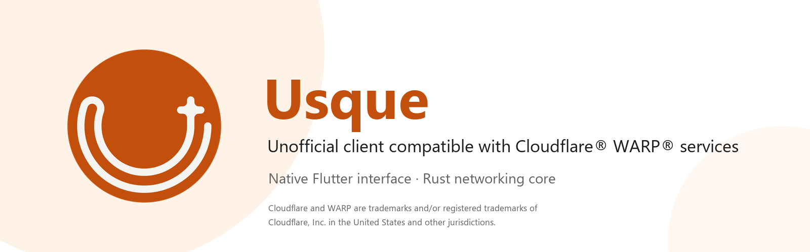
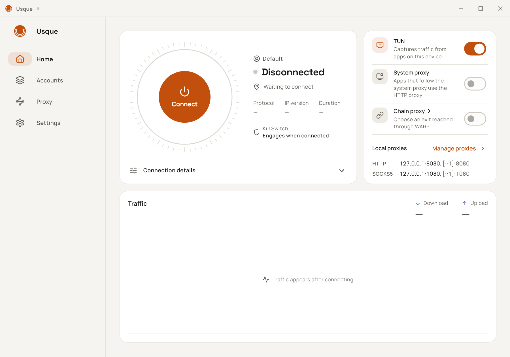
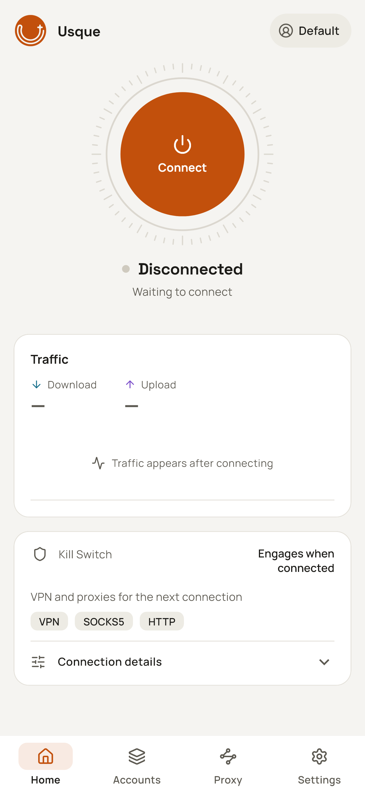

  

  <a href="README.md">English</a>
  ·
  <a href="README.zh-CN.md">简体中文</a>
  ·
  繁體中文
  ·
  <a href="README.ja.md">日本語</a>
  ·
  <a href="README.ko.md">한국어</a>
  ·
  <a href="README.ru.md">Русский</a>
  ·
  <a href="README.fa.md">فارسی</a>

  
  
  
  

# Usque

Usque 是適用於 Windows、Linux 和 Android / Android TV、相容 Cloudflare® WARP® 服務的非官方用戶端。它將系統 VPN、SOCKS5 和 HTTP 代理整合至原生 Flutter 介面，由 Rust MASQUE 引擎提供網路功能。

> [!IMPORTANT]
> 請僅從 [GitHub Releases](https://github.com/GeorgeXie2333/usque-app/releases) 下載正式安裝套件。Pull Request 建置產物、本機建置及未加標籤的二進位檔案均非正式發佈。開發分支文件可能包含尚未發佈的變更；請以安裝套件對應的發行說明和標籤下文件為準。

Usque 是獨立專案，與 Cloudflare, Inc. 並無隸屬、贊助或背書關係。Cloudflare 和 WARP 是 Cloudflare, Inc. 在美國及其他司法管轄區的商標及／或註冊商標。使用個人版 WARP 服務仍須遵守 Cloudflare 適用的條款與隱私政策。

## 介面展示

<table>
  <tr>
    <td align="center" valign="top">
      
<strong>Windows</strong>

      
    </td>
    <td align="center" valign="top">
      
<strong>Android</strong>

      
    </td>
  </tr>
</table>

目前由原始碼呈現的英文介面預覽，展示未連線狀態。

## 下載與安裝

本分支準備 **v0.3.3 / 0.3.3+29**，帶來 Linux 桌面版、可選的 Proton VPN 及日常連線體驗改進。已發佈版本請以 [GitHub Releases](https://github.com/GeorgeXie2333/usque-app/releases) 及對應標籤下文件為準。本版計劃提供十二種使用者安裝套件，另有兩個僅供應用程式內更新使用的 Windows MSI 檔案：

| 平台 | 最低系統版本 | 安裝套件 |
| --- | --- | --- |
| Windows | Windows 10 2004，Build 19041 | x64-v2 安裝程式 EXE 或 ARM64 安裝程式 EXE |
| Linux（v0.3.3） | Ubuntu 22.04+、Debian 12+、受支援的 Fedora；systemd | amd64 / arm64 × AppImage / deb / rpm |
| Android / Android TV | Android 8.0，API 26 | arm64-v8a、x86_64 或 armeabi-v7a APK |
| Android / Android TV | Android 8.0，API 26 | 包含上述三種 ABI 的通用 APK |

Linux 提供通用 x86-64 與 ARM64 的 AppImage/deb/rpm，請在安裝前驗證 Ed25519 簽章清單。AppImage 首次使用 VPN 時需要管理員授權，以安裝背景服務；認證資料依賴已解鎖的 Secret Service 金鑰環。[Linux 桌面指南](docs/LINUX_DESKTOP.md) 說明 GNOME/KDE、X11/Wayland、復原流程與已測試範圍。

請選擇與裝置架構相符的安裝套件。Windows x64 需要支援 **x86-64-v2** 的 CPU；ARM64 Windows 使用原生 ARM64 安裝套件。不清楚 Android 裝置架構時，可使用體積較大的通用 APK。安裝前，請將套件 SHA-256 與 `SHA256SUMS` 及 GitHub 顯示的檔案校驗值比對，再核對發行說明中的簽署者指紋。任何一項不一致都應停止安裝。

1.0 之前的 Windows/Android 安裝套件使用專案自行管理的固定自簽憑證。Windows 可能顯示「未知發行者」警告；Android 安裝套件不經 Google Play 發佈。不要透過關閉防毒軟體、防火牆，或匯入非官方安裝套件提供的憑證來繞過警告。

升級、解除安裝、復原及 Android 開發者驗證說明請參閱[安裝指南](docs/INSTALLATION.md)，官方簽署身分請參閱[程式碼簽署政策](docs/CODE_SIGNING.md)。更新下載需要使用者確認，安裝透過平台安裝程式完成，不會未經確認自動安裝。

從 v0.3.1 升級會將設定從 schema 24 遷移至 26，v0.3.1 及更早的用戶端無法讀取。升級前請查看[設定相容性](docs/INSTALLATION.md#configuration-compatibility-when-upgrading)，並安排所需備份；重新安裝舊版不會逆轉遷移。

## 首次連線

1. 按[安裝指南](docs/INSTALLATION.md#verify-before-installing)核驗正式安裝套件，安裝後開啟 Usque。
2. 完成首次啟動的權限與條款步驟。Android 初始設定只申請可選的通知權限；連線需要 VPN 輸出時才申請系統授權，授權可能中斷其他 VPN，僅使用本機代理的連線不會申請。註冊個人版 WARP® 帳戶，也可以填寫 WARP License Key。若設定中斷，請先檢查已儲存的結果，再重新註冊。目前不支援匯入新的 WARP Secret。
3. 開啟「代理」，在「本機流量」中開啟「虛擬網卡」（Windows）或「VPN」（Android），並在各自區段頂部開啟「SOCKS5 代理」或「HTTP 代理」，然後在首頁連線。開關會立即生效，監聽位址和連接埠的變更需要按「套用變更」。

| 連線方式 | 用途 |
| --- | --- |
| VPN/TUN | 讓系統流量經過通道，並遵循繞過規則和 Android 個別應用程式設定。 |
| SOCKS5 | 為支援的應用程式提供本機 TCP/UDP 代理，預設透過遠端 DNS 查詢網域名稱。 |
| HTTP 代理 | 為支援的應用程式提供本機 HTTP 代理，也支援透過 CONNECT 存取 HTTPS。 |
| Windows 系統代理 | 將 Windows 的代理設定指向 Usque；需同時啟用 HTTP 代理。 |

VPN、SOCKS5 和 HTTP 預設開啟，Windows 系統代理預設關閉。它們共用一條 WARP 連線，可以同時使用。
全部關閉後，WARP 連線仍會保持，但不再承載任何應用程式流量。
每個帳戶分別儲存認證資料，同一時間只能使用一個帳戶連線；網路設定由所有帳戶共用。

## 主要功能

- 可選的[鏈式代理](docs/CHAIN_PROXY.md)：在「代理 → 鏈式代理」依序選擇 **OpenVPN**、
  **WireGuard**、[**WARP via WireGuard**](docs/WARP_WIREGUARD.md)、[**Proton VPN**](docs/PROTON_VPN.md)、**VPN Gate**、**HTTP** 或 **SOCKS5**。
  原生 Proton 設定仍在驗證中；實際網路登入、人機拼圖驗證和完整通道尚未實測。
  VPN 設定支援從檔案或文字匯入，HTTP/SOCKS5 透過表單新增，儲存後選用並套用。
  VPN、SOCKS5 和 HTTP 共用最終出口，明確指定的直連規則仍然生效。此功能預設關閉。
- 可手動啟用[實驗性 L4 模式](docs/L4_PROXY.md)，透過 HTTP/3 代理 TCP 流量。
  未啟用 OpenVPN TCP 鏈式出口時，它不會轉送一般 UDP 流量，需要 UDP 的應用程式可能無法正常使用。自動模式不會選擇 L4。
- 自動嘗試 HTTP/3，失敗時退回 HTTP/2，並嘗試透過 IPv4 和 IPv6 尋找可連線的入口。
  H3 在支援的網路切換情境下可以遷移連線，詳見[路徑行為](docs/h3-path-infrastructure.md)。
- 全通道 VPN、通道內 DNS、Kill Switch（斷網保護）、區域網路存取和 [DIRECT／REJECT／PROXY 分流及 Ads 廣告封鎖](docs/ROUTING.md)。自訂網域名稱、IP 和 CIDR 支援更具體的例外規則，儲存時檢查衝突。啟用廣告封鎖並套用後會自動準備規則，應用程式執行期間每 7 天檢查更新，新請求無需重新連線即可生效；規則詳細資料提供狀態、來源和手動更新。
- 連線穩定時，自訂分流規則直接套用至新流量，無需重新連線；既有 TCP／CONNECT 連線和使用中的 UDP 目標保持原路徑。請查看套用結果，確認是否仍待套用或套用失敗。
- 自訂 [WARP 出口 DNS](docs/WARP_DNS.md)：開啟「設定 → 進階網路設定 → WARP DNS」，選擇一般 DNS、DoH 或 DoT，再按「套用變更」。變更 DNS 會重新連線目前的工作階段；最終鏈式出口仍使用自己的 DNS 策略。
- 可選擇依國家直連：分別下載所選國家的 GeoIP 資料和全域 GeoSite 網域規則。
  可辨識網域名稱時按網域判斷，否則按 IP 判斷；無法識別的目標繼續經過通道。
- 本機[網路診斷](docs/network-doctor.md)和網路品質頁面，展示延遲、封包遺失率及其測量狀態、佇列和最近 60 秒的趨勢。
  標準檢查只讀取本機狀態；深度檢查會在你確認後傳送測試請求。
- Windows 支援系統匣（狀態標記、虛擬網卡與系統代理開關；視窗在背景時，持續五秒的重新連線、連線錯誤及已通知中斷後的復原會發出通知）、單一執行個體、開機啟動、關閉視窗後縮小至系統匣、記住視窗位置和鍵盤快捷鍵。
  **Ctrl+1～4** 切換頁面，**Ctrl+S** 套用變更，**F5** 重新整理 VPN Gate 或診斷。詳見[系統匣與快捷鍵操作](docs/INSTALLATION.md#tray-and-keyboard-controls)。
  Android 支援快速設定圖塊、啟動器捷徑、開機復原和電視遙控器導覽。
  提供 21 種語言，以及淺色、深色主題。應用程式內可選擇「繁體中文（香港）」或「繁體中文（台灣）」，分別使用相應地區用語；本 README 使用通用繁體中文。
- 可在確認後將個人版 WARP Secret 匯出至指定檔案。Usque 目前無法重新匯入該檔案，因此它不能用於重新安裝後的帳戶復原。

Android 的「個別應用程式代理」對所有帳戶生效。關閉時，所有應用程式都使用 VPN；開啟後，只有勾選的應用程式使用 VPN，
新安裝的應用程式需要手動勾選。如果同時啟用了系統的「封鎖未使用 VPN 的連線」，未勾選的應用程式將無法連線至網路。

## 隱私與限制

- 強制核對 WARP 伺服器公鑰與註冊公鑰相符，不提供略過核對的選項。認證資料儲存在 Windows 認證管理員或 Android Keystore 中。
  Windows 由獨立 Agent 執行需要管理員權限的網路操作；Android 使用獨立的 VPN 處理程序。
- 代理預設僅供本機使用。SOCKS5 和 HTTP 支援可選的使用者名稱、密碼認證；未設定認證資料時不要求認證。
  僅使用代理無法提供系統層級的 VPN 斷網保護。
- 診斷在本機產生並移除敏感資訊，不進行使用行為統計，也不自動上傳。網路品質歷程只保留在記憶體中。
  記錄預設為 INFO，最多保留 7 天或 20 MiB。不要將認證資料或原始診斷套件放入公開 Issue；安全漏洞請透過 [SECURITY.md](SECURITY.md) 私下回報。
- Android 應用程式內的斷網保護無法在 VPN 處理程序結束後繼續運作。VPN Gate 無法繼續連線時，也會中斷 VPN。
  若需要在 VPN 結束後繼續阻止應用程式連線至網路，請同時開啟系統的「一律啟用 VPN」和「封鎖未使用 VPN 的連線」。
  操作方法請參閱 [Android 安裝說明](docs/INSTALLATION.md#android-and-android-tv)。
- Usque 不會透過多條路徑疊加頻寬。部分指標無法測量，例如 HTTP/2 的封包遺失率和 PMTU。
  本機診斷無法偵測流量洩漏。

### DNS 隱私

依國家及自訂網域直連預設使用**目前網路的 DNS**：符合規則的網域查詢會傳送至目前網路使用的 DNS 伺服器，位於 VPN 通道之外。
也可以選擇 **DoH** 並填寫完整 HTTPS 位址，或選擇 **DoT** 並填寫伺服器網域名稱和連接埠。
新草稿預先填入 Cloudflare，已儲存的自訂設定保持不變。
查詢會傳送至該伺服器；連線失敗時不會改用明文 DNS。詳見[設定步驟與範例](docs/encrypted-direct-dns.md)。

其他遠端 VPN 查詢使用 WARP 通道或所選的最終鏈式出口。HTTP/SOCKS5 鏈式 DNS 預設經該代理使用
會驗證 TLS 的 Cloudflare® DoH；自訂或非預設的繼承 DNS 設定保留 TCP。在這兩種出口下，應用程式指定的 UDP/53
查詢會轉換為傳送至該解析器的 TCP，不會退回實體網路 DNS。詳見[鏈式 DNS 選擇](docs/CHAIN_PROXY.md#http-and-socks5-exits--http-与-socks5-出口)。
應用程式自行使用加密 DNS 時，Usque 無法辨識網域名稱，此時按 IP 判斷是否直連。
中斷連線後下載規則，也仍受 Android 系統封鎖設定和尚未解除的 Windows 斷網保護約束。

### 實驗性功能與支援範圍

[Zero Trust 註冊](docs/ZERO_TRUST_EXPERIMENTAL.md)仍屬實驗性功能：可以使用組織身分建立 MASQUE 公網通道，
但不提供完整的 Cloudflare One™ Client 功能。macOS 提供獨立的 arm64 和 x86_64
[開發版 DMG 建置](docs/MACOS_DEVELOPMENT_PACKAGING.md)，桌面與代理功能仍在驗證中。
系統 VPN 和正式版本自動安裝保持關閉，等待簽署後的實機驗收。
已實作與待完成的功能請參閱 [macOS 功能對照表](docs/MACOS_WINDOWS_PARITY.md)。
目前也不提供 iOS 版本、應用程式商店發佈或公開命令列工具。

### macOS 開發版測試與已知問題

macOS 13+ **非官方 dev 預發佈套件**：
[Apple Silicon（arm64）](https://github.com/JustinL330/usque-app/releases/download/macos-dev-v0.3.3-3289e10d/usque-v0.3.3-macos-arm64.dmg)／
[Intel（x86_64）](https://github.com/JustinL330/usque-app/releases/download/macos-dev-v0.3.3-3289e10d/usque-v0.3.3-macos-x86_64.dmg)。
安裝套件僅作臨時簽署，尚未公證，不是正式版本，系統 VPN 保持關閉。測試前請閱讀
[發行說明、校驗值和清單](https://github.com/JustinL330/usque-app/releases/tag/macos-dev-v0.3.3-3289e10d)。

[macOS 測試清單](docs/MACOS_QA_CHECKLIST.md)分別記錄隔離測試與實機驗收。以下項目仍未完成：

- **系統 VPN／虛擬網卡：** 開發包保持關閉，簽署後的路由、DNS 和斷網保護尚未通過實機驗收。僅代理模式不提供系統級斷網保護。
- **系統代理與鏈式出口：** 隔離的設定、恢復和傳輸測試不能證明實網連線成功；真實授權及各類外部出口仍待驗收。macOS 下載或重新整理 VPN Gate 伺服器前須先連線 WARP，不允許未經保護的網路引導。
- **Zero Trust：** 回調檢查及取消後重試使用模擬資料；真實組織登入與回調仍未驗證。
- **Proton 遊客註冊：** 官方人機驗證和註冊成功仍未驗證。先前完整 CEF 代理失敗測試未通過；新增適配器檢查不代表該結束問題已解決。
- **桌面與硬體：** 版面檢查使用無視窗的 Windows／macOS 元件渲染；原生視窗互動、Intel 執行及 macOS 13 實機仍待測試。Mac 預設內容區域已與 Windows 統一為 1040×760，並配合可用螢幕、保留已儲存的視窗位置和尺寸。

本輪背景驗證沒有開啟應用程式、瀏覽器或權限視窗，也不修改本機網路設定。開發包尚未公證。

## 預設網路設定

| 設定 | 預設值 |
| --- | --- |
| 個人版端點模式 | 自動選擇；升級保留既有自訂設定 |
| 已儲存的自訂端點 IPv4 | `162.159.198.2` |
| 已儲存的自訂端點 IPv6 | `2606:4700:103::2` |
| 連接埠 / SNI | `443` / `speed.cloudflare.com` |
| 傳輸 | 自動：先 HTTP/3，再 HTTP/2 |
| HTTP/3 擁塞控制 | `cubic`；可選擇 BBRv2、實驗性 BBRv3 和 `reno` |
| QUIC UDP 接收緩衝區 | Windows/Android 的 H3、L4 均以 [2 MiB 為目標](docs/UDP_RECEIVE_BUFFER.md)申請；實際容量由系統決定 |
| TUN MTU | `1280` |
| 備用 DNS | `1.1.1.1`、`2606:4700:4700::1111` |
| SOCKS5 | `127.0.0.1:1080`、`[::1]:1080` |
| HTTP 代理 | `127.0.0.1:8080`、`[::1]:8080` |

變更代理位址和連接埠後，需要按**套用變更**才會提交。代理預設透過目前出口解析：在進階設定中設定 [WARP DNS](docs/WARP_DNS.md)，或在鏈式設定中指定最終出口 DNS。代理頁面不再提供 DNS 設定；舊版本儲存的代理 DNS 選擇繼續生效。

進階設定中的重設只會填入預設值，仍需提交才會生效。

Zero Trust 端點初始使用註冊位址。在進階網路設定中選擇**編輯 Zero Trust 端點**，閱讀紅色全螢幕警告，勾選確認風險及使用授權後編輯 IPv4/IPv6，再按**套用變更**。還原預設值會暫存註冊位址；重新登入會還原註冊位址並移除自訂位址。目前帳戶設定自訂 Zero Trust 位址，或目前 ZT 連線仍在使用自訂位址時，首頁會持續顯示無法關閉的風險提示。

進階網路設定的「自動選擇」會同時嘗試連線至帳戶可用的端點；「自訂」保留手動位址。連接埠和 SNI 在兩種模式下均可變更。詳見[自動選擇端點](docs/NETWORK_SETTINGS.md#automatic-endpoints--自动选择端点)。

擁塞控制的變更會儲存，並在下次手動連線或重試時生效，不影響目前的工作階段及其自動重新連線。HTTP/2 使用系統 TCP。詳見 [HTTP/3 擁塞控制](docs/congestion-control.md)。

## 文件與開發

從 [Wiki 使用指南](https://github.com/GeorgeXie2333/usque-app/wiki/Home-zh-CN)開始，查找設定步驟與實用教學；完整參考請見[文件索引](docs/README.md)，技術文件目前以英文為主。

| 需要了解 | 閱讀文件 |
| --- | --- |
| 安裝、更新、解除安裝與復原 | [安裝指南](docs/INSTALLATION.md) |
| 原生 Proton 訪客／帳戶設定 | [Proton VPN 使用指南與目前限制](docs/PROTON_VPN.md) |
| 透過 WARP 通道連線至 Proton VPN | [WireGuard over MASQUE 教學](https://github.com/GeorgeXie2333/usque-app/wiki/Proton-VPN-over-MASQUE-zh-CN) |
| 本機網路品質檢查 | [Network Doctor](docs/network-doctor.md) |
| 安全地建置和測試變更 | [貢獻指南](CONTRIBUTING.md) |
| 實作與驗證狀態 | [實作進度](docs/IMPLEMENTATION.md) |
| 維護正式發佈 | [發佈流程](docs/RELEASE.md) |

請遵循貢獻指南中的固定工具鏈和依變更範圍劃分的檢查。僅編譯建置和確定性測試可在開發機上進行；安裝開發套件或測試 VPN 生命週期必須使用規定的隔離環境。

## 上游與授權

協定與行為參考 [Diniboy1123/usque](https://github.com/Diniboy1123/usque)。本儲存庫在 `oracle/go` 中保留該用戶端的快照，供互通性測試使用。Flutter 介面與 Rust 引擎是本專案的新實作。上游著作權聲明請參閱授權條款。

第一方原始碼採用 [MIT License](LICENSE.md)，第三方元件保留各自的授權。可選的[鏈式代理](docs/CHAIN_PROXY.md)內嵌 OpenVPN 3 Core（MPL-2.0）和 Mbed TLS（Apache-2.0）。對應原始碼、經審查的修補及授權文字保存在 `third_party`；應用程式中的 VPN Gate 頁面可查看原生相依元件的授權聲明。

WireGuard 使用 BoringTun 0.7.1（BSD-3-Clause），本機 SVG 圖示使用 flutter_svg 2.3.0（MIT）；相應聲明已納入應用程式授權清單。

獨立的 Proton SRP 實作參考 Proton go-srp（MIT）；其[著作權聲明與完整授權](apps/usque_gui/assets/licenses/proton-srp.txt)保留在原始碼、測試向量及應用程式授權清單中。

---

Cloudflare、WARP 和 Cloudflare One 是 Cloudflare, Inc. 在美國及其他司法管轄區的商標及／或註冊商標。
