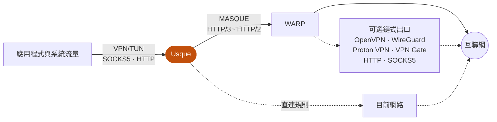

  <picture>
    <source media="(prefers-color-scheme: dark)" srcset="assets/branding/usque-readme-banner-dark.png">
    
  </picture>

  <a href="README.md">English</a>
  ·
  <a href="README.zh-CN.md">简体中文</a>
  ·
  繁體中文
  ·
  <a href="README.ja.md">日本語</a>
  ·
  <a href="README.ko.md">한국어</a>
  ·
  <a href="README.ru.md">Русский</a>
  ·
  <a href="README.fa.md">فارسی</a>

  相容 Cloudflare® WARP® 服務的非官方用戶端，支援 Windows、Linux 和 Android / Android TV， 
  採用原生 Flutter 介面與 Rust MASQUE 引擎。

  

  
  
  

  獨立專案，與 Cloudflare, Inc. 無隸屬、贊助或背書關係。

<table>
  <tr>
    <td align="center" valign="top">
      
<strong>Windows</strong>

      <picture>
        <source media="(prefers-color-scheme: dark)" srcset="assets/screenshots/usque-windows-home-dark.png">
        
      </picture>
    </td>
    <td align="center" valign="top">
      
<strong>Android</strong>

      <picture>
        <source media="(prefers-color-scheme: dark)" srcset="assets/screenshots/usque-android-connect-dark.gif">
        
      </picture>
    </td>
  </tr>
</table>

由目前原始碼呈現的英文介面預覽，使用範例資料。

## 概覽

- **效能** — Rust 編寫的 MASQUE 引擎，基於 HTTP/3 並自動回退到 HTTP/2；Android 與 Linux 批量收發 UDP，Windows 與 Android 申請更大的 UDP 接收緩衝，擁塞控制可選 BBRv2 和實驗性 BBRv3。
- **VPN 與本機代理** — 系統 VPN（虛擬網卡）、SOCKS5 和 HTTP 代理共用一條 WARP 連線，可以同時使用。
- **鏈式代理** — 在 WARP 之後經 OpenVPN、WireGuard、Proton VPN、VPN Gate、HTTP 或 SOCKS5 出口存取網路。
- **分流與廣告攔截** — 針對網域名稱和 CIDR 的 DIRECT／REJECT／PROXY 規則、Ads 廣告攔截和依國家直連。
- **加密 DNS** — WARP 出口和直連規則的網域名稱查詢都可以使用 DoH 或 DoT。
- **網路診斷** — 延遲、封包遺失和最近 60 秒趨勢；深度檢查需要你確認後才會執行。
- **情境** — 在 **設定檔** 頁儲存常用網路設定並隨時切換。
- **隱私** — 強制驗證伺服器公鑰，認證資料存放在系統認證資料庫，診斷在本機產生並移除敏感資訊，不做使用統計。
- **平台整合** — Windows 系統匣、Android 快速設定圖塊和電視遙控器導覽；21 種語言，淺色、深色主題。

## 介面一覽

<table>
  <tr>
    <td align="center" valign="top" width="25%">
      <picture>
        <source media="(prefers-color-scheme: dark)" srcset="assets/screenshots/usque-gallery-scenes-dark.png">
        
      </picture>
       <strong>情境</strong>
       切換已儲存的網路設定
    </td>
    <td align="center" valign="top" width="25%">
      <picture>
        <source media="(prefers-color-scheme: dark)" srcset="assets/screenshots/usque-gallery-chain-dark.png">
        
      </picture>
       <strong>鏈式代理</strong>
       OpenVPN、WireGuard 與代理出口
    </td>
    <td align="center" valign="top" width="25%">
      <picture>
        <source media="(prefers-color-scheme: dark)" srcset="assets/screenshots/usque-gallery-routing-dark.png">
        
      </picture>
       <strong>分流設定</strong>
       按規則直連、攔截或代理
    </td>
    <td align="center" valign="top" width="25%">
      <picture>
        <source media="(prefers-color-scheme: dark)" srcset="assets/screenshots/usque-gallery-quality-dark.png">
        
      </picture>
       <strong>網路品質</strong>
       延遲、封包遺失與吞吐量
    </td>
  </tr>
</table>

## 運作原理

應用程式透過你開啟的 VPN 或代理接入 Usque。Usque 經 MASQUE 將流量送到 WARP，再直接存取網路，或經可選的鏈式出口離開。明確指定的直連規則會讓匹配的流量改走目前網路。

## 下載

**v0.3.4** 新增本機連線情境，並改進設定、分流及桌面和 Android 使用體驗。安裝的版本請以對應的發行說明和版本標籤下的文件為準。

| 平台 | 最低系統 | 安裝套件 |
| --- | --- | --- |
| Windows | Windows 10 2004，Build 19041 | x64-v2 或 ARM64 安裝程式 EXE |
| Linux（自 v0.3.3 起） | Ubuntu 22.04+、Debian 12+、受支援的 Fedora；systemd | amd64 或 arm64 的 AppImage、deb 或 rpm |
| Android / Android TV | Android 8.0，API 26 | arm64-v8a、x86_64 或 armeabi-v7a APK，或通用 APK |

Windows x64 需要支援 **x86-64-v2** 的 CPU；ARM64 Windows 使用原生 ARM64 安裝套件。不清楚 Android 裝置架構時，可使用體積更大、包含全部三種 ABI 的通用 APK。每個版本另有兩個僅供應用程式內更新使用的 Windows MSI 檔案；手動安裝 Windows 版請使用 EXE。

> [!IMPORTANT]
> **請僅從 [GitHub Releases](https://github.com/GeorgeXie2333/usque-app/releases) 下載正式安裝套件。** Pull Request 建置、本機建置及未加標籤的二進位檔案均非正式發佈。
>
> **安裝前先驗證。** 將套件 SHA-256 與 `SHA256SUMS` 及 GitHub 顯示的檔案校驗值比對，再驗證發行說明中的簽署者指紋；Linux 還需驗證 Ed25519 簽章清單。任何一項不一致都應停止安裝。
>
> **不要繞過安全警告。** 1.0 之前的 Windows/Android 安裝套件使用專案自行管理的固定自我簽署憑證：Windows 可能顯示「未知發佈者」警告，Android 安裝套件不經 Google Play 發佈。不要透過關閉防毒軟體、防火牆或匯入非官方安裝套件提供的憑證來繞過警告。

- **升級會單向遷移設定。** v0.3.2 和 v0.3.3 使用設定 schema 26；從 v0.3.1 升級會將 schema 24 遷移至 26，v0.3.1 及更早用戶端無法讀取。v0.3.4 會將 schema 26 遷移至 27，v0.3.3 及更早用戶端無法讀取。重新安裝舊版不會逆轉遷移，請先查看[設定相容性](docs/INSTALLATION.md#configuration-compatibility-when-upgrading)並安排所需備份。
- **Linux：** AppImage 首次使用 VPN 時需要管理員授權安裝背景服務；認證資料依賴已解鎖的 Secret Service 鑰匙串。[Linux 桌面指南](docs/LINUX_DESKTOP.md) 說明 GNOME/KDE、X11/Wayland、復原流程與已測試範圍。
- **更新**下載需要使用者確認，安裝透過平台安裝程式完成，不會未經確認自動安裝。
- 升級、解除安裝、復原及 Android 開發者驗證說明請參閱[安裝指南](docs/INSTALLATION.md)，官方簽署身分請參閱[程式碼簽署策略](docs/CODE_SIGNING.md)。

## 快速上手

1. 按[安裝指南](docs/INSTALLATION.md#verify-before-installing)驗證正式安裝套件，安裝後開啟 Usque。
2. 完成首次啟動的權限與條款步驟，然後註冊個人版 WARP® 帳戶，也可以填寫 WARP 授權金鑰。若設定中斷，先檢查已儲存結果再重新註冊。目前不支援匯入新的 WARP Secret。
3. 開啟 **代理**，在 **本機流量** 中開啟 **虛擬網卡**（Windows/Linux）或 **VPN**（Android），並在各自區段頂部開啟 **SOCKS5 代理** 或 **HTTP 代理**，然後在 **首頁** 連線。

Android 引導只申請可選通知權限，連線需要 VPN 輸出時才申請系統授權，授權可能中斷其他 VPN；僅本機代理連線不申請。這些開關立即生效，監聽位址和連接埠的修改需要按 **套用變更**。

| 聯網方式 | 用途 |
| --- | --- |
| VPN/TUN | 讓系統流量經過隧道，並遵循直連規則和 Android 個別應用程式設定。 |
| SOCKS5 | 為支援它的應用程式提供本機 TCP/UDP 代理，預設透過遠端 DNS 查詢網域名稱。 |
| HTTP 代理 | 為支援它的應用程式提供本機 HTTP 代理，也支援透過 CONNECT 存取 HTTPS。 |
| 系統代理（Windows/Linux） | 將 Windows 或 GNOME/KDE 的代理設定指向 Usque；需同時啟用 HTTP 代理。 |

VPN、SOCKS5 和 HTTP 預設開啟，系統代理預設關閉。它們共用一條 WARP 連線，可以同時使用。全部關閉後，WARP 連線仍會保持，但不再承載任何應用程式流量。每個帳戶單獨儲存認證資料，一次只能使用一個帳戶連線；網路設定由所有帳戶共享。

## 功能詳解

### 效能與傳輸

- **吞吐量：** 引擎在 Android 和 Linux 上批量收發 UDP（`sendmmsg`/`recvmmsg`），在 Windows 和 Android 上申請更大的 [UDP 接收緩衝](docs/UDP_RECEIVE_BUFFER.md)，並提供[可選的 HTTP/3 擁塞控制](docs/congestion-control.md)：預設 Cubic，另有 BBRv2、實驗性 BBRv3 和 Reno。
- **自動傳輸：** 先嘗試 HTTP/3，失敗時回退到 HTTP/2，並嘗試透過 IPv4 和 IPv6 尋找可達端點；H3 在支援的網路切換情境下可以遷移連線，詳見[路徑行為](docs/h3-path-infrastructure.md)。
- **[實驗性 L4 模式](docs/L4_PROXY.md)**（需手動啟用）透過 HTTP/3 代理 TCP 流量。未啟用 OpenVPN TCP 鏈式出口時，它不轉發一般 UDP 流量，需要 UDP 的應用程式可能無法正常使用。自動模式不會選擇 L4。

### 情境與帳戶

- **[本機網路情境](docs/SCENARIOS.md)**在 **設定檔** 頁儲存帳戶綁定、鏈式代理、端點、端點 IP 偏好與傳輸協定。可預覽後使用，並還原切換前的設定；虛擬網卡與代理開關、分流與 DNS 沿用全域設定。儲存情境不改變目前連線，頁面明確區分已儲存和已套用。帳戶在 **帳戶管理 → 帳戶** 中管理。
- **匯出 WARP 登入資訊：** 確認後可將個人版 WARP 登入資訊（WARP Secret）匯出到指定檔案。Usque 目前無法重新匯入該檔案，因此它不能用於重新安裝後的帳戶復原。

### 鏈式代理

- 在 **代理 → 鏈式代理** 中選擇 **OpenVPN**、**WireGuard**、[**WARP via WireGuard**](docs/WARP_WIREGUARD.md)、[**Proton VPN**](docs/PROTON_VPN.md)、**VPN Gate**、**HTTP** 或 **SOCKS5** 作為 WARP 之後的出口。VPN 設定支援檔案或文字匯入，HTTP/SOCKS5 透過表單新增，儲存後選用並套用。此功能預設關閉，詳見[鏈式代理指南](docs/CHAIN_PROXY.md)。
- VPN、SOCKS5 和 HTTP 共用最終出口，明確指定的直連規則仍然生效。
- 原生 Proton 設定仍在驗證中；實際網路登入、人機拼圖驗證和完整通道尚未實測。

### 分流、攔截與 DNS

- 全通道 VPN、隧道內 DNS、Kill Switch（斷網保護）、區域網路存取和 [DIRECT／REJECT／PROXY 分流及 Ads 廣告攔截](docs/ROUTING.md)。自訂網域名稱、IP 和 CIDR 支援更具體的例外規則，儲存時檢查衝突。
- 連線穩定時，自訂分流規則直接用於新流量，無需重新連線；已有 TCP／CONNECT 連線和活躍 UDP 目標保持原路徑。請查看套用結果，確認是否仍待套用或套用失敗。
- 開啟廣告攔截並套用後自動準備規則，應用程式執行期間每 7 天檢查更新，新請求無需重新連線即可生效；**規則詳情** 提供狀態、來源和手動更新。
- 可選的依國家直連：單獨下載所選國家的 GeoIP 資料和全域 GeoSite 網域名稱規則。能看到網域名稱時按網域名稱判斷，否則按 IP 判斷；無法辨識的目標繼續走隧道。
- 自訂 [WARP 出口 DNS](docs/WARP_DNS.md)：開啟 **設定 → 進階網路設定 → WARP DNS**，選擇一般 DNS、DoH 或 DoT，再按 **套用變更**。修改 DNS 會重新連線目前工作階段；最終鏈式出口仍使用自己的 DNS 策略。

### 診斷

- 本機[網路診斷](docs/network-doctor.md)和 **網路品質** 頁面，展示延遲、封包遺失率及其測量狀態、佇列和最近 60 秒的趨勢。**標準** 檢查只讀取本機狀態；**深度** 檢查會在你確認後傳送測試請求。

### 桌面與 Android

- **Windows：** 系統匣提供狀態標記、虛擬網卡與系統代理開關；視窗在背景時，持續五秒的重新連線、連線錯誤和已通知中斷後的恢復會彈出通知；另支援單一執行個體、開機啟動、關閉視窗後最小化到系統匣和記住視窗位置。**Ctrl+1～4** 切換頁面，**Ctrl+S** 套用變更，**F5** 重新整理 VPN Gate 或診斷。詳見[系統匣與快捷鍵操作](docs/INSTALLATION.md#tray-and-keyboard-controls)。
- **Android：** 快速設定圖塊、啟動器捷徑、開機恢復和電視遙控器導覽。
- **Android 個別應用程式代理** 對所有帳戶生效。關閉時，所有應用程式都使用 VPN；開啟後，只有勾選的應用程式使用 VPN，新安裝的應用程式需要手動勾選。如果同時啟用了系統的「封鎖未使用 VPN 的連線」，未勾選的應用程式將無法連線至網路。
- **全平台：** 提供 21 種語言，以及淺色、深色主題。應用程式內可選擇「繁體中文（香港）」或「繁體中文（台灣）」，分別使用當地用語；本 README 使用通用繁體中文。

## 隱私與安全

- **驗證伺服器。** 強制驗證 WARP 伺服器公鑰，不提供跳過驗證的選項。
- **保護認證資料。** 認證資料儲存在 Windows 認證管理員、Linux Secret Service 鑰匙串或 Android Keystore 中。Windows 和 Linux 由獨立 Agent 執行需要管理員權限的網路操作；Android 使用獨立的 VPN 處理程序。
- **本機代理。** 代理預設僅供本機使用。SOCKS5 和 HTTP 支援可選的使用者名稱、密碼認證；未設定認證資料時不要求認證。僅使用代理不能提供系統級 VPN 斷網保護。
- **不做統計。** 診斷在本機產生並移除敏感資訊，不進行使用者行為統計，也不自動上傳。網路品質歷史只保留在記憶體中。記錄預設為 INFO，最多保留 7 天或 20 MiB。不要將認證資料或原始診斷包放入公開 Issue；漏洞請透過 [SECURITY.md](SECURITY.md) 私下回報。

### 限制

- Android 應用程式內的斷網保護無法在 VPN 處理程序結束後繼續工作。VPN Gate 無法繼續連線時，也會中斷 VPN。如果需要在 VPN 結束後繼續阻止應用程式連線至網路，請同時開啟系統的「一律啟用 VPN」和「封鎖未使用 VPN 的連線」。操作方法見 [Android 安裝說明](docs/INSTALLATION.md#android-and-android-tv)。
- Usque 不會透過多條路徑疊加頻寬。部分指標無法測量，例如 HTTP/2 的封包遺失率和 PMTU。本機診斷無法偵測流量洩漏。

### DNS 隱私

- **直連規則預設使用目前網路的 DNS。** 依國家及自訂網域名稱直連預設使用 **目前網路的 DNS**：符合規則的網域名稱查詢會傳送給目前網路使用的 DNS 伺服器，位於 VPN 隧道之外。也可以選擇 **DoH** 並填寫完整 HTTPS 位址，或選擇 **DoT** 並填寫伺服器網域名稱和連接埠。新草稿預填 Cloudflare，已儲存的自訂設定保持不變。查詢會傳送給該伺服器；連線失敗時不會改用明文 DNS。詳見[設定步驟與範例](docs/encrypted-direct-dns.md)。
- **其他遠端 VPN 查詢**使用 WARP 隧道或所選最終鏈式出口。HTTP/SOCKS5 鏈 DNS 預設經該代理使用驗證 TLS 的 Cloudflare® DoH；自訂或非預設繼承 DNS 保留 TCP。在這兩種出口下，應用程式指定的 UDP/53 查詢轉換為發往該解析器的 TCP，不回退到實體 DNS。詳見[鏈 DNS 選擇](docs/CHAIN_PROXY.md#http-and-socks5-exits--http-与-socks5-出口)。
- **應用程式自行使用加密 DNS 時**，Usque 看不到網域名稱，此時按 IP 判斷是否直連。
- 中斷連線後下載規則，也仍受 Android 系統封鎖設定和尚未解除的 Windows 斷網保護約束。

### 實驗性功能與支援範圍

[Zero Trust 註冊](docs/ZERO_TRUST_EXPERIMENTAL.md)仍屬實驗性功能：可以用組織身分建立 MASQUE 公開網際網路通道，
但不提供完整的 Cloudflare One™ Client 功能。macOS 提供獨立的 arm64 和 x86_64
[開發版 DMG 建置](docs/MACOS_DEVELOPMENT_PACKAGING.md)，桌面與代理功能仍在驗證中。
系統 VPN 和正式版本自動安裝保持關閉，等待簽署後的實機驗收。
已實作與待完成的功能請參閱 [macOS 功能對照表](docs/MACOS_WINDOWS_PARITY.md)。
目前也不提供 iOS 版本、應用程式商店分發或公開命令列工具。

### macOS 開發版測試與已知問題

macOS 13+ **歷史 v0.3.3 非官方 dev 預發佈套件**：
[Apple Silicon（arm64）](https://github.com/JustinL330/usque-app/releases/download/macos-dev-v0.3.3-compact-12636756/usque-v0.3.3-macos-arm64.dmg)／
[Intel（x86_64）](https://github.com/JustinL330/usque-app/releases/download/macos-dev-v0.3.3-compact-12636756/usque-v0.3.3-macos-x86_64.dmg)。
安裝套件僅作臨時簽署，尚未公證，不是正式版本，系統 VPN 保持關閉。測試前請閱讀
[發行說明、校驗值和清單](https://github.com/JustinL330/usque-app/releases/tag/macos-dev-v0.3.3-compact-12636756)。
上述舊版精簡套件下載量減少約 47%／43%，包含繁體中文、原有介面語言、CEF 驗證元件和 sandbox。
體積原因與驗證結果見[macOS 安裝套件體積說明](docs/MACOS_PACKAGE_SIZE.md)。

目前 `dev` 原始碼已同步 v0.3.4，並保留 macOS 連線情境、結束前確認清理，以及 VPN Gate
自動準備受保護的 WARP 連線。上方安裝套件早於這些修改，不含 v0.3.4 介面和功能，尚未發佈替代安裝套件。

[macOS 測試清單](docs/MACOS_QA_CHECKLIST.md)分別記錄隔離測試與實機驗收。以下項目仍未完成：

- **系統 VPN／虛擬網卡：** 開發套件保持關閉，簽署後的路由、DNS 和斷網保護尚未通過實機驗收。僅代理模式不提供系統級斷網保護。
- **系統代理與鏈式出口：** 隔離的設定、恢復和傳輸測試不能證明實網連線成功；真實授權及各類外部出口仍待驗收。目前 macOS 原始碼重用 WARP 或自動建立臨時 WARP 連線來重新整理 VPN Gate，保留已儲存的鏈式設定；不會回退到實體網路直接下載清單。
- **Zero Trust：** 回呼驗證及取消後重試使用模擬資料；真實組織登入與回呼仍未驗證。
- **Proton 帳戶：** macOS 已移除遊客登入和內建驗證瀏覽器；保留一般帳戶登入、驗證器代碼及已儲存帳戶管理。若登入要求瀏覽器人機驗證，此 macOS 版本無法完成；真實登入與流量仍待實機驗證。
- **桌面與硬體：** 版面檢查使用無視窗的 Windows／macOS 元件渲染；原生視窗互動、Intel 執行及 macOS 13 實機仍待測試。Mac 預設內容區域已與 Windows 統一為 1040×760，並配合可用螢幕、保留已儲存的視窗位置和尺寸。

本輪背景驗證沒有開啟應用程式、瀏覽器或權限視窗，也不修改本機網路設定。開發套件尚未公證。

## 預設網路設定

| 設定 | 預設值 |
| --- | --- |
| 個人版端點模式 | 自動選擇；升級保留已有自訂設定 |
| 儲存的自訂端點 IPv4 | `162.159.198.2` |
| 儲存的自訂端點 IPv6 | `2606:4700:103::2` |
| 連接埠 / SNI | `443` / `speed.cloudflare.com` |
| 傳輸 | 自動：先 HTTP/3，再 HTTP/2 |
| HTTP/3 擁塞控制 | `cubic`；可選擇 BBRv2、實驗性 BBRv3 和 `reno` |
| QUIC UDP 接收緩衝 | Windows/Android 的 H3、L4 均以 [2 MiB 為目標](docs/UDP_RECEIVE_BUFFER.md)申請；實際容量由系統決定 |
| TUN MTU | `1280` |
| 備用 DNS | `1.1.1.1`、`2606:4700:4700::1111` |
| SOCKS5 | `127.0.0.1:1080`、`[::1]:1080` |
| HTTP 代理 | `127.0.0.1:8080`、`[::1]:8080` |

<strong>代理、端點與擁塞控制的修改何時生效</strong>

 

修改代理位址和連接埠後，需要按 **套用變更** 才會提交。代理預設透過目前出口解析：在進階設定中設定 [WARP DNS](docs/WARP_DNS.md)，或在鏈式設定中設定最終出口 DNS。代理頁不再提供 DNS 設定；舊版本儲存的代理 DNS 選擇繼續生效。

進階設定中的重設只會填入預設值，仍需提交才會生效。

進階網路設定的「自動選擇」會同時嘗試連線至帳戶可用的端點；「自訂」保留手動位址。連接埠和 SNI 在兩種模式均可修改。詳見[自動選擇端點](docs/NETWORK_SETTINGS.md#automatic-endpoints--自动选择端点)。

Zero Trust 端點初始使用註冊位址。在進階網路設定中選擇 **編輯 Zero Trust 端點**，閱讀紅色全螢幕警告，勾選確認風險及使用授權後編輯 IPv4/IPv6，再按 **套用變更**。還原預設值會暫存註冊位址；重新登入會恢復註冊位址並移除自訂位址。目前帳戶設定自訂 Zero Trust 位址，或目前 ZT 連線仍在使用自訂位址時，首頁會常駐不可關閉的風險提示。

擁塞控制的更改會儲存，並在下一次手動連線或重試時生效，不影響目前工作階段及其自動重新連線。HTTP/2 使用系統 TCP。詳見 [HTTP/3 擁塞控制](docs/congestion-control.md)。

## 文件與開發

從 [Wiki 使用指南](https://github.com/GeorgeXie2333/usque-app/wiki/Home-zh-CN)開始，查找設定步驟與實用教學；完整參考請見[文件索引](docs/README.md)，技術文件目前以英文為主。

| 需要瞭解 | 閱讀文件 |
| --- | --- |
| 安裝、更新、解除安裝與復原 | [安裝指南](docs/INSTALLATION.md) |
| 原生 Proton 遊客／帳戶準備 | [Proton VPN 使用指南與目前限制](docs/PROTON_VPN.md) |
| 透過 WARP 隧道連線 Proton VPN | [WireGuard over MASQUE 教學](https://github.com/GeorgeXie2333/usque-app/wiki/Proton-VPN-over-MASQUE-zh-CN) |
| 本機網路品質檢查 | [Network Doctor](docs/network-doctor.md) |
| 安全地建置和測試改動 | [貢獻指南](CONTRIBUTING.md) |
| 實作與驗證狀態 | [實作進度](docs/IMPLEMENTATION.md) |
| 維護正式發佈 | [發佈流程](docs/RELEASE.md) |

請遵循貢獻指南中的固定工具鏈和按改動範圍劃分的檢查。僅編譯建置和確定性測試可在開發機進行；安裝開發套件或測試 VPN 生命週期必須使用規定的隔離環境。

## 上游與授權

協定與行為參考 [Diniboy1123/usque](https://github.com/Diniboy1123/usque)。本倉庫在 `oracle/go` 中儲存一份快照，供互通測試使用。Flutter 介面與 Rust 引擎為本專案自行實作。上游版權聲明見授權條款。

第一方原始碼採用 [MIT License](LICENSE.md)，第三方元件保留各自授權條款。可選的[鏈式代理](docs/CHAIN_PROXY.md)內嵌 OpenVPN 3 Core（MPL-2.0）和 Mbed TLS（Apache-2.0）。對應原始碼、修補程式和授權文字儲存在 `third_party`；應用程式中的 VPN Gate 頁面可查看原生相依元件的授權聲明。WireGuard 使用 BoringTun 0.7.1（BSD-3-Clause），本機 SVG 圖示使用 flutter_svg 2.3.2（MIT）；相應聲明已納入應用程式授權條款清單。

獨立 Proton SRP 實作參考 Proton go-srp（MIT）；其[版權聲明與完整授權](apps/usque_gui/assets/licenses/proton-srp.txt)保留在原始碼、測試向量及應用程式授權條款清單中。

---

Usque 為獨立專案，與 Cloudflare, Inc. 無隸屬、贊助或背書關係。使用個人版 WARP 服務仍須遵守 Cloudflare 的適用條款與隱私政策。Cloudflare、WARP 和 Cloudflare One 是 Cloudflare, Inc. 在美國及其他司法管轄區的商標和/或註冊商標。
