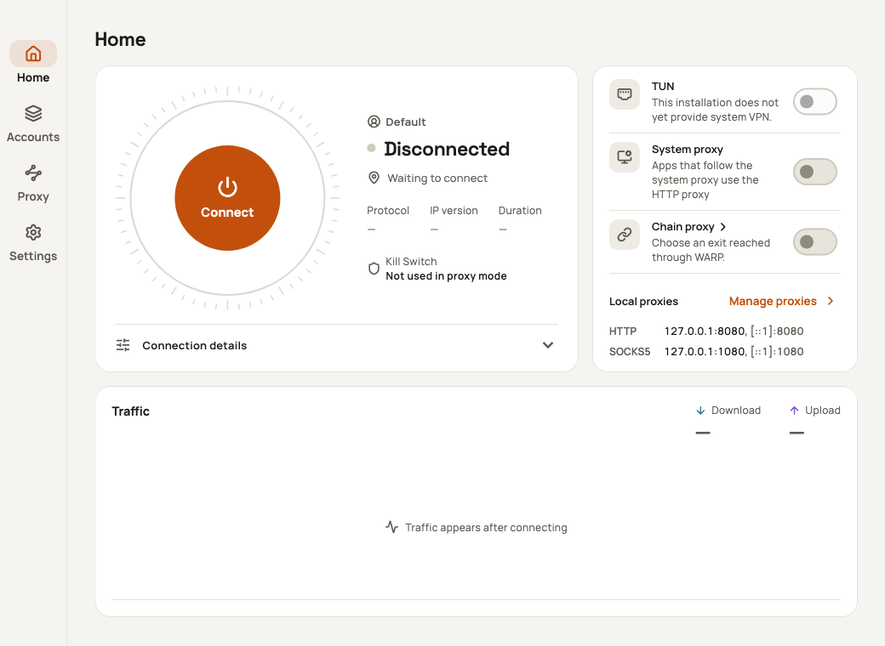
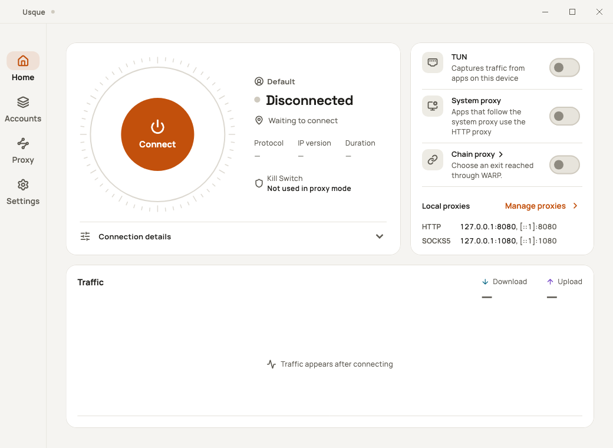
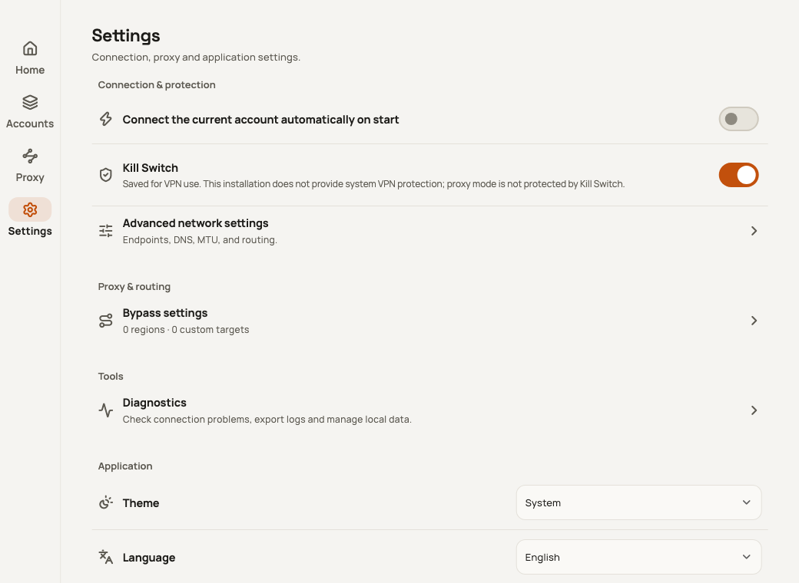
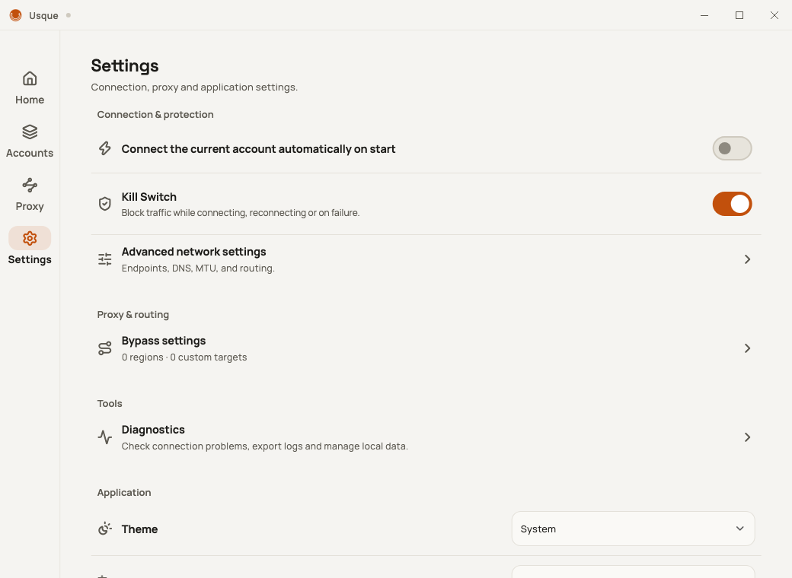

# macOS 測試清單與保留問題

本清單對應使用者要求：虛擬網卡、系統代理、所有鏈式模式、Windows 介面比較、
預設視窗大小、Zero Trust 回調，以及 Proton 遊客註冊／人機驗證。

「隔離通過」代表使用模擬後端、記憶體憑據、暫存設定檔或本機測試通道；
不代表已使用真實帳號、系統權限或外部 VPN 連線。背景測試不開啟原生視窗、
瀏覽器、CEF 或權限提示，不讀寫使用者 Keychain，也不修改本機代理、DNS 或路由。

## 功能驗收

| 項目 | 本輪檢查與修正 | 仍需完成 |
| --- | --- | --- |
| 虛擬網卡／系統 VPN | 單會話、替換、取消、程序失聯及保護順序的隔離契約；修正 Mac 介面誤將未提供的 VPN 顯示為可啟用 | 開發包保持停用。簽署後必須實測路由、IPv4／IPv6、分流、DNS 與異常斷網保護 |
| 系統代理 | 隔離的設定與恢復流程；首頁、代理頁、選單列及快捷鍵依 Engine 能力決定能否啟用；已選輸出仍可關閉 | 真實授權取消／重試、套用與比較後恢復，以及外部網站連線 |
| HTTP／SOCKS5 鏈式出口 | 憑據交接與設定準備檢查，沿用共享資料面 | 各種認證、TCP／UDP、DNS 與實際外部代理連線 |
| OpenVPN 鏈式出口 | 自訂 UDP／TCP 設定準備與敏感交接檢查 | 真實伺服器連線、重新連線及同會話整合 |
| WireGuard／WARP WireGuard | 設定交接檢查；修正 WARP 的數字 IP 端點覆寫在擴展重新解析時遺失，其他來源仍拒絕端點不符 | 真實握手、外部流量及睡眠／換網 |
| VPN Gate | 修正未連線時可能建立未保護請求／臨時會話的路徑；下載先要求已連線 WARP，最終出口重連時可重用底層 WARP；快取讀取、準備、收藏及移除仍可離線操作 | 真實清單更新、節點下載與連線；未保護的引導仍被拒絕 |
| Proton 鏈式出口與遊客註冊 | 模擬帳號、挑戰交接與回傳檢查；收緊原生數值、主框架、瀏覽器識別及驗證文件錯誤檢查 | 官方人機驗證與註冊成功尚未驗證；見下方保留問題 |
| Zero Trust | 嚴格組織／路徑／token 檢查、單次取用、取消與逾時後的舊回調隔離；模擬取消後重試及自動回填 | 真實組織／身分供應商登入、瀏覽器取消及系統 URL 回調派送 |
| 四個主頁面與 Windows 比較 | 共用 Flutter 頁面；Mac 使用原生標題列、選單列及 Cmd 快捷鍵；無視窗版面與能力差異檢查 | 原生標題列、Dock、選單互動、輔助使用及實際字型顯示 |
| 預設視窗 | Mac 內容區域由 800×600 改為與 Windows 一致的 1040×760；首次置中，計入原生標題列，配合可用螢幕；保留已存位置／尺寸 | 真實多螢幕、縮放及視窗拖曳。最小內容尺寸偏好為 640×480，小螢幕會縮減 |

## 仍未解決或未驗證的問題

1. **系統 VPN 不可作為已可用功能交付。** 目前沒有可啟用的簽署擴展，
   隔離測試不能證明實體出口沒有洩漏；不開啟此能力，也不自動切換至 PF。
2. **Proton 完整代理失敗測試曾失敗。** 原有錯誤為
   `Authentication proxy failure did not end cleanly`。本輪未啟動 CEF，
   新增的適配器檢查不能證明此結束問題已修復。官方驗證、實際 guest 註冊和
   已簽署啟動器仍需分別驗收，不能宣稱已能成功註冊。
3. **真實系統代理、外部鏈式出口及 Zero Trust 組織登入未在本輪執行。**
   模擬成功只證明對應的設定／回調流程，不能寫成實網通過。
4. **Intel 執行與 macOS 13 實機尚缺。** 兩架構原生編譯及檔案檢查不等同於兩種硬體實測。
5. **Kill Switch 是已儲存的設定，不是代理模式的即時保護指示。**
   Mac 無系統 VPN 能力時，設定頁會明確說明代理模式不受系統斷網保護。

## 可重現的介面比較

以下是使用 fake Engine 的無視窗 Flutter 元件渲染，**不是 Windows 或 macOS 真機截圖**。
兩份內容區域均為 1040×760、英文、100% 文字大小。Windows 圖片包含共用 Flutter
標題列；Mac 的原生標題列位於內容區域之外，這裡沒有渲染。

| macOS 模擬 | Windows 模擬 |
| --- | --- |
|  |  |
|  |  |

測試也覆蓋 800×600、640×480 與 200% 文字大小。畫面中的 VPN 開關差異反映目前
Mac 開發包沒有系統 VPN 能力；主要頁面與資料設定語義沿用 Windows 的共用實作。

相關原始碼與檢查：

- [Mac 視窗與回調契約](../apps/usque_gui/macos/RunnerTests/DesktopContractMain.swift)
- [無視窗介面與回調測試](../apps/usque_gui/test/macos_desktop_layout_test.dart)
- [Mac 網路／鏈式交接測試](../crates/usque-engine/src/macos_parity_tests.rs)
- [共享資料面與保護契約](../crates/usque-macos-runtime/tests/control.rs)
- [完整功能對照表](MACOS_WINDOWS_PARITY.md)
- [開發包及簽署限制](MACOS_DEVELOPMENT_PACKAGING.md)
